# Ray-Ban Meta Display glasses concept applications by L+R

Explore a curated showcase of demo web apps bridging emerging wearable tech with real-world utility, bringing imagination to life on [Meta Ray-Ban Display glasses](https://wearables.developer.meta.com/docs).

[DisplayGlasses.dev](https://displayglasses.dev) is a resource by L+R which includes a simulator for the Ray-Ban Meta Display glasses and a [getting started guide](https://displayglasses.dev/docs).

Built by the team at [L+R](https://levinriegner.com).

**Legend**

| | Status | | Feature | | Feature |
|:---:|---|:---:|---|:---:|---|
| ✅ | Working on the glasses as described | 🎙 | Voice control through Meta AI (WebMCP) | 🔊 | Synthesized sound (Web Audio, no audio files) |
| 🔌 | Working, but depends on a live third-party API or server | ✍️ | Text entry through neural handwriting | 🎞️ | Animation loop (requestAnimationFrame) |
| 🧪 | Concept: real interface, simulated data or service. Its README has a “Making it real” section | 🧭 | Head motion and orientation (gyroscope / IMU) | 🖌️ | Canvas 2D / WebGL drawing |
| | | 📍 | Location (GPS) | 🧩 | Inline SVG graphics |
| | | 🎤 | Microphone or speech recognition | 🌐 | Calls an external API or live data source |
| | | 📷 | Camera | 📡 | Real-time connection (WebSocket) |
| | | 🔗 | Deep links between apps | 🤖 | AI model in the loop |
| | | 💾 | Saves locally on the glasses | | |

**Input on every demo:** the Meta Neural Band and the temple touchpad. Swipe your thumb along your index finger (or the touchpad) for ▲ ▼ ◀ ▶, pinch index finger to thumb to select, pinch middle finger to thumb to go back. Demos marked ✍️ also take text through the glasses' neural handwriting. Web apps get exactly these inputs: wrist rotation, pinch-and-hold scrolling and custom gestures are reserved for the system, and there is no vibration or haptic feedback.

**Under the hood, every demo** is vanilla HTML, CSS and JavaScript with no framework and no build step, uses CSS animation for transitions and focus, self-hosts its fonts, works offline through a service worker, and has a QR code in its README to add it to your glasses. Previews are the raw 600×600 lens output.

## Hosted demos

### Primary demos
> UI polished and complete. See the status marker on each row for what is real versus conceptual.

| Demo | Description | Preview | Live | Simulator | Case study | Status |
|---|---|---|---|---|---|:---:|
| [**Brush Coach**](https://github.com/levin-riegner/lr-rbm-demos/tree/main/brusher) | Counts brush strokes from head motion and walks you through each zone of your mouth. | 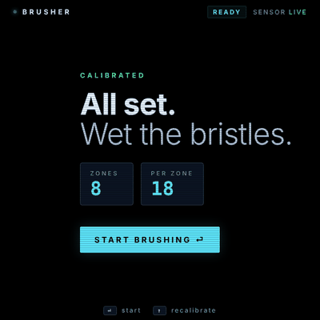 | [Launch app](https://rbm-demos.lnr.io/brusher/) | [Open in simulator](https://displayglasses.dev/?url=https%3A%2F%2Frbm-demos.lnr.io%2Fbrusher%2F&pos=center&size=60&bright=100&bg=hiking&bg-dark=10) | [Case study](https://www.levinriegner.com/work/brush-coach/) | <sub>✅ 🧭 🔊 🧩</sub> |
| [**Calculator**](https://github.com/levin-riegner/lr-rbm-demos/tree/main/calculator) | Four-function calculator with three skins, driven entirely by the D-pad. | 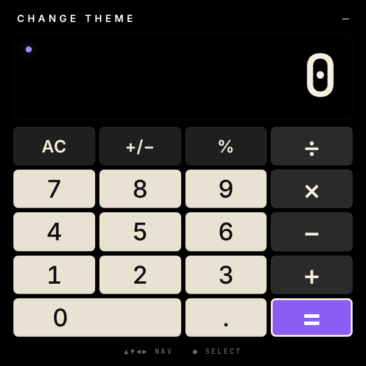 | [Launch app](https://rbm-demos.lnr.io/calculator/) | [Open in simulator](https://displayglasses.dev/?url=https%3A%2F%2Frbm-demos.lnr.io%2Fcalculator%2F&pos=center&size=60&bright=100&bg=hiking&bg-dark=10) | — | <sub>✅ 🎙 🔊 💾</sub> |
| [**Comfortable Thumb**](https://github.com/levin-riegner/lr-rbm-demos/tree/main/pentatonic-solo) | A one-thumb synth locked to a pentatonic scale, with a live oscilloscope. | 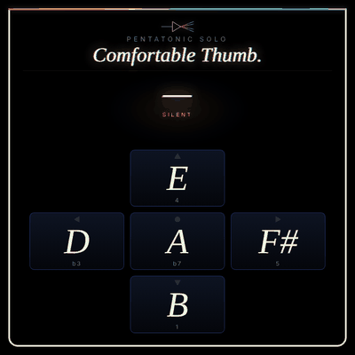 | [Launch app](https://rbm-demos.lnr.io/pentatonic-solo/) | [Open in simulator](https://displayglasses.dev/?url=https%3A%2F%2Frbm-demos.lnr.io%2Fpentatonic-solo%2F&pos=center&size=60&bright=100&bg=hiking&bg-dark=10) | — | <sub>✅ 🔊 🎞️ 🖌️ 🧩</sub> |
| [**Cooking HUD**](https://github.com/levin-riegner/lr-rbm-demos/tree/main/cooking-hud) | Recipe steps on the lens with shop, prep and cook phases and a rail of running timers. | 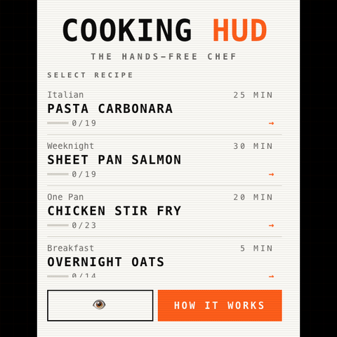 | [Launch app](https://rbm-demos.lnr.io/cooking-hud/) | [Open in simulator](https://displayglasses.dev/?url=https%3A%2F%2Frbm-demos.lnr.io%2Fcooking-hud%2F&pos=center&size=60&bright=100&bg=hiking&bg-dark=10) | [Case study](https://www.levinriegner.com/work/cooking-hud/) | <sub>✅ 🎙 🔊 🎞️ 💾</sub> |
| [**Dad Jokes**](https://github.com/levin-riegner/lr-rbm-demos/tree/main/dad-jokes) | Fresh dad jokes in auto-fitting type, with a rim shot and a groan button. | 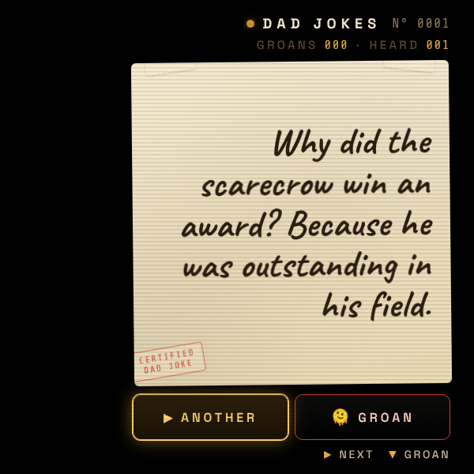 | [Launch app](https://rbm-demos.lnr.io/dad-jokes/) | [Open in simulator](https://displayglasses.dev/?url=https%3A%2F%2Frbm-demos.lnr.io%2Fdad-jokes%2F&pos=center&size=60&bright=100&bg=hiking&bg-dark=10) | — | <sub>🔌 🎙 🌐 🔊 💾</sub> |
| [**GLIMMER**](https://github.com/levin-riegner/lr-rbm-demos/tree/main/lr-glimmer) | A pocket companion that hatches, evolves through five stages and needs looking after. | 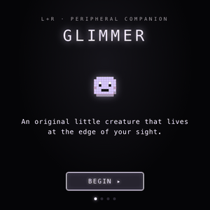 | [Launch app](https://rbm-demos.lnr.io/lr-glimmer/) | [Open in simulator](https://displayglasses.dev/?url=https%3A%2F%2Frbm-demos.lnr.io%2Flr-glimmer%2F&pos=center&size=60&bright=100&bg=hiking&bg-dark=10) | [Case study](https://www.levinriegner.com/work/glimmer/) | <sub>✅ ✍️ 🖌️ 💾</sub> |
| **LVSR** | Two-player Pong over WebSocket, with room codes and server-run physics. | — | [Launch app](https://lvsr.netlify.app) | [Open in simulator](https://displayglasses.dev/?url=https%3A%2F%2Flvsr.netlify.app&pos=center&size=60&bright=100&bg=hiking&bg-dark=10) | — | — |
| [**Metronome**](https://github.com/levin-riegner/lr-rbm-demos/tree/main/metronome) | Metronome with tempo and time signature controls; nod your head to tap the beat. | 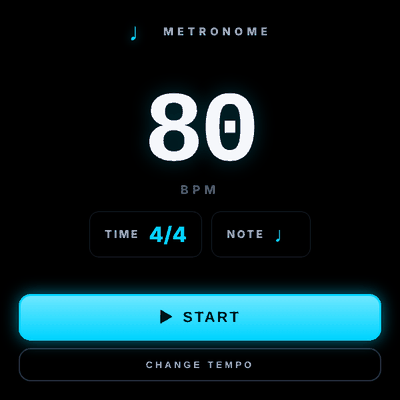 | [Launch app](https://rbm-demos.lnr.io/metronome/) | [Open in simulator](https://displayglasses.dev/?url=https%3A%2F%2Frbm-demos.lnr.io%2Fmetronome%2F&pos=center&size=60&bright=100&bg=hiking&bg-dark=10) | [Case study](https://www.levinriegner.com/work/metronome/) | <sub>✅ 🎙 🧭 🔊 🎞️ 🧩 💾</sub> |
| [**Pinout HUD**](https://github.com/levin-riegner/lr-rbm-demos/tree/main/pinout-hud) | ESP32 pinout reference with board templates and a zoomable focus mode. | 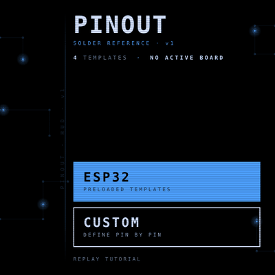 | [Launch app](https://rbm-demos.lnr.io/pinout-hud/) | [Open in simulator](https://displayglasses.dev/?url=https%3A%2F%2Frbm-demos.lnr.io%2Fpinout-hud%2F&pos=center&size=60&bright=100&bg=hiking&bg-dark=10) | [Case study](https://www.levinriegner.com/work/pinout-hud/) | <sub>✅ 🎞️ 🖌️ 💾</sub> |
| [**Quicklist**](https://github.com/levin-riegner/lr-rbm-demos/tree/main/quicklist) | A running list you add to by voice or handwriting and check off with the D-pad. | 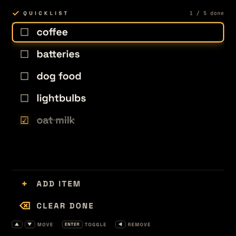 | [Launch app](https://rbm-demos.lnr.io/quicklist/) | [Open in simulator](https://displayglasses.dev/?url=https%3A%2F%2Frbm-demos.lnr.io%2Fquicklist%2F&pos=center&size=60&bright=100&bg=hiking&bg-dark=10) | — | <sub>✅ 🎙 ✍️ 💾</sub> |
| [**Snake**](https://github.com/levin-riegner/lr-rbm-demos/tree/main/snake) | Classic Snake on the lens, with high scores that persist. | 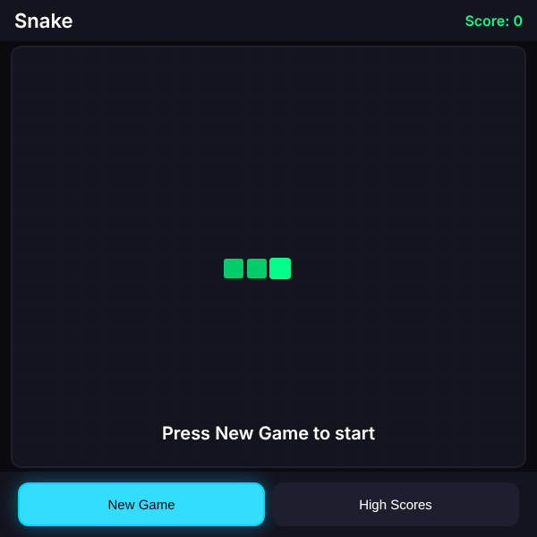 | [Launch app](https://rbm-demos.lnr.io/snake/) | [Open in simulator](https://displayglasses.dev/?url=https%3A%2F%2Frbm-demos.lnr.io%2Fsnake%2F&pos=center&size=60&bright=100&bg=hiking&bg-dark=10) | — | <sub>✅ 🖌️ 💾</sub> |
| [**Tally Counter**](https://github.com/levin-riegner/lr-rbm-demos/tree/main/tally-counter) | One-pinch tally counter with a running total and the time counting started. | 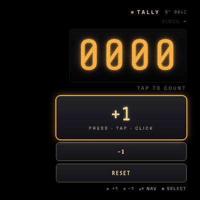 | [Launch app](https://rbm-demos.lnr.io/tally-counter/) | [Open in simulator](https://displayglasses.dev/?url=https%3A%2F%2Frbm-demos.lnr.io%2Ftally-counter%2F&pos=center&size=60&bright=100&bg=hiking&bg-dark=10) | [Case study](https://www.levinriegner.com/work/tally-counter/) | <sub>✅ 🎙 🔊 💾</sub> |
| [**Tiltscroll Tales**](https://github.com/levin-riegner/lr-rbm-demos/tree/main/tiltscroll-tales) | An illustrated fairy tale you scroll by tilting your head. |  | [Launch app](https://rbm-demos.lnr.io/tiltscroll-tales/) | [Open in simulator](https://displayglasses.dev/?url=https%3A%2F%2Frbm-demos.lnr.io%2Ftiltscroll-tales%2F&pos=center&size=60&bright=100&bg=hiking&bg-dark=10) | — | <sub>✅ 🧭 🎞️ 🧩 💾</sub> |
| [**Tip Calculator**](https://github.com/levin-riegner/lr-rbm-demos/tree/main/tip-calculator) | Enter the bill, pick a tip and split the check, all on the D-pad. | 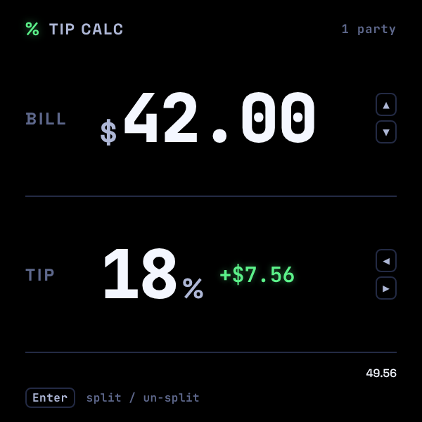 | [Launch app](https://rbm-demos.lnr.io/tip-calculator/) | [Open in simulator](https://displayglasses.dev/?url=https%3A%2F%2Frbm-demos.lnr.io%2Ftip-calculator%2F&pos=center&size=60&bright=100&bg=hiking&bg-dark=10) | — | <sub>✅ 🎙</sub> |
| [**Zork Terminal**](https://github.com/levin-riegner/lr-rbm-demos/tree/main/zork-terminal) | The classic text adventure on a CRT-style lens, played with a verb picker or by voice. | 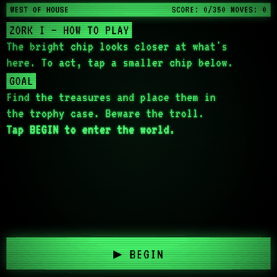 | [Launch app](https://rbm-demos.lnr.io/zork-terminal/) | [Open in simulator](https://displayglasses.dev/?url=https%3A%2F%2Frbm-demos.lnr.io%2Fzork-terminal%2F&pos=center&size=60&bright=100&bg=hiking&bg-dark=10) | [Case study](https://www.levinriegner.com/work/zork-i-tribute/) | <sub>✅ 🎙 🔊</sub> |

### Secondary demos — Works in progress!

| Demo | Description | Preview | Live | Simulator | Case study | Status |
|---|---|---|---|---|---|:---:|
| [**See DJ**](https://github.com/levin-riegner/lr-rbm-demos/tree/main/see-dj) | Booth HUD showing per-deck track, BPM, pitch, mixer levels and crossfader position. | 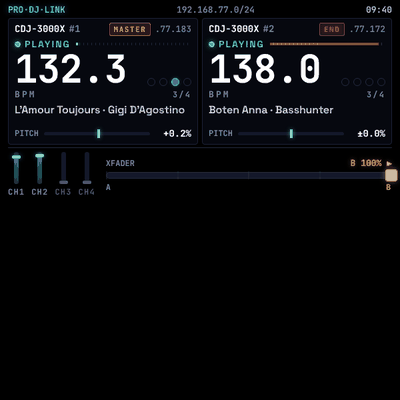 | [Launch app](https://rbm-demos.lnr.io/see-dj/) | [Open in simulator](https://displayglasses.dev/?url=https%3A%2F%2Frbm-demos.lnr.io%2Fsee-dj%2F&pos=center&size=60&bright=100&bg=hiking&bg-dark=10) | [Case study](https://www.levinriegner.com/work/see-dj/) | <sub>🧪 🎞️</sub> |
| [**Chores**](https://github.com/levin-riegner/lr-rbm-demos/tree/main/chores) | Daily chore checklist with a one-pinch reorder flow for the supplies you run out of. | 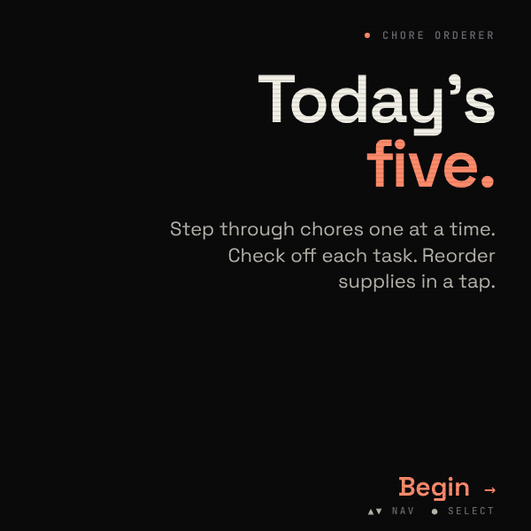 | [Launch app](https://rbm-demos.lnr.io/chores/) | [Open in simulator](https://displayglasses.dev/?url=https%3A%2F%2Frbm-demos.lnr.io%2Fchores%2F&pos=center&size=60&bright=100&bg=hiking&bg-dark=10) | — | <sub>🧪 🎙 🎞️</sub> |
| [**Conversational**](https://github.com/levin-riegner/lr-rbm-demos/tree/main/conversational) | Live-style transcription of a conversation, with a translation layer and a saved-word library. | 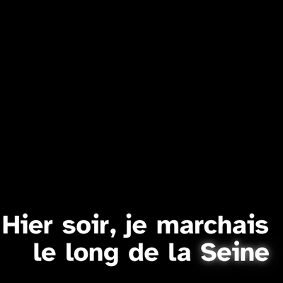 | [Launch app](https://rbm-demos.lnr.io/conversational/) | [Open in simulator](https://displayglasses.dev/?url=https%3A%2F%2Frbm-demos.lnr.io%2Fconversational%2F&pos=center&size=60&bright=100&bg=hiking&bg-dark=10) | — | <sub>🧪 💾</sub> |
| [**Crypto Tracker**](https://github.com/levin-riegner/lr-rbm-demos/tree/main/crypto-tracker) | Live coin prices and 24-hour change from CoinGecko, with favorites. | 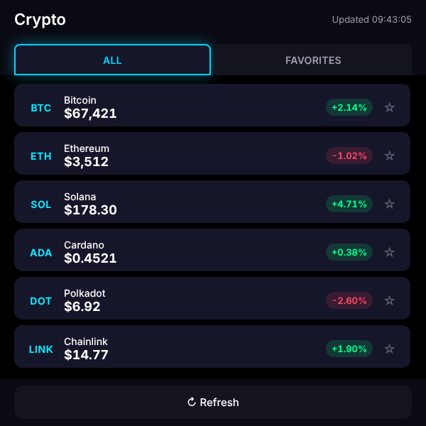 | [Launch app](https://rbm-demos.lnr.io/crypto-tracker/) | [Open in simulator](https://displayglasses.dev/?url=https%3A%2F%2Frbm-demos.lnr.io%2Fcrypto-tracker%2F&pos=center&size=60&bright=100&bg=hiking&bg-dark=10) | — | <sub>🔌 🎙 🌐 💾</sub> |
| [**Device Info**](https://github.com/levin-riegner/lr-rbm-demos/tree/main/get-device-info) | Shows what the glasses' browser reports: hardware, screen, network, sensors and supported APIs. | 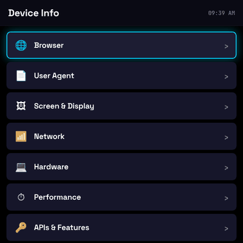 | [Launch app](https://rbm-demos.lnr.io/get-device-info/) | [Open in simulator](https://displayglasses.dev/?url=https%3A%2F%2Frbm-demos.lnr.io%2Fget-device-info%2F&pos=center&size=60&bright=100&bg=hiking&bg-dark=10) | — | <sub>✅ 📍 🔊 🖌️ 💾</sub> |
| [**Flashcards (Serbian)**](https://github.com/levin-riegner/lr-rbm-demos/tree/main/flashcards-serbian) | Serbian vocabulary flashcards with a learn mode and a timed quiz. | 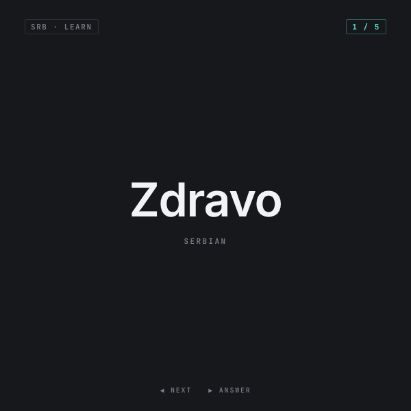 | [Launch app](https://rbm-demos.lnr.io/flashcards-serbian/) | [Open in simulator](https://displayglasses.dev/?url=https%3A%2F%2Frbm-demos.lnr.io%2Fflashcards-serbian%2F&pos=center&size=60&bright=100&bg=hiking&bg-dark=10) | — | <sub>✅ 🎙</sub> |
| [**Flight Status**](https://github.com/levin-riegner/lr-rbm-demos/tree/main/flight-status) | Flight board with terminal, gate, boarding time and seat, in full and compact views. | 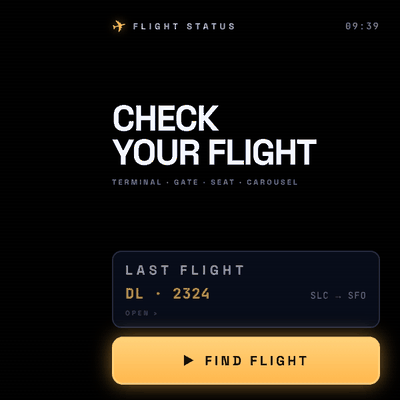 | [Launch app](https://rbm-demos.lnr.io/flight-status/) | [Open in simulator](https://displayglasses.dev/?url=https%3A%2F%2Frbm-demos.lnr.io%2Fflight-status%2F&pos=center&size=60&bright=100&bg=hiking&bg-dark=10) | [Case study](https://www.levinriegner.com/work/flight-status/) | <sub>🧪 💾</sub> |
| [**Grillmaster**](https://github.com/levin-riegner/lr-rbm-demos/tree/main/grillmaster) | Grill and smoker coach: flip timers for the grill, stall detection and pit alarms for low and slow. | 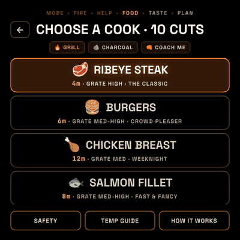 | [Launch app](https://rbm-demos.lnr.io/grillmaster/) | [Open in simulator](https://displayglasses.dev/?url=https%3A%2F%2Frbm-demos.lnr.io%2Fgrillmaster%2F&pos=center&size=60&bright=100&bg=hiking&bg-dark=10) | — | <sub>✅ 🎙 🔊 🎞️ 🖌️ 💾</sub> |
| [**Kairos Calendar HUD**](https://github.com/levin-riegner/lr-rbm-demos/tree/main/kairos-calendar-hud) | Ambient calendar showing what's now, what's next and when you're free. | 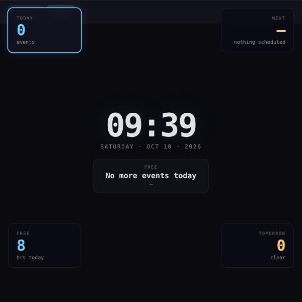 | [Launch app](https://rbm-demos.lnr.io/kairos-calendar-hud/) | [Open in simulator](https://displayglasses.dev/?url=https%3A%2F%2Frbm-demos.lnr.io%2Fkairos-calendar-hud%2F&pos=center&size=60&bright=100&bg=hiking&bg-dark=10) | — | <sub>🧪 🎞️ 🖌️</sub> |
| [**Knot Helpful**](https://github.com/levin-riegner/lr-rbm-demos/tree/main/knot-help) | Step-by-step guide to six knots, with diagrams and the mistake to avoid at each step. | 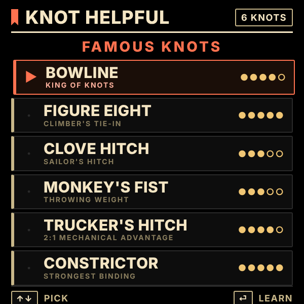 | [Launch app](https://rbm-demos.lnr.io/knot-help/) | [Open in simulator](https://displayglasses.dev/?url=https%3A%2F%2Frbm-demos.lnr.io%2Fknot-help%2F&pos=center&size=60&bright=100&bg=hiking&bg-dark=10) | — | <sub>✅ 🎙 🧩</sub> |
| [**Meditation**](https://github.com/levin-riegner/lr-rbm-demos/tree/main/meditation) | Box-breathing guide with a session timer, history and a closing bell. | 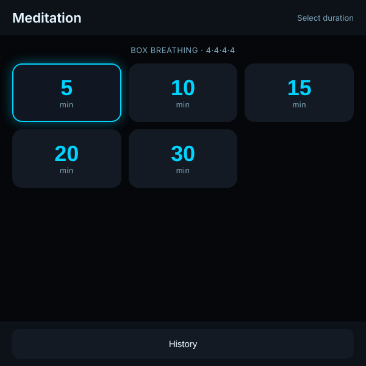 | [Launch app](https://rbm-demos.lnr.io/meditation/) | [Open in simulator](https://displayglasses.dev/?url=https%3A%2F%2Frbm-demos.lnr.io%2Fmeditation%2F&pos=center&size=60&bright=100&bg=hiking&bg-dark=10) | — | <sub>✅ 🎙 🔊 🎞️ 💾</sub> |
| [**Origami Sensei**](https://github.com/levin-riegner/lr-rbm-demos/tree/main/origami-sensei) | Fold-by-fold instructions for six origami models. | 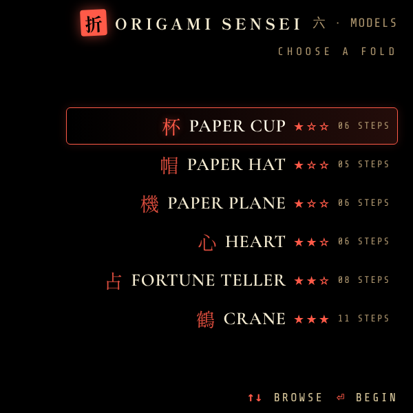 | [Launch app](https://rbm-demos.lnr.io/origami-sensei/) | [Open in simulator](https://displayglasses.dev/?url=https%3A%2F%2Frbm-demos.lnr.io%2Forigami-sensei%2F&pos=center&size=60&bright=100&bg=hiking&bg-dark=10) | — | <sub>✅ 🎙 🔊 🧩</sub> |
| [**Periff**](https://github.com/levin-riegner/lr-rbm-demos/tree/main/periff) | Record spoken ideas, get a transcript and keep a searchable archive. | 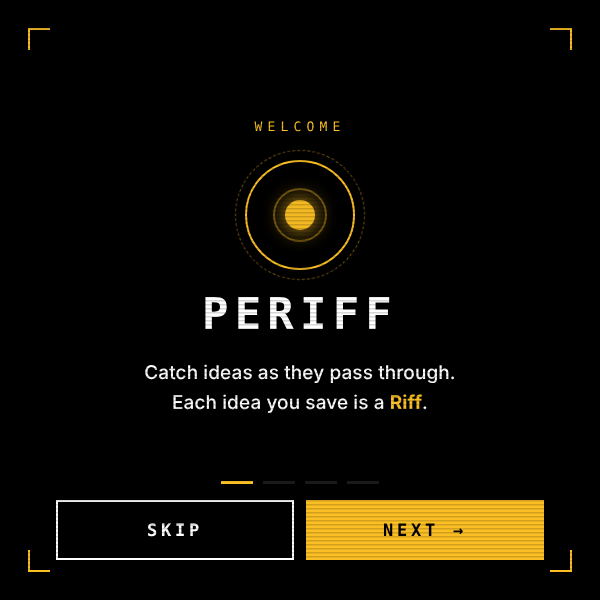 | [Launch app](https://rbm-demos.lnr.io/periff/) | [Open in simulator](https://displayglasses.dev/?url=https%3A%2F%2Frbm-demos.lnr.io%2Fperiff%2F&pos=center&size=60&bright=100&bg=hiking&bg-dark=10) | — | <sub>🧪 🎤 🎞️ 💾</sub> |
| [**Plane Spotter**](https://github.com/levin-riegner/lr-rbm-demos/tree/main/plane-spotter) | Points a head-tracked arrow at the nearest aircraft overhead, with its details. | 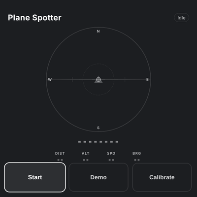 | [Launch app](https://rbm-demos.lnr.io/plane-spotter/) | [Open in simulator](https://displayglasses.dev/?url=https%3A%2F%2Frbm-demos.lnr.io%2Fplane-spotter%2F&pos=center&size=60&bright=100&bg=hiking&bg-dark=10) | — | <sub>🔌 🧭 📍 🌐</sub> |
| [**Pomodoro**](https://github.com/levin-riegner/lr-rbm-demos/tree/main/pomodoro) | Focus timer with 25, 5 and 15 minute phases and cycle stats. | 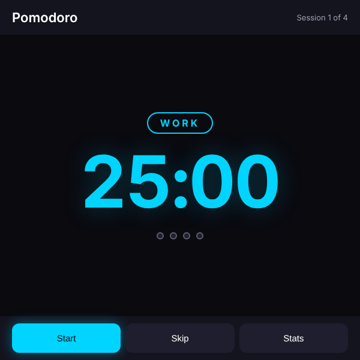 | [Launch app](https://rbm-demos.lnr.io/pomodoro/) | [Open in simulator](https://displayglasses.dev/?url=https%3A%2F%2Frbm-demos.lnr.io%2Fpomodoro%2F&pos=center&size=60&bright=100&bg=hiking&bg-dark=10) | — | <sub>✅ 🎙 🔊 💾</sub> |
| [**Presto**](https://github.com/levin-riegner/lr-rbm-demos/tree/main/presto) | Card-magic coach that feeds you the next move, the patter and the secret, beat by beat. | 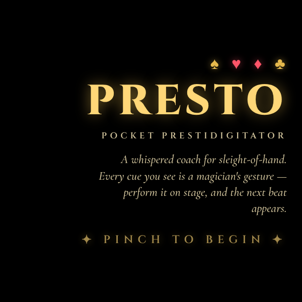 | [Launch app](https://rbm-demos.lnr.io/presto/) | [Open in simulator](https://displayglasses.dev/?url=https%3A%2F%2Frbm-demos.lnr.io%2Fpresto%2F&pos=center&size=60&bright=100&bg=hiking&bg-dark=10) | — | <sub>🧪 🔊</sub> |
| [**Recipe Stepper**](https://github.com/levin-riegner/lr-rbm-demos/tree/main/recipe-stepper) | Turns any recipe into lens-sized steps you page through hands-free. |  | [Launch app](https://rbm-demos.lnr.io/recipe-stepper/) | [Open in simulator](https://displayglasses.dev/?url=https%3A%2F%2Frbm-demos.lnr.io%2Frecipe-stepper%2F&pos=center&size=60&bright=100&bg=hiking&bg-dark=10) | — | <sub>✅ 🎙 🌐 🤖</sub> |
| [**Skipper**](https://github.com/levin-riegner/lr-rbm-demos/tree/main/skipper) | Boat coach for a Blu Water 170: departure checks, docking, anchoring and emergency drills with a live-GPS MAYDAY script. | 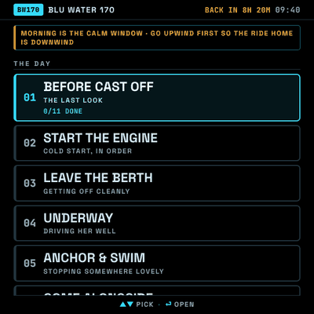 | [Launch app](https://rbm-demos.lnr.io/skipper/) | [Open in simulator](https://displayglasses.dev/?url=https%3A%2F%2Frbm-demos.lnr.io%2Fskipper%2F&pos=center&size=60&bright=100&bg=hiking&bg-dark=10) | — | <sub>✅ 📍 🎞️ 💾</sub> |
| [**Trivia Live**](https://github.com/levin-riegner/lr-rbm-demos/tree/main/trivia-live) | Ten-question trivia rounds with category and difficulty pickers and a running best score. | 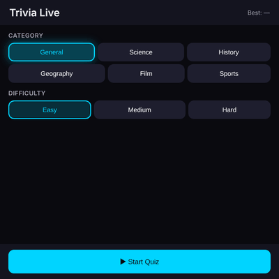 | [Launch app](https://rbm-demos.lnr.io/trivia-live/) | [Open in simulator](https://displayglasses.dev/?url=https%3A%2F%2Frbm-demos.lnr.io%2Ftrivia-live%2F&pos=center&size=60&bright=100&bg=hiking&bg-dark=10) | — | <sub>🔌 🎙 🌐 💾</sub> |
| [**Twitch Chat HUD**](https://github.com/levin-riegner/lr-rbm-demos/tree/main/twitch-chat) | Your Twitch chat in large type, streamed over IRC so streamers can read it hands-free. | 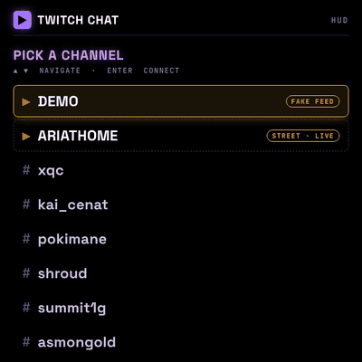 | [Launch app](https://rbm-demos.lnr.io/twitch-chat/) | [Open in simulator](https://displayglasses.dev/?url=https%3A%2F%2Frbm-demos.lnr.io%2Ftwitch-chat%2F&pos=center&size=60&bright=100&bg=hiking&bg-dark=10) | — | <sub>🔌 📡 💾</sub> |
| [**Weather Dashboard**](https://github.com/levin-riegner/lr-rbm-demos/tree/main/weather-dashboard) | Five-day forecast for your cities from Open-Meteo. | 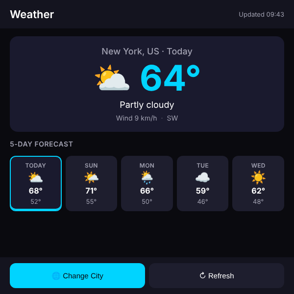 | [Launch app](https://rbm-demos.lnr.io/weather-dashboard/) | [Open in simulator](https://displayglasses.dev/?url=https%3A%2F%2Frbm-demos.lnr.io%2Fweather-dashboard%2F&pos=center&size=60&bright=100&bg=hiking&bg-dark=10) | — | <sub>🔌 🎙 🌐 💾</sub> |
| [**World Clock**](https://github.com/levin-riegner/lr-rbm-demos/tree/main/world-clock) | Local time in the cities you care about, picked from a list. | 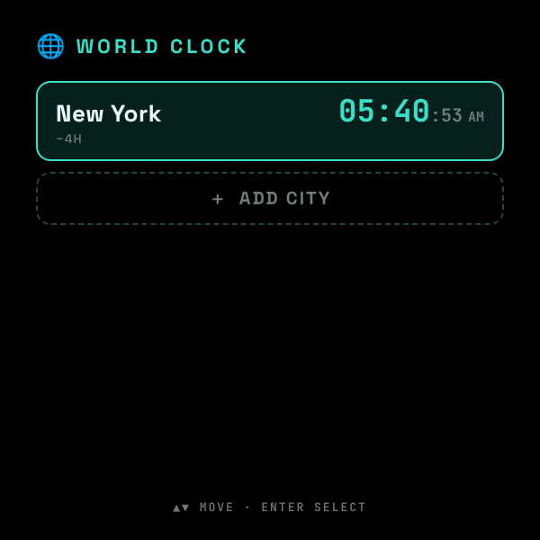 | [Launch app](https://rbm-demos.lnr.io/world-clock/) | [Open in simulator](https://displayglasses.dev/?url=https%3A%2F%2Frbm-demos.lnr.io%2Fworld-clock%2F&pos=center&size=60&bright=100&bg=hiking&bg-dark=10) | — | <sub>✅ 🎙 💾</sub> |

### Proof of concept demos

| Demo | Description | Preview | Live | Simulator | Case study | Status |
|---|---|---|---|---|---|:---:|
| [**Deep Link Launcher**](https://github.com/levin-riegner/lr-rbm-demos/tree/main/deep-link-launcher) | Hands off to another demo through a deep link; the sending half of the pair. |  | [Launch app](https://rbm-demos.lnr.io/deep-link-launcher/) | [Open in simulator](https://displayglasses.dev/?url=https%3A%2F%2Frbm-demos.lnr.io%2Fdeep-link-launcher%2F&pos=center&size=60&bright=100&bg=hiking&bg-dark=10) | — | <sub>✅ 🔗 💾</sub> |
| [**Deep Link Target**](https://github.com/levin-riegner/lr-rbm-demos/tree/main/deep-link-target) | Opens on the requested screen and shows where the deep link came from; the receiving half. | 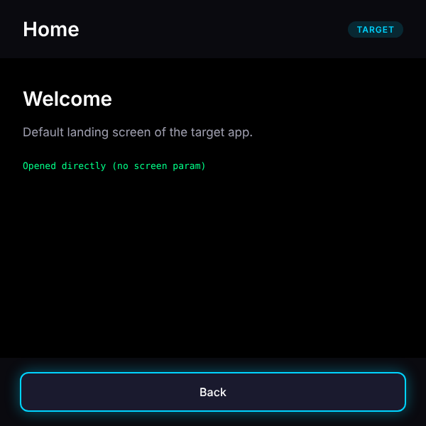 | [Launch app](https://rbm-demos.lnr.io/deep-link-target/) | [Open in simulator](https://displayglasses.dev/?url=https%3A%2F%2Frbm-demos.lnr.io%2Fdeep-link-target%2F&pos=center&size=60&bright=100&bg=hiking&bg-dark=10) | — | <sub>✅ 🔗</sub> |
| [**Find My Car**](https://github.com/levin-riegner/lr-rbm-demos/tree/main/find-my-car) | Saves where you parked and guides you back with bearing and distance. | 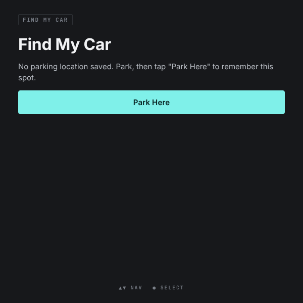 | [Launch app](https://rbm-demos.lnr.io/find-my-car/) | [Open in simulator](https://displayglasses.dev/?url=https%3A%2F%2Frbm-demos.lnr.io%2Ffind-my-car%2F&pos=center&size=60&bright=100&bg=hiking&bg-dark=10) | — | <sub>✅ 🧭 📍 🧩 💾</sub> |
| [**Head Gesture Prototype**](https://github.com/levin-riegner/lr-rbm-demos/tree/main/head-gesture-prototype) | Dismiss a notification with a shake of the head. |  | [Launch app](https://rbm-demos.lnr.io/head-gesture-prototype/) | [Open in simulator](https://displayglasses.dev/?url=https%3A%2F%2Frbm-demos.lnr.io%2Fhead-gesture-prototype%2F&pos=center&size=60&bright=100&bg=hiking&bg-dark=10) | — | <sub>✅ 🧭</sub> |
| [**Headprint**](https://github.com/levin-riegner/lr-rbm-demos/tree/main/headprint) | Identifies the wearer from how their head moves through four gestures. |  | [Launch app](https://rbm-demos.lnr.io/headprint/) | [Open in simulator](https://displayglasses.dev/?url=https%3A%2F%2Frbm-demos.lnr.io%2Fheadprint%2F&pos=center&size=60&bright=100&bg=hiking&bg-dark=10) | — | <sub>✅ 🧭 🔊 💾</sub> |
| [**Levin Riegner**](https://github.com/levin-riegner/lr-rbm-demos/tree/main/levinriegner) | The L+R studio portfolio: work, services, about and contact, on the lens. |  | [Launch app](https://rbm-demos.lnr.io/levinriegner/) | [Open in simulator](https://displayglasses.dev/?url=https%3A%2F%2Frbm-demos.lnr.io%2Flevinriegner%2F&pos=center&size=60&bright=100&bg=hiking&bg-dark=10) | — | <sub>✅ 🔊 🎞️ 🖌️</sub> |
| [**Speedometer**](https://github.com/levin-riegner/lr-rbm-demos/tree/main/speedometer) | Speed readout from the glasses' motion sensors, with a top speed and a level. | 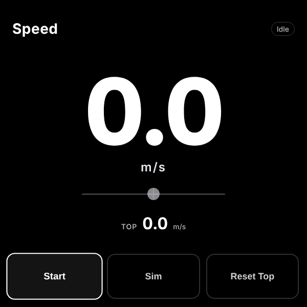 | [Launch app](https://rbm-demos.lnr.io/speedometer/) | [Open in simulator](https://displayglasses.dev/?url=https%3A%2F%2Frbm-demos.lnr.io%2Fspeedometer%2F&pos=center&size=60&bright=100&bg=hiking&bg-dark=10) | — | <sub>✅ 🧭 🎞️ 💾</sub> |
| [**Stub**](https://github.com/levin-riegner/lr-rbm-demos/tree/main/stub) | Capture coat-check tags, valet tickets and locker numbers, kept out of your camera roll. | 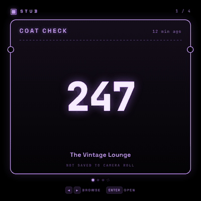 | [Launch app](https://rbm-demos.lnr.io/stub/) | [Open in simulator](https://displayglasses.dev/?url=https%3A%2F%2Frbm-demos.lnr.io%2Fstub%2F&pos=center&size=60&bright=100&bg=hiking&bg-dark=10) | — | <sub>🧪 🎙 💾</sub> |
| [**Teleprompter (admin)**](https://github.com/levin-riegner/lr-rbm-demos/tree/main/teleprompter/admin) | Phone dashboard that sends script lines to the glasses in real time. | 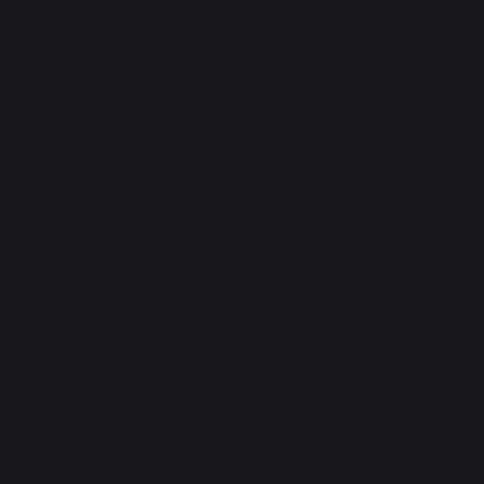 | [Launch app](https://rbm-demos.lnr.io/teleprompter/admin/) | — | — | <sub>🔌 ✍️ 📡</sub> |
| [**Teleprompter (glasses)**](https://github.com/levin-riegner/lr-rbm-demos/tree/main/teleprompter/glasses) | The glasses side of the teleprompter: shows each line as the phone sends it. |  | [Launch app](https://rbm-demos.lnr.io/teleprompter/glasses/) | [Open in simulator](https://displayglasses.dev/?url=https%3A%2F%2Frbm-demos.lnr.io%2Fteleprompter%2Fglasses%2F&pos=center&size=60&bright=100&bg=hiking&bg-dark=10) | — | <sub>🔌 🎤 📷 📡</sub> |

### Testing apps

| Demo | Description | Preview | Live | Simulator | Case study | Status |
|---|---|---|---|---|---|:---:|
| [**Glasses API Test**](https://github.com/levin-riegner/lr-rbm-demos/tree/main/glasses-api-test) | Pinch-to-run checks for microphone, camera, location, sensors and WebMCP. | 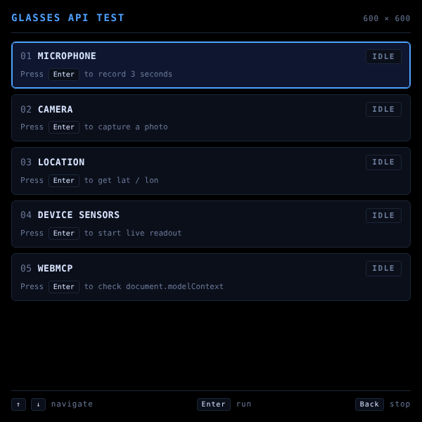 | [Launch app](https://rbm-demos.lnr.io/glasses-api-test/) | [Open in simulator](https://displayglasses.dev/?url=https%3A%2F%2Frbm-demos.lnr.io%2Fglasses-api-test%2F&pos=center&size=60&bright=100&bg=hiking&bg-dark=10) | — | <sub>✅ 🧭 📍 🎤 📷 🔊 🎞️ 🖌️</sub> |
| [**Glasses Wack**](https://github.com/levin-riegner/lr-rbm-demos/tree/main/glasses-wack) | Wider API checker covering graphics, storage, network and sensors. | 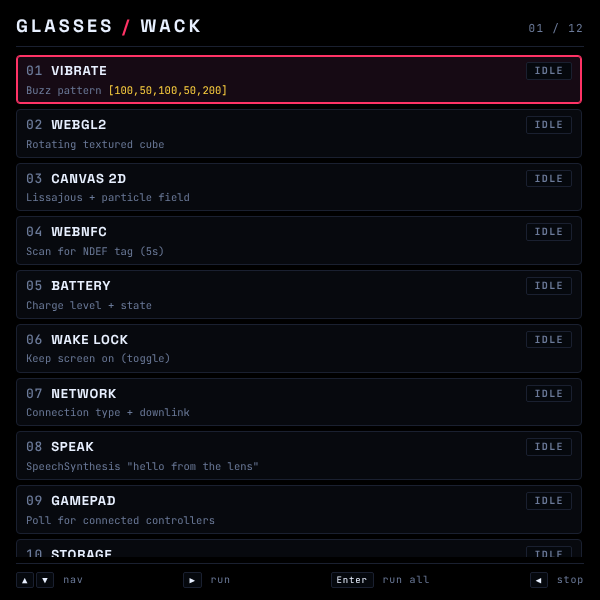 | [Launch app](https://rbm-demos.lnr.io/glasses-wack/) | [Open in simulator](https://displayglasses.dev/?url=https%3A%2F%2Frbm-demos.lnr.io%2Fglasses-wack%2F&pos=center&size=60&bright=100&bg=hiking&bg-dark=10) | — | <sub>✅ 🎞️ 🖌️</sub> |
| [**IP Info**](https://github.com/levin-riegner/lr-rbm-demos/tree/main/ip-info) | Your public IP, city, timezone and provider at a glance. | 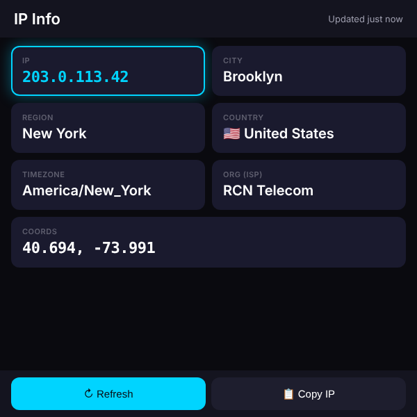 | [Launch app](https://rbm-demos.lnr.io/ip-info/) | [Open in simulator](https://displayglasses.dev/?url=https%3A%2F%2Frbm-demos.lnr.io%2Fip-info%2F&pos=center&size=60&bright=100&bg=hiking&bg-dark=10) | — | <sub>🔌 🌐 💾</sub> |
| [**Key Logger**](https://github.com/levin-riegner/lr-rbm-demos/tree/main/key-logger) | Shows every D-pad tap, double-tap and hold as ripples, particles and sound. | 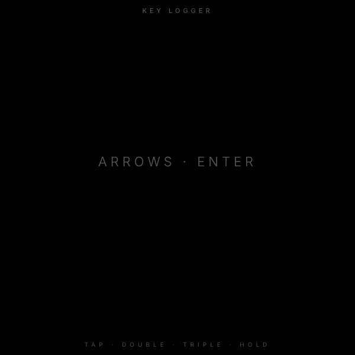 | [Launch app](https://rbm-demos.lnr.io/key-logger/) | [Open in simulator](https://displayglasses.dev/?url=https%3A%2F%2Frbm-demos.lnr.io%2Fkey-logger%2F&pos=center&size=60&bright=100&bg=hiking&bg-dark=10) | — | <sub>✅ 🔊 🎞️ 🖌️</sub> |
| [**Pair HUD**](https://github.com/levin-riegner/lr-rbm-demos/tree/main/pair-hud) | Pair your phone with a PIN and push content to the lens over a WebSocket. | 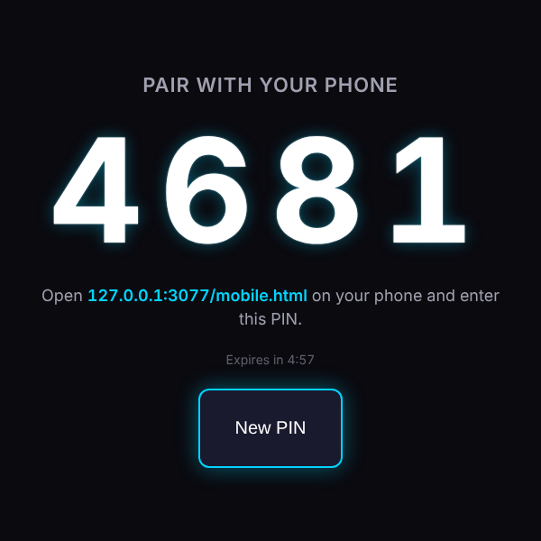 | [Launch app](https://rbm-demos.lnr.io/pair-hud/) | [Open in simulator](https://displayglasses.dev/?url=https%3A%2F%2Frbm-demos.lnr.io%2Fpair-hud%2F&pos=center&size=60&bright=100&bg=hiking&bg-dark=10) | — | <sub>🔌 📡</sub> |

## Simulator

A browser-based simulator that previews how any web app would look on the display glasses. It applies the additive waveguide blend (plus-lighter) over a real-world background image, so you can judge contrast and legibility without a physical device.

Try it live: [https://displayglasses.dev](https://displayglasses.dev)

Features:
- Load any URL into the simulated 600x600 HUD
- Drag to reposition, resize the display
- Swap background scenes or upload your own image/video
- Adjust HUD brightness, size, and background brightness
- Press **H** to hide all UI overlays for clean screen recordings

Meta also ships an official **Display Simulator** Chrome extension with its [Web Apps AI toolkit](https://github.com/facebook/meta-wearables-webapp): a 600×600 additive-display frame with D-pad input, display tuning, recording, and a QA checklist. Use it alongside the L+R simulator for day-to-day testing; neither replaces a pass on the glasses.

## Running an app locally

```bash
cd <app-name>
python3 -m http.server 8080
```

Open `http://localhost:8080` in Chrome, set the viewport to 600x600 via DevTools, and navigate with arrow keys.

## License

MIT — see [LICENSE](LICENSE).
