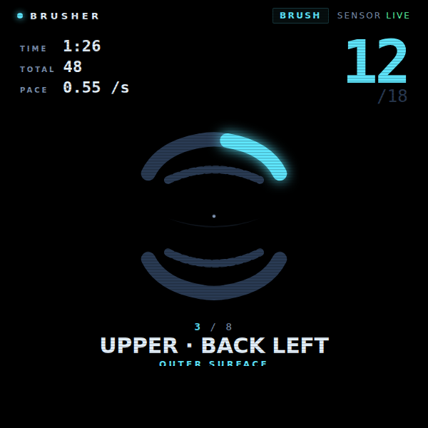
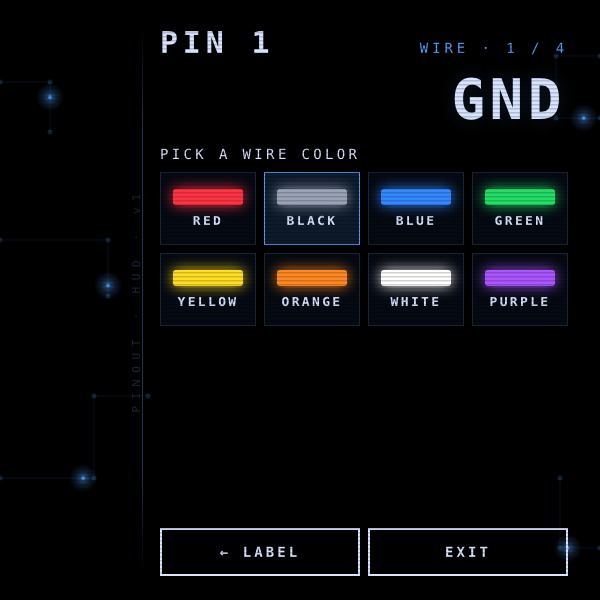
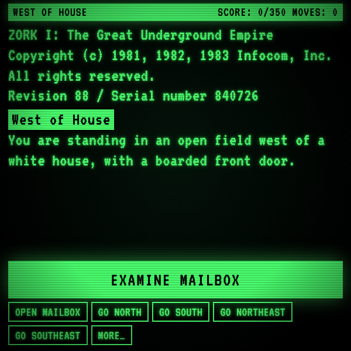
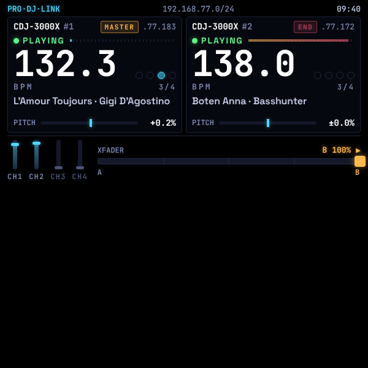
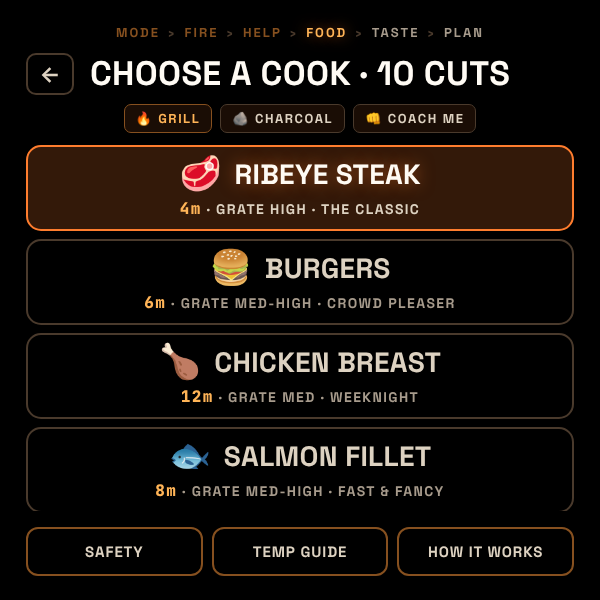
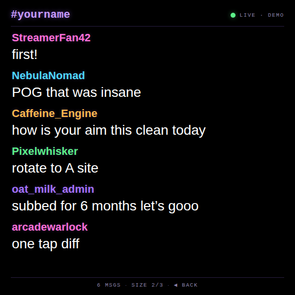

# Ray-Ban Meta Display glasses concept applications by L+R

Explore a curated showcase of demo web apps bridging emerging wearable tech with real-world utility, bringing imagination to life on [Meta Ray-Ban Display glasses](https://wearables.developer.meta.com/docs).

[DisplayGlasses.dev](https://displayglasses.dev) is a resource by L+R which includes a simulator for the Ray-Ban Meta Display glasses and a [getting started guide](https://displayglasses.dev/docs).

Built by the team at [L+R](https://levinriegner.com).

Every demo self-hosts its fonts, works offline through a service worker, and handles the glasses' back gesture. Demos marked 🎙 register [WebMCP](https://github.com/facebook/meta-wearables-webapp) tools so you can drive them by talking to Meta AI (requires WebMCP enabled on the device).

Status: ✅ working on the glasses as described · 🔌 working, but depends on a live third-party API or server · 🧪 concept: real interface, simulated data or service (each README has a “Making it real” section) · 🎙 has Meta AI voice tools (WebMCP). Every app README has a QR code to add it to your glasses.

## Hosted demos

### Primary demos
> UI polished and complete. See the status marker on each row for what is real versus conceptual.

| Demo | Status | Preview | Source | Live | Simulator | Case study |
|---|:---:|---|---|---|---|---|
| **Brush Coach**<br><sub>toothbrush stroke counter that tracks brushing motion and guides you through mouth zones</sub> | <sub>✅</sub> |  | [GitHub](https://github.com/levin-riegner/lr-rbm-demos/tree/main/brusher) | [Launch app](https://rbm-demos.lnr.io/brusher/) | [Open in simulator](https://displayglasses.dev/?url=https%3A%2F%2Frbm-demos.lnr.io%2Fbrusher%2F&pos=center&size=60&bright=100&bg=hiking&bg-dark=10) | [Case study](https://www.levinriegner.com/work/brush-coach/) |
| **Calculator**<br><sub>four-function calculator with multiple themes and D-pad input</sub> | <sub>✅ 🎙</sub> |  | [GitHub](https://github.com/levin-riegner/lr-rbm-demos/tree/main/calculator) | [Launch app](https://rbm-demos.lnr.io/calculator/) | [Open in simulator](https://displayglasses.dev/?url=https%3A%2F%2Frbm-demos.lnr.io%2Fcalculator%2F&pos=center&size=60&bright=100&bg=hiking&bg-dark=10) | — |
| **Comfortable Thumb**<br><sub>pentatonic synth locked to B minor with an animated oscilloscope</sub> | <sub>✅</sub> |  | [GitHub](https://github.com/levin-riegner/lr-rbm-demos/tree/main/pentatonic-solo) | [Launch app](https://rbm-demos.lnr.io/pentatonic-solo/) | [Open in simulator](https://displayglasses.dev/?url=https%3A%2F%2Frbm-demos.lnr.io%2Fpentatonic-solo%2F&pos=center&size=60&bright=100&bg=hiking&bg-dark=10) | — |
| **Cooking HUD**<br><sub>step-by-step recipe flow with a multi-timer rail and shop/prep/cook phases</sub> | <sub>✅ 🎙</sub> |  | [GitHub](https://github.com/levin-riegner/lr-rbm-demos/tree/main/cooking-hud) | [Launch app](https://rbm-demos.lnr.io/cooking-hud/) | [Open in simulator](https://displayglasses.dev/?url=https%3A%2F%2Frbm-demos.lnr.io%2Fcooking-hud%2F&pos=center&size=60&bright=100&bg=hiking&bg-dark=10) | [Case study](https://www.levinriegner.com/work/cooking-hud/) |
| **Dad Jokes**<br><sub>random dad jokes with auto-fitting type and rim-shot audio stings</sub> | <sub>🔌 🎙</sub> |  | [GitHub](https://github.com/levin-riegner/lr-rbm-demos/tree/main/dad-jokes) | [Launch app](https://rbm-demos.lnr.io/dad-jokes/) | [Open in simulator](https://displayglasses.dev/?url=https%3A%2F%2Frbm-demos.lnr.io%2Fdad-jokes%2F&pos=center&size=60&bright=100&bg=hiking&bg-dark=10) | — |
| **GLIMMER**<br><sub>Tamagotchi-style companion with five evolution stages, stat decay, and events</sub> | <sub>✅</sub> |  | [GitHub](https://github.com/levin-riegner/lr-rbm-demos/tree/main/lr-glimmer) | [Launch app](https://rbm-demos.lnr.io/lr-glimmer/) | [Open in simulator](https://displayglasses.dev/?url=https%3A%2F%2Frbm-demos.lnr.io%2Flr-glimmer%2F&pos=center&size=60&bright=100&bg=hiking&bg-dark=10) | [Case study](https://www.levinriegner.com/work/glimmer/) |
| **LVSR**<br><sub>two-player Pong over WebSocket with room codes and server-authoritative physics</sub> | <sub></sub> | — | Private | [Launch app](https://lvsr.netlify.app) | [Open in simulator](https://displayglasses.dev/?url=https%3A%2F%2Flvsr.netlify.app&pos=center&size=60&bright=100&bg=hiking&bg-dark=10) | — |
| **Metronome**<br><sub>hands-free metronome with tempo, time signature, and head-nod beat input</sub> | <sub>✅ 🎙</sub> |  | [GitHub](https://github.com/levin-riegner/lr-rbm-demos/tree/main/metronome) | [Launch app](https://rbm-demos.lnr.io/metronome/) | [Open in simulator](https://displayglasses.dev/?url=https%3A%2F%2Frbm-demos.lnr.io%2Fmetronome%2F&pos=center&size=60&bright=100&bg=hiking&bg-dark=10) | [Case study](https://www.levinriegner.com/work/metronome/) |
| **Pinout HUD**<br><sub>ESP32 pinout reference with board templates and a zoomable focus mode</sub> | <sub>✅</sub> |  | [GitHub](https://github.com/levin-riegner/lr-rbm-demos/tree/main/pinout-hud) | [Launch app](https://rbm-demos.lnr.io/pinout-hud/) | [Open in simulator](https://displayglasses.dev/?url=https%3A%2F%2Frbm-demos.lnr.io%2Fpinout-hud%2F&pos=center&size=60&bright=100&bg=hiking&bg-dark=10) | [Case study](https://www.levinriegner.com/work/pinout-hud/) |
| **Quicklist**<br><sub>hands-free running list: add items by voice or the handwriting composer, check them off with the D-pad, works offline</sub> | <sub>✅ 🎙</sub> |  | [GitHub](https://github.com/levin-riegner/lr-rbm-demos/tree/main/quicklist) | [Launch app](https://rbm-demos.lnr.io/quicklist/) | [Open in simulator](https://displayglasses.dev/?url=https%3A%2F%2Frbm-demos.lnr.io%2Fquicklist%2F&pos=center&size=60&bright=100&bg=hiking&bg-dark=10) | — |
| **Snake**<br><sub>classic Snake game with D-pad control and local high scores</sub> | <sub>✅</sub> |  | [GitHub](https://github.com/levin-riegner/lr-rbm-demos/tree/main/snake) | [Launch app](https://rbm-demos.lnr.io/snake/) | [Open in simulator](https://displayglasses.dev/?url=https%3A%2F%2Frbm-demos.lnr.io%2Fsnake%2F&pos=center&size=60&bright=100&bg=hiking&bg-dark=10) | — |
| **Tally Counter**<br><sub>single-button tally counter with running total and "since" timestamp</sub> | <sub>✅ 🎙</sub> |  | [GitHub](https://github.com/levin-riegner/lr-rbm-demos/tree/main/tally-counter) | [Launch app](https://rbm-demos.lnr.io/tally-counter/) | [Open in simulator](https://displayglasses.dev/?url=https%3A%2F%2Frbm-demos.lnr.io%2Ftally-counter%2F&pos=center&size=60&bright=100&bg=hiking&bg-dark=10) | [Case study](https://www.levinriegner.com/work/tally-counter/) |
| **Tiltscroll Tales**<br><sub>head-tilt-scrolled fairy tale across four chapters with glowing visuals</sub> | <sub>✅</sub> |  | [GitHub](https://github.com/levin-riegner/lr-rbm-demos/tree/main/tiltscroll-tales) | [Launch app](https://rbm-demos.lnr.io/tiltscroll-tales/) | [Open in simulator](https://displayglasses.dev/?url=https%3A%2F%2Frbm-demos.lnr.io%2Ftiltscroll-tales%2F&pos=center&size=60&bright=100&bg=hiking&bg-dark=10) | — |
| **Tip Calculator**<br><sub>restaurant tip calculator with D-pad bill entry, tip percentage, and party-size split</sub> | <sub>✅ 🎙</sub> | — | [GitHub](https://github.com/levin-riegner/lr-rbm-demos/tree/main/tip-calculator) | [Launch app](https://rbm-demos.lnr.io/tip-calculator/) | [Open in simulator](https://displayglasses.dev/?url=https%3A%2F%2Frbm-demos.lnr.io%2Ftip-calculator%2F&pos=center&size=60&bright=100&bg=hiking&bg-dark=10) | — |
| **Zork Terminal**<br><sub>CRT-styled text adventure with D-pad verb picker and typewriter output</sub> | <sub>✅ 🎙</sub> |  | [GitHub](https://github.com/levin-riegner/lr-rbm-demos/tree/main/zork-terminal) | [Launch app](https://rbm-demos.lnr.io/zork-terminal/) | [Open in simulator](https://displayglasses.dev/?url=https%3A%2F%2Frbm-demos.lnr.io%2Fzork-terminal%2F&pos=center&size=60&bright=100&bg=hiking&bg-dark=10) | [Case study](https://www.levinriegner.com/work/zork-i-tribute/) |

### Secondary demos — Works in progress!

| Demo | Status | Preview | Source | Live | Simulator | Case study |
|---|:---:|---|---|---|---|---|
| **See DJ**<br><sub>passive booth HUD that reads Pro DJ Link to show per-deck track, BPM, beat, pitch, MASTER/SYNC tags, 4-channel mixer and crossfader telemetry</sub> | <sub>🧪</sub> |  | [GitHub](https://github.com/levin-riegner/lr-rbm-demos/tree/main/see-dj) | [Launch app](https://rbm-demos.lnr.io/see-dj/) | [Open in simulator](https://displayglasses.dev/?url=https%3A%2F%2Frbm-demos.lnr.io%2Fsee-dj%2F&pos=center&size=60&bright=100&bg=hiking&bg-dark=10) | [Case study](https://www.levinriegner.com/work/see-dj/) |
| **Chores**<br><sub>daily chore checklist with one-tap supply reorders via Amazon deep links</sub> | <sub>🧪 🎙</sub> |  | [GitHub](https://github.com/levin-riegner/lr-rbm-demos/tree/main/chores) | [Launch app](https://rbm-demos.lnr.io/chores/) | [Open in simulator](https://displayglasses.dev/?url=https%3A%2F%2Frbm-demos.lnr.io%2Fchores%2F&pos=center&size=60&bright=100&bg=hiking&bg-dark=10) | — |
| **Conversational**<br><sub>conversational voice-assistant demo</sub> | <sub>🧪</sub> | — | [GitHub](https://github.com/levin-riegner/lr-rbm-demos/tree/main/conversational) | [Launch app](https://rbm-demos.lnr.io/conversational/) | [Open in simulator](https://displayglasses.dev/?url=https%3A%2F%2Frbm-demos.lnr.io%2Fconversational%2F&pos=center&size=60&bright=100&bg=hiking&bg-dark=10) | — |
| **Crypto Tracker**<br><sub>live crypto prices, 24h change, and favorites pulled from CoinGecko</sub> | <sub>🔌 🎙</sub> |  | [GitHub](https://github.com/levin-riegner/lr-rbm-demos/tree/main/crypto-tracker) | [Launch app](https://rbm-demos.lnr.io/crypto-tracker/) | [Open in simulator](https://displayglasses.dev/?url=https%3A%2F%2Frbm-demos.lnr.io%2Fcrypto-tracker%2F&pos=center&size=60&bright=100&bg=hiking&bg-dark=10) | — |
| **Device Info**<br><sub>displays device and browser information</sub> | <sub>✅</sub> | — | [GitHub](https://github.com/levin-riegner/lr-rbm-demos/tree/main/get-device-info) | [Launch app](https://rbm-demos.lnr.io/get-device-info/) | [Open in simulator](https://displayglasses.dev/?url=https%3A%2F%2Frbm-demos.lnr.io%2Fget-device-info%2F&pos=center&size=60&bright=100&bg=hiking&bg-dark=10) | — |
| **Flashcards (Serbian)**<br><sub>Serbian vocabulary trainer with separate Learn and Test modes</sub> | <sub>✅ 🎙</sub> |  | [GitHub](https://github.com/levin-riegner/lr-rbm-demos/tree/main/flashcards-serbian) | [Launch app](https://rbm-demos.lnr.io/flashcards-serbian/) | [Open in simulator](https://displayglasses.dev/?url=https%3A%2F%2Frbm-demos.lnr.io%2Fflashcards-serbian%2F&pos=center&size=60&bright=100&bg=hiking&bg-dark=10) | — |
| **Flight Status**<br><sub>airline and flight lookup with terminal, gate, and boarding details</sub> | <sub>🧪</sub> |  | [GitHub](https://github.com/levin-riegner/lr-rbm-demos/tree/main/flight-status) | [Launch app](https://rbm-demos.lnr.io/flight-status/) | [Open in simulator](https://displayglasses.dev/?url=https%3A%2F%2Frbm-demos.lnr.io%2Fflight-status%2F&pos=center&size=60&bright=100&bg=hiking&bg-dark=10) | [Case study](https://www.levinriegner.com/work/flight-status/) |
| **Grillmaster**<br><sub>hands-free grill, smoke, and BBQ coach: a flip-timer for the grill plus a temp-driven pit monitor (stall detection, wrap and pull at temperature, pit-drift alarm) for low & slow</sub> | <sub>✅ 🎙</sub> |  | [GitHub](https://github.com/levin-riegner/lr-rbm-demos/tree/main/grillmaster) | [Launch app](https://rbm-demos.lnr.io/grillmaster/) | [Open in simulator](https://displayglasses.dev/?url=https%3A%2F%2Frbm-demos.lnr.io%2Fgrillmaster%2F&pos=center&size=60&bright=100&bg=hiking&bg-dark=10) | — |
| **Kairos Calendar HUD**<br><sub>ambient calendar with today/next/free/tomorrow zones and a quick agenda view</sub> | <sub>🧪</sub> |  | [GitHub](https://github.com/levin-riegner/lr-rbm-demos/tree/main/kairos-calendar-hud) | [Launch app](https://rbm-demos.lnr.io/kairos-calendar-hud/) | [Open in simulator](https://displayglasses.dev/?url=https%3A%2F%2Frbm-demos.lnr.io%2Fkairos-calendar-hud%2F&pos=center&size=60&bright=100&bg=hiking&bg-dark=10) | — |
| **Knot Helpful**<br><sub>step-by-step tutor for six famous knots (bowline, figure-8, clove, monkey's fist, trucker's, constrictor) with diagrams + per-step mistake tips</sub> | <sub>✅ 🎙</sub> |  | [GitHub](https://github.com/levin-riegner/lr-rbm-demos/tree/main/knot-help) | [Launch app](https://rbm-demos.lnr.io/knot-help/) | [Open in simulator](https://displayglasses.dev/?url=https%3A%2F%2Frbm-demos.lnr.io%2Fknot-help%2F&pos=center&size=60&bright=100&bg=hiking&bg-dark=10) | — |
| **Meditation**<br><sub>box-breathing timer with animated guide, session history, and completion bell</sub> | <sub>✅ 🎙</sub> |  | [GitHub](https://github.com/levin-riegner/lr-rbm-demos/tree/main/meditation) | [Launch app](https://rbm-demos.lnr.io/meditation/) | [Open in simulator](https://displayglasses.dev/?url=https%3A%2F%2Frbm-demos.lnr.io%2Fmeditation%2F&pos=center&size=60&bright=100&bg=hiking&bg-dark=10) | — |
| **Origami Sensei**<br><sub>step-by-step paper-folding instructor across six origami models</sub> | <sub>✅ 🎙</sub> |  | [GitHub](https://github.com/levin-riegner/lr-rbm-demos/tree/main/origami-sensei) | [Launch app](https://rbm-demos.lnr.io/origami-sensei/) | [Open in simulator](https://displayglasses.dev/?url=https%3A%2F%2Frbm-demos.lnr.io%2Forigami-sensei%2F&pos=center&size=60&bright=100&bg=hiking&bg-dark=10) | — |
| **Periff**<br><sub>voice recorder for ideas with transcription and a searchable archive of riffs</sub> | <sub>🧪</sub> |  | [GitHub](https://github.com/levin-riegner/lr-rbm-demos/tree/main/periff) | [Launch app](https://rbm-demos.lnr.io/periff/) | [Open in simulator](https://displayglasses.dev/?url=https%3A%2F%2Frbm-demos.lnr.io%2Fperiff%2F&pos=center&size=60&bright=100&bg=hiking&bg-dark=10) | — |
| **Plane Spotter**<br><sub>tracks the nearest aircraft with a head-tracked arrow via the OpenSky API</sub> | <sub>🔌</sub> |  | [GitHub](https://github.com/levin-riegner/lr-rbm-demos/tree/main/plane-spotter) | [Launch app](https://rbm-demos.lnr.io/plane-spotter/) | [Open in simulator](https://displayglasses.dev/?url=https%3A%2F%2Frbm-demos.lnr.io%2Fplane-spotter%2F&pos=center&size=60&bright=100&bg=hiking&bg-dark=10) | — |
| **Pomodoro**<br><sub>25/5/15 minute Pomodoro timer with cycle stats persisted locally</sub> | <sub>✅ 🎙</sub> |  | [GitHub](https://github.com/levin-riegner/lr-rbm-demos/tree/main/pomodoro) | [Launch app](https://rbm-demos.lnr.io/pomodoro/) | [Open in simulator](https://displayglasses.dev/?url=https%3A%2F%2Frbm-demos.lnr.io%2Fpomodoro%2F&pos=center&size=60&bright=100&bg=hiking&bg-dark=10) | — |
| **Presto**<br><sub>sleight-of-hand magic coach with tricks, patter, and pinch-triggered cues</sub> | <sub>🧪</sub> |  | [GitHub](https://github.com/levin-riegner/lr-rbm-demos/tree/main/presto) | [Launch app](https://rbm-demos.lnr.io/presto/) | [Open in simulator](https://displayglasses.dev/?url=https%3A%2F%2Frbm-demos.lnr.io%2Fpresto%2F&pos=center&size=60&bright=100&bg=hiking&bg-dark=10) | — |
| **Recipe Stepper**<br><sub>paginates any recipe into D-pad-friendly steps using AI extraction</sub> | <sub>✅ 🎙</sub> |  | [GitHub](https://github.com/levin-riegner/lr-rbm-demos/tree/main/recipe-stepper) | [Launch app](https://rbm-demos.lnr.io/recipe-stepper/) | [Open in simulator](https://displayglasses.dev/?url=https%3A%2F%2Frbm-demos.lnr.io%2Frecipe-stepper%2F&pos=center&size=60&bright=100&bg=hiking&bg-dark=10) | — |
| **Skipper**<br><sub>hands-free boat coach for the Poseidon Blu Water 170: pre-departure checks, starting, docking stern-to or alongside, anchoring, and eleven emergency drills with a live-GPS MAYDAY script</sub> | <sub>✅</sub> | — | [GitHub](https://github.com/levin-riegner/lr-rbm-demos/tree/main/skipper) | [Launch app](https://rbm-demos.lnr.io/skipper/) | [Open in simulator](https://displayglasses.dev/?url=https%3A%2F%2Frbm-demos.lnr.io%2Fskipper%2F&pos=center&size=60&bright=100&bg=hiking&bg-dark=10) | — |
| **Trivia Live**<br><sub>10-question live trivia from the Open Trivia DB with category and difficulty pickers</sub> | <sub>🔌 🎙</sub> |  | [GitHub](https://github.com/levin-riegner/lr-rbm-demos/tree/main/trivia-live) | [Launch app](https://rbm-demos.lnr.io/trivia-live/) | [Open in simulator](https://displayglasses.dev/?url=https%3A%2F%2Frbm-demos.lnr.io%2Ftrivia-live%2F&pos=center&size=60&bright=100&bg=hiking&bg-dark=10) | — |
| **Twitch Chat HUD**<br><sub>large-type Twitch chat feed streamed anonymously over IRC WebSocket for hands-free streamers</sub> | <sub>🔌</sub> |  | [GitHub](https://github.com/levin-riegner/lr-rbm-demos/tree/main/twitch-chat) | [Launch app](https://rbm-demos.lnr.io/twitch-chat/) | [Open in simulator](https://displayglasses.dev/?url=https%3A%2F%2Frbm-demos.lnr.io%2Ftwitch-chat%2F&pos=center&size=60&bright=100&bg=hiking&bg-dark=10) | — |
| **Weather Dashboard**<br><sub>5-day forecast for preset cities via Open-Meteo with a 10-minute cache</sub> | <sub>🔌 🎙</sub> |  | [GitHub](https://github.com/levin-riegner/lr-rbm-demos/tree/main/weather-dashboard) | [Launch app](https://rbm-demos.lnr.io/weather-dashboard/) | [Open in simulator](https://displayglasses.dev/?url=https%3A%2F%2Frbm-demos.lnr.io%2Fweather-dashboard%2F&pos=center&size=60&bright=100&bg=hiking&bg-dark=10) | — |
| **World Clock**<br><sub>live local times for favorite cities with a D-pad city picker</sub> | <sub>✅ 🎙</sub> |  | [GitHub](https://github.com/levin-riegner/lr-rbm-demos/tree/main/world-clock) | [Launch app](https://rbm-demos.lnr.io/world-clock/) | [Open in simulator](https://displayglasses.dev/?url=https%3A%2F%2Frbm-demos.lnr.io%2Fworld-clock%2F&pos=center&size=60&bright=100&bg=hiking&bg-dark=10) | — |

### Proof of concept demos

| Demo | Status | Preview | Source | Live | Simulator | Case study |
|---|:---:|---|---|---|---|---|
| **Deep Link Launcher**<br><sub>source app that hands off to another demo via query-param deep links</sub> | <sub>✅</sub> |  | [GitHub](https://github.com/levin-riegner/lr-rbm-demos/tree/main/deep-link-launcher) | [Launch app](https://rbm-demos.lnr.io/deep-link-launcher/) | [Open in simulator](https://displayglasses.dev/?url=https%3A%2F%2Frbm-demos.lnr.io%2Fdeep-link-launcher%2F&pos=center&size=60&bright=100&bg=hiking&bg-dark=10) | — |
| **Deep Link Target**<br><sub>receiver app that opens to a specific screen and shows the referrer</sub> | <sub>✅</sub> |  | [GitHub](https://github.com/levin-riegner/lr-rbm-demos/tree/main/deep-link-target) | [Launch app](https://rbm-demos.lnr.io/deep-link-target/) | [Open in simulator](https://displayglasses.dev/?url=https%3A%2F%2Frbm-demos.lnr.io%2Fdeep-link-target%2F&pos=center&size=60&bright=100&bg=hiking&bg-dark=10) | — |
| **Find My Car**<br><sub>saves your parking spot and walks you back with compass bearing and distance</sub> | <sub>✅</sub> |  | [GitHub](https://github.com/levin-riegner/lr-rbm-demos/tree/main/find-my-car) | [Launch app](https://rbm-demos.lnr.io/find-my-car/) | [Open in simulator](https://displayglasses.dev/?url=https%3A%2F%2Frbm-demos.lnr.io%2Ffind-my-car%2F&pos=center&size=60&bright=100&bg=hiking&bg-dark=10) | — |
| **Head Gesture Prototype**<br><sub>dismiss a notification with a head shake using DeviceOrientation events</sub> | <sub>✅</sub> |  | [GitHub](https://github.com/levin-riegner/lr-rbm-demos/tree/main/head-gesture-prototype) | [Launch app](https://rbm-demos.lnr.io/head-gesture-prototype/) | [Open in simulator](https://displayglasses.dev/?url=https%3A%2F%2Frbm-demos.lnr.io%2Fhead-gesture-prototype%2F&pos=center&size=60&bright=100&bg=hiking&bg-dark=10) | — |
| **Headprint**<br><sub>biometric wearer ID built from a four-gesture head-motion profile</sub> | <sub>✅</sub> |  | [GitHub](https://github.com/levin-riegner/lr-rbm-demos/tree/main/headprint) | [Launch app](https://rbm-demos.lnr.io/headprint/) | [Open in simulator](https://displayglasses.dev/?url=https%3A%2F%2Frbm-demos.lnr.io%2Fheadprint%2F&pos=center&size=60&bright=100&bg=hiking&bg-dark=10) | — |
| **Levin Riegner**<br><sub>L+R studio portfolio HUD with work, services, about, and contact sections</sub> | <sub>✅</sub> |  | [GitHub](https://github.com/levin-riegner/lr-rbm-demos/tree/main/levinriegner) | [Launch app](https://rbm-demos.lnr.io/levinriegner/) | [Open in simulator](https://displayglasses.dev/?url=https%3A%2F%2Frbm-demos.lnr.io%2Flevinriegner%2F&pos=center&size=60&bright=100&bg=hiking&bg-dark=10) | — |
| **Speedometer**<br><sub>live GPS speed readout with top-speed tracking and a level indicator</sub> | <sub>✅</sub> |  | [GitHub](https://github.com/levin-riegner/lr-rbm-demos/tree/main/speedometer) | [Launch app](https://rbm-demos.lnr.io/speedometer/) | [Open in simulator](https://displayglasses.dev/?url=https%3A%2F%2Frbm-demos.lnr.io%2Fspeedometer%2F&pos=center&size=60&bright=100&bg=hiking&bg-dark=10) | — |
| **Stub**<br><sub>receipt and ticket capture with OCR; nothing is saved to the camera roll</sub> | <sub>🧪 🎙</sub> |  | [GitHub](https://github.com/levin-riegner/lr-rbm-demos/tree/main/stub) | [Launch app](https://rbm-demos.lnr.io/stub/) | [Open in simulator](https://displayglasses.dev/?url=https%3A%2F%2Frbm-demos.lnr.io%2Fstub%2F&pos=center&size=60&bright=100&bg=hiking&bg-dark=10) | — |
| **Teleprompter (admin)**<br><sub>phone-side dashboard that pushes live script lines to the glasses via Socket.io</sub> | <sub>🔌</sub> |  | [GitHub](https://github.com/levin-riegner/lr-rbm-demos/tree/main/teleprompter/admin) | [Launch app](https://rbm-demos.lnr.io/teleprompter/admin/) | — | — |
| **Teleprompter (glasses)**<br><sub>glasses-side reader that displays lines pushed from the admin in real time</sub> | <sub>🔌</sub> |  | [GitHub](https://github.com/levin-riegner/lr-rbm-demos/tree/main/teleprompter/glasses) | [Launch app](https://rbm-demos.lnr.io/teleprompter/glasses/) | [Open in simulator](https://displayglasses.dev/?url=https%3A%2F%2Frbm-demos.lnr.io%2Fteleprompter%2Fglasses%2F&pos=center&size=60&bright=100&bg=hiking&bg-dark=10) | — |

### Testing apps

| Demo | Status | Preview | Source | Live | Simulator | Case study |
|---|:---:|---|---|---|---|---|
| **Glasses API Test**<br><sub>D-pad smoke test for platform APIs (vibration, WebGL, NFC, battery, and more)</sub> | <sub>✅</sub> |  | [GitHub](https://github.com/levin-riegner/lr-rbm-demos/tree/main/glasses-api-test) | [Launch app](https://rbm-demos.lnr.io/glasses-api-test/) | [Open in simulator](https://displayglasses.dev/?url=https%3A%2F%2Frbm-demos.lnr.io%2Fglasses-api-test%2F&pos=center&size=60&bright=100&bg=hiking&bg-dark=10) | — |
| **Glasses Wack**<br><sub>broader API checker covering graphics, storage, network, and sensors</sub> | <sub>✅</sub> |  | [GitHub](https://github.com/levin-riegner/lr-rbm-demos/tree/main/glasses-wack) | [Launch app](https://rbm-demos.lnr.io/glasses-wack/) | [Open in simulator](https://displayglasses.dev/?url=https%3A%2F%2Frbm-demos.lnr.io%2Fglasses-wack%2F&pos=center&size=60&bright=100&bg=hiking&bg-dark=10) | — |
| **IP Info**<br><sub>shows your public IP, city, timezone, and ISP via ipapi.co</sub> | <sub>🔌</sub> |  | [GitHub](https://github.com/levin-riegner/lr-rbm-demos/tree/main/ip-info) | [Launch app](https://rbm-demos.lnr.io/ip-info/) | [Open in simulator](https://displayglasses.dev/?url=https%3A%2F%2Frbm-demos.lnr.io%2Fip-info%2F&pos=center&size=60&bright=100&bg=hiking&bg-dark=10) | — |
| **Key Logger**<br><sub>visualizes D-pad taps, double-taps, and holds with ripples, particles, and sound</sub> | <sub>✅</sub> |  | [GitHub](https://github.com/levin-riegner/lr-rbm-demos/tree/main/key-logger) | [Launch app](https://rbm-demos.lnr.io/key-logger/) | [Open in simulator](https://displayglasses.dev/?url=https%3A%2F%2Frbm-demos.lnr.io%2Fkey-logger%2F&pos=center&size=60&bright=100&bg=hiking&bg-dark=10) | — |
| **Pair HUD**<br><sub>WebSocket PIN pairing to push content from your phone to the HUD</sub> | <sub>🔌</sub> |  | [GitHub](https://github.com/levin-riegner/lr-rbm-demos/tree/main/pair-hud) | [Launch app](https://rbm-demos.lnr.io/pair-hud/) | [Open in simulator](https://displayglasses.dev/?url=https%3A%2F%2Frbm-demos.lnr.io%2Fpair-hud%2F&pos=center&size=60&bright=100&bg=hiking&bg-dark=10) | — |

## Simulator

A browser-based simulator that previews how any web app would look on the display glasses. It applies the additive waveguide blend (plus-lighter) over a real-world background image, so you can judge contrast and legibility without a physical device.

Try it live: [https://displayglasses.dev](https://displayglasses.dev)

Features:
- Load any URL into the simulated 600x600 HUD
- Drag to reposition, resize the display
- Swap background scenes or upload your own image/video
- Adjust HUD brightness, size, and background brightness
- Press **H** to hide all UI overlays for clean screen recordings

Meta also ships an official **Display Simulator** Chrome extension with its [Web Apps AI toolkit](https://github.com/facebook/meta-wearables-webapp): a 600×600 additive-display frame with D-pad input, display tuning, recording, and a QA checklist. Use it alongside the L+R simulator for day-to-day testing; neither replaces a pass on the glasses.

## Running an app locally

```bash
cd <app-name>
python3 -m http.server 8080
```

Open `http://localhost:8080` in Chrome, set the viewport to 600x600 via DevTools, and navigate with arrow keys.

## License

MIT — see [LICENSE](LICENSE).
