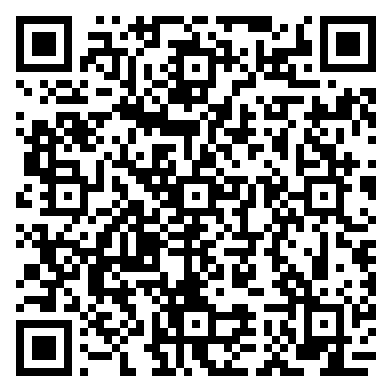

# Crypto Tracker

Live USD prices and 24h change for 8 major cryptocurrencies on the Meta Ray-Ban Display glasses, powered by the free **CoinGecko** API (no API key). Glance at the list, open a coin for the detail view, star your favorites, and ask Meta AI for prices by voice.

> ▶ [Try it in the simulator](https://displayglasses.dev/?url=https%3A%2F%2Frbm-demos.lnr.io%2Fcrypto-tracker%2F&pos=center&size=60&bright=100&bg=hiking&bg-dark=10) · 👓 [Add it to your glasses](#add-to-your-glasses)

---

## What it does

- **8-coin list.** BTC, ETH, SOL, ADA, DOT, LINK, AVAX and MATIC, each with price, a colored 24h change badge and a favorite star. Two tabs filter the list: **All** and **Favorites**.
- **Detail view.** Symbol, name, large price, change badge, and a stat grid (Price, 24h Change, Last Updated) with an Add / Remove Favorite button.
- **Auto-refresh.** Prices refresh every **30 s** while the Home screen is showing; the timer stops on Detail and while the page is hidden, and any in-flight request is aborted.
- **Cached and offline-friendly.** The last response is kept in memory and in `localStorage` (`mdg_crypto_tracker`); the network is only hit when the cache is more than 30 s old. Favorites persist in `localStorage` (`mdg_crypto_tracker_favs`). A network-first service worker caches the app shell.
- **Voice via Meta AI.** Four WebMCP tools (`crypto_*`) report prices, add or remove favorites and force a refresh. They call the same functions the D-pad uses, so the lens re-renders as Meta AI acts.

---

## Controls

| Where | Input | Result |
| --- | --- | --- |
| Home | ▲ ▼ ◀ ▶ | Move focus through the All / Favorites tabs, the coin cards and the Refresh button |
| Home | Enter (on a tab) | Switch between All and Favorites |
| Home | Enter (on a coin) | Open the coin's detail view |
| Home | Enter (on Refresh / Retry) | Fetch fresh prices now, bypassing the 30 s cache |
| Detail | ▲ ▼ ◀ ▶ | Move focus between the back arrow, Add / Remove Favorite and Back |
| Detail | Enter (on Add / Remove Favorite) | Toggle the coin's favorite star |
| Detail | Enter (on ← or Back) | Return to the coin list |
| Detail | Back gesture (thumb + middle finger) | Return to the coin list; focus lands on the coin you opened |
| Anywhere | Voice (Meta AI) | See **Voice (Meta AI)** below |

---

## Voice (Meta AI)

With WebMCP enabled, Meta AI can drive the tracker by voice. Try:

- "What's Bitcoin at?"
- "Which of my coins are up today?"
- "Add Solana and Chainlink to my favorites."
- "Remove ETH from favorites."
- "Refresh the prices."

Coins are matched by symbol or name (BTC, ETH, SOL, ADA, DOT, LINK, AVAX, MATIC); unknown names are reported back rather than guessed.

> Voice control requires WebMCP to be enabled on the device (Developer Mode or rollout). Relaunch the app after enabling it. Without it the app behaves exactly as before — D-pad only.

---

## Screenshots

No screenshots yet. The app has no `?state=` routing; a plain capture of the Home screen is the only deterministic state.

---

## Add to your glasses

Scan this with your phone to open the Meta AI app and add the demo to your Ray-Ban Meta Display glasses:



Or add it by hand in the Meta AI app: **Devices → Display Glasses settings → App connections → Web apps → Add a web app**, with the name `Crypto Tracker` and this URL:

```
https://rbm-demos.lnr.io/crypto-tracker/
```

## Running locally

The app is a single static HTML/CSS/JS bundle — no build step.

```bash
npx serve -l 3101 crypto-tracker
# then open http://localhost:3101
```

### Regenerating screenshots

> 🛠️ **Developer tooling only.** The app itself has zero Chrome dependency — it's vanilla HTML/CSS/JS that runs in the Ray-Ban Meta Display's built-in browser. The block below is just the local recipe used on a Mac to refresh the PNGs in `screenshots/`.

```bash
npx serve -l 3101 crypto-tracker &
CHROME="/Applications/Google Chrome.app/Contents/MacOS/Google Chrome"
mkdir -p crypto-tracker/screenshots
"$CHROME" --headless --disable-gpu --hide-scrollbars \
  --window-size=600,600 --virtual-time-budget=4000 \
  --screenshot="crypto-tracker/screenshots/home.png" \
  "http://localhost:3101/"
```

---

## Notes

### API

Single call: `https://api.coingecko.com/api/v3/simple/price?ids=bitcoin,ethereum,solana,cardano,polkadot,chainlink,avalanche-2,matic-network&vs_currencies=usd&include_24hr_change=true&include_last_updated_at=true`

- Auto-refresh every **30 s** while on the Home screen (paused on Detail or when the page is hidden)
- Response cached in memory and `localStorage` (`mdg_crypto_tracker`); network only hit when the cache is >30 s old
- Favorites persisted in `localStorage` (`mdg_crypto_tracker_favs`)

---

## Files

```
crypto-tracker/
├── index.html      # Home + Detail screens, service-worker registration
├── styles.css      # dark theme, coin card, change badge, skeleton, tabs
├── app.js          # fetch + cache + render, auto-refresh, favorites, D-pad, WebMCP tools
├── sw.js           # network-first service worker
├── favicon.png     # app icon
└── vercel.json     # static rewrites
```

---

<sub>Made by L+R at [L+R](https://www.levinriegner.com).</sub>
