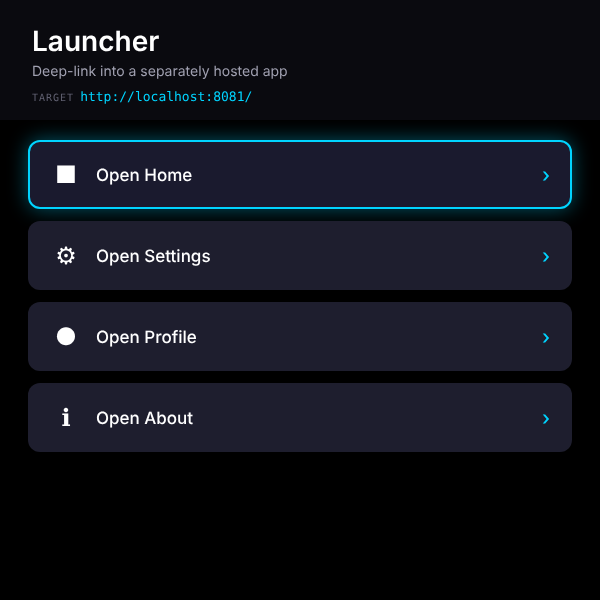
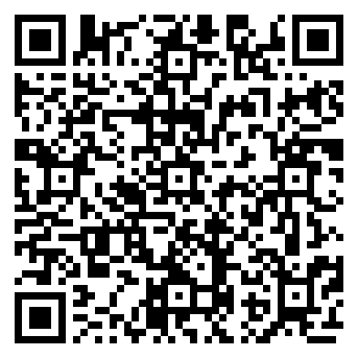

# Deep Link Launcher

One half of a two-app pair that demonstrates cross-app navigation on the Meta Ray-Ban Display glasses. This app is the **source**: four D-pad buttons each launch into a separately hosted **target** app by navigating to `<target>?screen=<name>`. The pair shares no code and talks only through URL params and `document.referrer`.

> ▶ [Try it in the simulator](https://displayglasses.dev/?url=https%3A%2F%2Frbm-demos.lnr.io%2Fdeep-link-launcher%2F&pos=center&size=60&bright=100&bg=hiking&bg-dark=10) · 👓 [Add it to your glasses](#add-to-your-glasses)

> ✅ **Status: Working.** Each button is a real browser navigation to `<target>?screen=<name>`; the default target is `http://localhost:8081/`, so on the glasses open the hosted launcher once with `?target=https://rbm-demos.lnr.io/deep-link-target/` to point it at the hosted target.

Pair: [`deep-link-target/`](../deep-link-target/)

---

## What it does

- **Four launch buttons.** Open Home, Open Settings, Open Profile, Open About. Each one navigates the glasses browser to `<target>?screen=<home|settings|profile|about>`; the target reads the `screen` param and renders the matching view.
- **Configurable target.** The default target URL is `http://localhost:8081/`, stored in `localStorage['deeplink:target']`. Pass `?target=https://my-target.example/` once to override it; the override is persisted and the query is stripped from the URL with `history.replaceState`.
- **Target readout.** The header shows the current target URL so you can confirm where the hop will land.
- **Offline.** A network-first service worker (`sw.js`) precaches the app so it opens without a connection.
- **Vanilla and static.** A single `index.html` with inline CSS and JS. No build, no server runtime; any static host works (Vercel, GitHub Pages, a file server).

---

## Controls

| Where | Input | Result |
| --- | --- | --- |
| Launcher | ▼ or ▶ | Focus the next button (wraps) |
| Launcher | ▲ or ◀ | Focus the previous button (wraps) |
| Launcher | Enter | Open the focused screen in the target app |

The first button is focused on load. The app does not handle the Back gesture itself; the browser's own back navigation returns here from the target.

---

## Screenshots

| Launcher |
| --- |
|  |

---

## Add to your glasses

Scan this with your phone to open the Meta AI app and add the demo to your Ray-Ban Meta Display glasses:



Or add it by hand in the Meta AI app: **Devices → Display Glasses settings → App connections → Web apps → Add a web app**, with the name `Launcher` and this URL:

```
https://rbm-demos.lnr.io/deep-link-launcher/
```

## Running locally

Both apps must run on different ports so the cross-origin hop is real. The ports below match the launcher's default target (`http://localhost:8081/`), so no override is needed.

```bash
npx serve -l 8080 deep-link-launcher
npx serve -l 8081 deep-link-target
# then open http://localhost:8080
```

Open `http://localhost:8080` in Chrome at 600×600 and drive it with the arrow keys and Enter. To point the launcher at a target hosted elsewhere, open it once as `http://localhost:8080/?target=https://my-target.example/`.

### Regenerating screenshots

> 🛠️ **Developer tooling only.** The app itself has zero Chrome dependency — it's vanilla HTML/CSS/JS that runs in the Ray-Ban Meta Display's built-in browser. The block below is just the local recipe used on a Mac to refresh the PNGs in `screenshots/`.

The app has a single screen and no `?state=` routing, so one plain capture is enough:

```bash
npx serve -l 8080 deep-link-launcher &
CHROME="/Applications/Google Chrome.app/Contents/MacOS/Google Chrome"
"$CHROME" --headless --disable-gpu --hide-scrollbars \
  --window-size=600,600 --virtual-time-budget=2000 \
  --screenshot="deep-link-launcher/screenshots/preview.png" \
  "http://localhost:8080/"
```

---

## Notes

- The pair communicates only via URL params and `document.referrer`; there is no shared code.
- The target override is read on first load only, then persisted. Clear `localStorage['deeplink:target']` to go back to the default.

---

## Files

```
deep-link-launcher/
├── index.html      # header + four launch buttons, inline CSS/JS, D-pad focus, service-worker registration
├── sw.js           # network-first service worker
├── favicon.png     # app icon
└── screenshots/    # preview.png used by this README and the top-level index
```

---

<sub>Made by L+R at [L+R](https://www.levinriegner.com).</sub>
