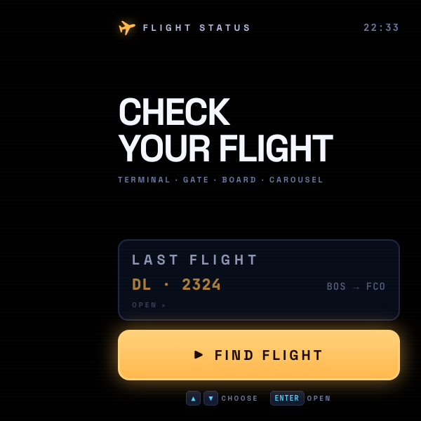
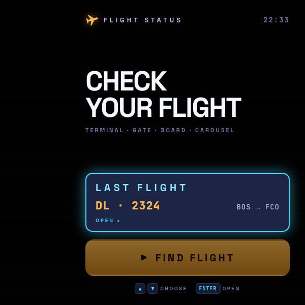
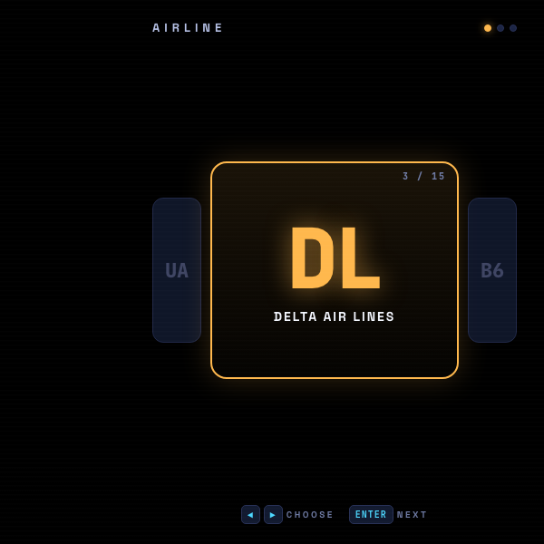
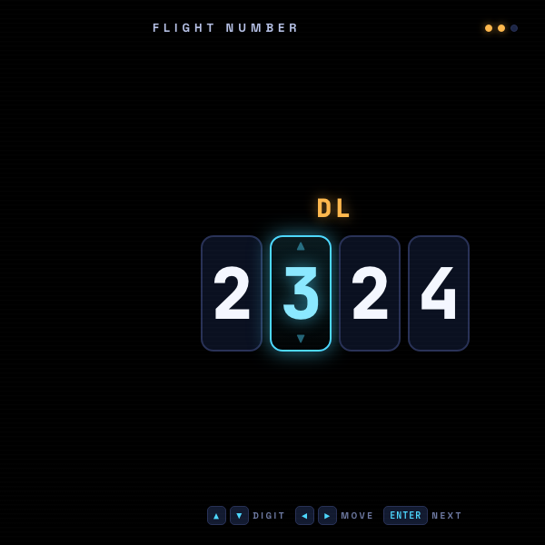
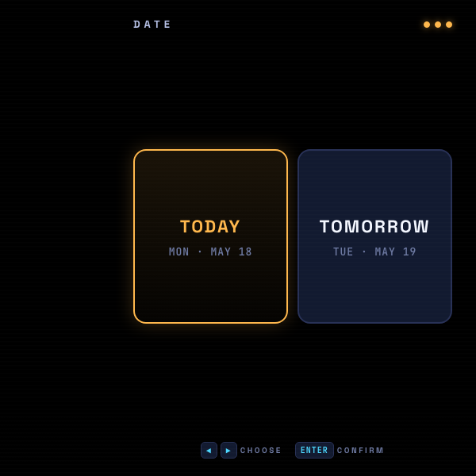
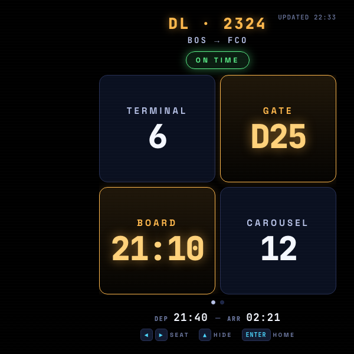
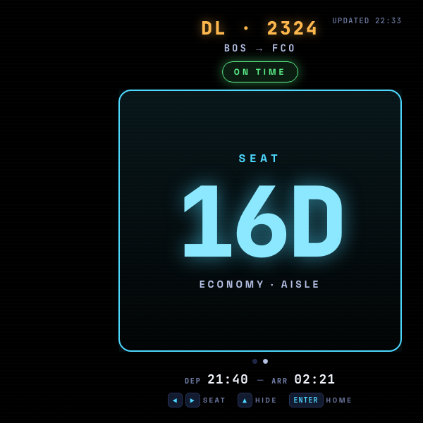
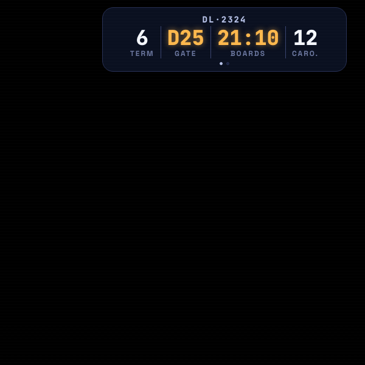
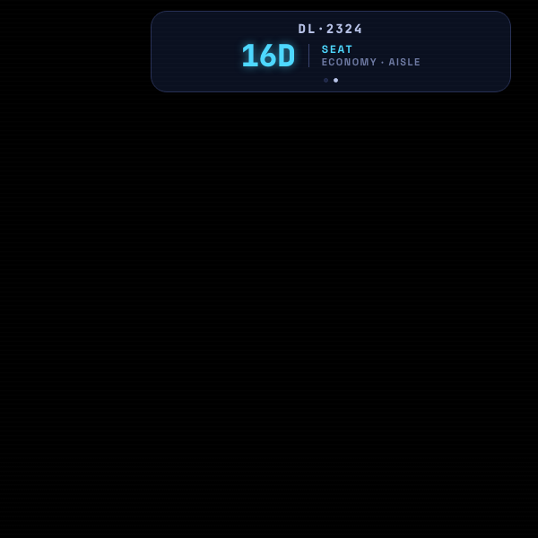

# Flight Status

A heads-up display for Meta Display glasses that surfaces the four things you actually need at the airport — **terminal, gate, boarding time, carousel** — plus your seat. Pick a flight without typing a single character, and keep the information glanceable while you walk.

> 📖 **Case study:** [levinriegner.com/work/flight-status](https://www.levinriegner.com/work/flight-status/)

> ▶ [Try it in the simulator](https://displayglasses.dev/?url=https%3A%2F%2Frbm-demos.lnr.io%2Fflight-status%2F&pos=center&size=60&bright=100&bg=hiking&bg-dark=10) · 👓 [Add it to your glasses](#add-to-your-glasses)

> 🧪 **Status: Concept.** The interface and D-pad flow are real; every status value (route, terminal, gate, boarding time, carousel, seat, DEP/ARR and the ON TIME / DELAYED / BOARDING badge) is produced by a seeded random generator in `app.js`, not fetched from any airline or flight-data service. See [Making it real](#making-it-real).

---

## What it does

- **Type-free flight lookup.** Pick airline from a carousel of 15 carriers (AA, UA, DL, B6, …), set a 4-digit flight number with a wheel picker, pick today or tomorrow — all with ◀ ▶ ▲ ▼ and Enter.
- **Persistent status display.** Three swipeable views — **MAIN** (TERMINAL · GATE · BOARD with gate + boarding time emphasized in amber), **SEAT** (big cyan seat code with class + window/aisle role), and **CAROUSEL** (big amber baggage-claim number). Status badge (ON TIME / DELAYED / BOARDING) and DEP/ARR times stay anchored at top and bottom.
- **Compact mode.** Swipe up to collapse into a single pinned strip at the top of the lens — same three sub-views, all the same height so the strip doesn't jump when you cycle. Swipe down to expand again.
- **Last-flight memory.** The home screen remembers the most recent flight you checked; press ▲ + Enter to re-open it instantly with no wizard.

All mock data is deterministic — the same airline + flight + date hash always renders the same terminal / gate / board / carousel / seat / status, so the demo behaves predictably.

> ℹ️ For a production build, the [aviationstack API](https://aviationstack.com/) can be plugged in to swap the deterministic mock for real-time data — it covers airline / flight / terminal / gate / scheduled + estimated times. It was left out of this demo to keep it self-contained and to avoid the API-key dependency.

---

## Controls

| Where | Input | Result |
| --- | --- | --- |
| Home | ▲ | Focus LAST FLIGHT card |
| Home | ▼ | Focus FIND FLIGHT button |
| Home | Enter | Open focused option |
| Airline picker | ◀ ▶ | Cycle through carriers |
| Airline picker | Enter | Next step |
| Flight number | ▲ ▼ | Change selected digit (0–9, wraps) |
| Flight number | ◀ ▶ | Move between digits |
| Flight number | Enter | Next step |
| Date | ◀ ▶ | Today / Tomorrow |
| Date | Enter | Show status |
| Status (full) | ◀ ▶ | Cycle main → seat → carousel |
| Status (full) | ▲ | Collapse to compact |
| Status (full) | ▼ | Back to home |
| Status (full) | Enter | Refresh — re-roll the mock data, stay on the current view |
| Status (compact) | ◀ ▶ | Cycle compact main → seat → carousel |
| Status (compact) | ▼ or Enter | Expand current view |
| Airline picker | Back gesture (thumb + middle finger) | Back to home |
| Flight number | Back gesture (thumb + middle finger) | Back to airline picker |
| Date | Back gesture (thumb + middle finger) | Back to flight number |
| Status | Back gesture (thumb + middle finger) | Back to home |

Touch swipes mirror the arrow keys on the status screen (left/right toggles view; up collapses, down expands).

---

## Screenshots

### Home

| Default focus on FIND FLIGHT | ▲ to focus LAST FLIGHT |
| --- | --- |
|  |  |

### Pick-a-flight wizard

| Airline carousel | 4-digit flight number | Date |
| --- | --- | --- |
|  |  |  |

### Status display

| Full · main (TERMINAL / GATE / BOARD) | Full · seat | Full · carousel |
| --- | --- | --- |
|  |  |  |

### Compact mode (swipe-up)

| Compact · main | Compact · seat | Compact · carousel |
| --- | --- | --- |
|  |  |  |

---

## Making it real

**What's real today:**
- The whole type-free wizard: the 15-carrier airline carousel, the 4-digit wheel picker and the today / tomorrow date tiles.
- The status screen itself: the three MAIN / SEAT / CAROUSEL views, the swipe-up compact strip, the refresh flash and the Back gesture at every step.
- Last-flight memory in `localStorage` (`mdg_flight_status_v1`), restored from the home screen without re-running the wizard.
- The clock in the header, which reads the wall clock and only ticks while the page is visible.
- Offline use through the network-first service worker.

**What's simulated:**
- `buildStatus()` in `app.js` hashes `airline + flight number + date` into a seed for a small PRNG and rolls origin, destination, terminal, gate, boarding time, DEP / ARR, carousel number, status badge, seat and cabin class from that seed. Nothing is looked up anywhere.
- Enter on the full status screen ("Refresh") bumps `refreshCount` and re-rolls the same generator; it is not a re-fetch.
- The `UPDATED hh:mm` stamp on the status screen is the current wall-clock time, not the time any data was received.
- The seat and cabin class are invented; no booking is consulted.

**How to make it real:**
- Replace `buildStatus()` with a `fetch` to a flight-status API keyed by IATA airline code, flight number and date, for example [aviationstack](https://aviationstack.com/) (`/v1/flights?flight_iata=DL2324&flight_date=YYYY-MM-DD`), AeroDataBox or FlightAware AeroAPI. These return origin / destination, terminal, gate, scheduled and estimated times and a status, which maps directly onto the MAIN view and the badge.
- Those APIs need a key, so do not call them from the page. Put the key behind a small proxy (a Vercel or Cloudflare function at `/api/flight`) and have the app call that. The service worker already skips `/api/` requests, so responses are never served stale from cache.
- Keep the last successful response in `localStorage` with its fetched-at time, show that time in the `UPDATED` stamp, and fall back to it (clearly marked as cached) when the proxy is unreachable.
- Make Refresh a real re-fetch and, if live updates are wanted, poll on a modest interval that starts and stops with `visibilitychange`, the same way the clock does now.
- Baggage carousel and seat are not in general flight-status feeds. Carousel data is airport-specific and often unavailable; the honest option is to hide the CAROUSEL view when the API has no value. Seat and cabin class come from the booking, not the flight, so either let the wearer enter them once (a row wheel plus a letter picker, or the glasses' text composer) or drop the SEAT view.
- Effort: medium for terminal / gate / times / status through a proxy; small to persist and surface the fetched-at time; large to source seat and carousel for real.

---

## Add to your glasses

Scan this with your phone to open the Meta AI app and add the demo to your Ray-Ban Meta Display glasses:


Or add it by hand in the Meta AI app: **Devices → Display Glasses settings → App connections → Web apps → Add a web app**, with the name `Flight Status` and this URL:

```
https://rbm-demos.lnr.io/flight-status/
```

## Running locally

The app is a single static HTML/CSS/JS bundle — no build step.

```bash
npx serve -l 4214 flight-status
# then open http://localhost:4214
```

For development inside the meta-display-glasses-webapps workspace it's also wired into `.claude/launch.json` as the `flight-status` preview target on port **4214**.

### Regenerating screenshots

> 🛠️ **Developer tooling only.** The app itself has zero Chrome dependency — it's vanilla HTML/CSS/JS that runs in the Ray-Ban Meta Display's built-in browser. The block below is just the local recipe used on a Mac to refresh the PNGs in `screenshots/`.

The screenshots above are produced from headless Chrome against the `?state=…` URL parameter the app reads on load:

```bash
npx serve -l 4314 flight-status &
CHROME="/Applications/Google Chrome.app/Contents/MacOS/Google Chrome"
for STATE in home-find home-last airline number date \
             status-main status-seat status-carousel \
             compact-main compact-seat compact-carousel; do
  "$CHROME" --headless --disable-gpu --hide-scrollbars \
    --window-size=600,600 --virtual-time-budget=3000 \
    --screenshot="flight-status/screenshots/$STATE.png" \
    "http://localhost:4314/?state=$STATE"
done
```

---

## Files

```
flight-status/
├── index.html      # screens + compact strip + status views
├── styles.css      # 600×600 right-aligned HUD; navy + amber + cyan
├── app.js          # state machine, deterministic mock data, swipe handling
├── favicon.png     # black "FL" on amber
└── screenshots/    # generated state captures used by this README
```

---

<sub>Made by Alex Levin at [L+R](https://www.levinriegner.com).</sub>
