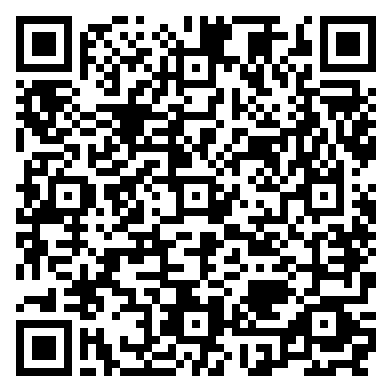

# Glasses API Test

A one-screen test harness for the browser APIs a web app can reach on the Meta Ray-Ban Display glasses: microphone, camera, location, motion sensors and WebMCP. Each API is a row with a PASS / FAIL / LIVE badge and a line of raw readings, so a developer can confirm in a few pinches which capabilities the device actually exposes before building on them.

> ▶ [Try it in the simulator](https://displayglasses.dev/?url=https%3A%2F%2Frbm-demos.lnr.io%2Fglasses-api-test%2F&pos=center&size=60&bright=100&bg=hiking&bg-dark=10) · 👓 [Add it to your glasses](#add-to-your-glasses)

---

## What it does

- **01 MICROPHONE.** Requests `getUserMedia({ audio })`, records 3 seconds with `MediaRecorder`, shows a live level meter, then reports the recorded size, peak RMS, sample rate, channel count and device label.
- **02 CAMERA.** Opens the rear (`environment`) camera, waits 400 ms for exposure, grabs one frame onto a canvas as JPEG and shows the snapshot with its resolution, approximate size and device label. The stream is released immediately after the capture.
- **03 LOCATION.** Calls `navigator.geolocation.getCurrentPosition` with high accuracy and a 10 s timeout, then prints latitude, longitude, accuracy radius and altitude.
- **04 DEVICE SENSORS.** Attaches `devicemotion` and `deviceorientation` listeners (behind `requestPermission()` where the browser requires it) and streams acceleration and alpha / beta / gamma angles as a LIVE readout. If no event arrives within 3 s the row is marked FAIL. Enter on a running row stops it.
- **05 WEBMCP.** Checks whether `document.modelContext` exists and reports the types of `registerTool` and `getTools`. It does not register any tools.
- **Audible feedback.** Short Web Audio beeps for navigate, run, stop, pass, fail and live, so results are noticeable without reading the lens.
- **Lifecycle.** Hiding the page stops an in-flight microphone or camera capture, pauses the sensor readout (re-armed on return) and suspends the audio context.
- **Offline.** A network-first service worker precaches the page so the harness loads without a connection.

---

## Controls

| Where | Input | Result |
| --- | --- | --- |
| Row list | ▲ ▼ | Move focus between the five rows (wraps) |
| Row list | Enter | Run the focused test; on a LIVE sensor row, stop it |
| Row list | Back gesture (thumb + middle finger) | Stop the focused test (microphone, camera or sensors) and reset its row to IDLE |

◀ ▶ are not used. Location and WebMCP are one-shot checks with nothing to stop.

---

## Screenshots

| Preview |
| --- |
|  |

No `?state=` routing; the single capture is the default view.

---

## Add to your glasses

Scan this with your phone to open the Meta AI app and add the demo to your Ray-Ban Meta Display glasses:



Or add it by hand in the Meta AI app: **Devices → Display Glasses settings → App connections → Web apps → Add a web app**, with the name `Glasses API Test` and this URL:

```
https://rbm-demos.lnr.io/glasses-api-test/
```

---

## Running locally

The app is a single static HTML file with inline CSS and JS — no build step.

```bash
npx serve -l 3001 glasses-api-test
# then open http://localhost:3001
```

Microphone, camera and location prompts need a secure context; `localhost` counts.

### Regenerating screenshots

> 🛠️ **Developer tooling only.** The app itself has zero Chrome dependency — it's vanilla HTML/CSS/JS that runs in the Ray-Ban Meta Display's built-in browser. The block below is just the local recipe used on a Mac to refresh the PNGs in `screenshots/`.

```bash
npx serve -l 3001 glasses-api-test &
CHROME="/Applications/Google Chrome.app/Contents/MacOS/Google Chrome"
mkdir -p glasses-api-test/screenshots
"$CHROME" --headless --disable-gpu --hide-scrollbars \
  --window-size=600,600 --virtual-time-budget=2000 \
  --screenshot="glasses-api-test/screenshots/preview.png" \
  "http://localhost:3001/"
```

---

## Files

```
glasses-api-test/
├── index.html      # five API rows, inline styles, test runners, beeps, service-worker registration
├── sw.js           # network-first service worker
├── favicon.png     # app icon
└── screenshots/    # preview.png
```

---

<sub>Made by L+R at [L+R](https://www.levinriegner.com).</sub>
