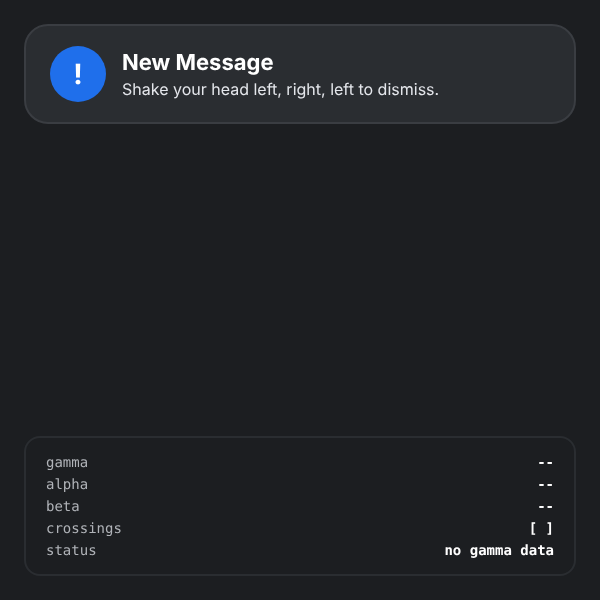
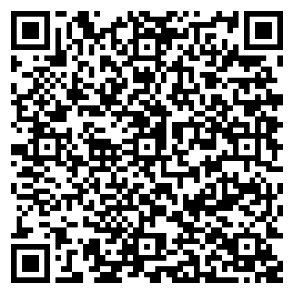

# Head Gesture Prototype

A small experiment in using the head as an input on the Meta Ray-Ban Display glasses. A notification card sits on the lens; shaking your head left, right, left within one second dismisses it. A debug panel shows the live orientation angles and the detected zone crossings, so a developer can tune thresholds and see why a gesture did or did not register.

> ▶ [Try it in the simulator](https://displayglasses.dev/?url=https%3A%2F%2Frbm-demos.lnr.io%2Fhead-gesture-prototype%2F&pos=center&size=60&bright=100&bg=hiking&bg-dark=10) · 👓 [Add it to your glasses](#add-to-your-glasses)

> ✅ **Status: Working.** The shake detector runs on real `deviceorientation` events from the glasses with no network; `server.js` is only a local static server, and the ◀ ▶ ▼ keys are a labeled simulation for desktops without a sensor.

---

## What it does

- **Shake-to-dismiss.** Reads `deviceorientation.gamma` and classifies the head into three zones: left (below −15°), right (above +15°) and center (within ±8°). Each left/right entry is a crossing; the pattern `L R L` completed within 1000 ms dismisses the notification.
- **Hysteresis.** The release band (±8°) is narrower than the trigger band (±15°), so small wobbles near the threshold do not produce repeated crossings. Consecutive crossings in the same direction are ignored.
- **Debug panel.** Live gamma / alpha / beta values, the current crossing buffer (`[L R]`) and a status line (`awaiting permission`, `listening`, `shake detected`, `no gamma data`). The panel flashes blue when a shake is detected.
- **Dismissed state.** After a shake the card animates out and a `Show again` button takes focus, so the loop can be repeated.
- **Permission gate.** On browsers that require `DeviceOrientationEvent.requestPermission()` an `Enable sensors` button appears; elsewhere listening starts on load.
- **Keyboard simulation.** ◀ ▶ ▼ feed synthetic left / right / center zones into the same detector, so the gesture logic can be exercised without a sensor.
- **Lifecycle.** The orientation listener is removed while the page is hidden and re-added (same function reference) when it is visible again; the zone resets to center so a stale crossing is not carried across.

---

## Controls

| Where | Input | Result |
| --- | --- | --- |
| Notification | Head shake (left, right, left within 1 s) | Dismiss the notification |
| Notification | ◀ | Simulate a left head zone (adds an `L` crossing) |
| Notification | ▶ | Simulate a right head zone (adds an `R` crossing) |
| Notification | ▼ | Simulate returning to center |
| Dismissed | Enter (on `Show again`) | Bring the notification back and clear the crossings |
| Permission gate | Enter (on `Enable sensors`) | Request orientation access and start listening |

▲ is not used, and there is no back-gesture handling; the page is a single screen.

---

## Screenshots

| Preview |
| --- |
|  |

No `?state=` routing; the single capture is the default view.

---

## Add to your glasses

Scan this with your phone to open the Meta AI app and add the demo to your Ray-Ban Meta Display glasses:



Or add it by hand in the Meta AI app: **Devices → Display Glasses settings → App connections → Web apps → Add a web app**, with the name `Head Gesture Prototype` and this URL:

```
https://rbm-demos.lnr.io/head-gesture-prototype/
```

---

## Running locally

The folder ships a tiny Node static server (`server.js`) wired to `npm start`. It serves the folder as-is; there is no build step.

```bash
cd head-gesture-prototype
npm start
# then open http://localhost:3000
```

`PORT` overrides the port (`PORT=3006 npm start`). `npx serve -l 3006 head-gesture-prototype` works just as well. The `vercel.json` describes the same static deployment for Vercel; `.vercel/` is git-ignored.

### Regenerating screenshots

> 🛠️ **Developer tooling only.** The app itself has zero Chrome dependency — it's vanilla HTML/CSS/JS that runs in the Ray-Ban Meta Display's built-in browser. The block below is just the local recipe used on a Mac to refresh the PNGs in `screenshots/`.

```bash
npx serve -l 3006 head-gesture-prototype &
CHROME="/Applications/Google Chrome.app/Contents/MacOS/Google Chrome"
mkdir -p head-gesture-prototype/screenshots
"$CHROME" --headless --disable-gpu --hide-scrollbars \
  --window-size=600,600 --virtual-time-budget=2000 \
  --screenshot="head-gesture-prototype/screenshots/preview.png" \
  "http://localhost:3006/"
```

---

## Files

```
head-gesture-prototype/
├── index.html      # notification card, dismissed state, debug panel, service-worker registration
├── styles.css      # 600×600 frame scaled to the viewport, card and panel styling
├── app.js          # gamma zone classifier, L-R-L pattern detector, permission gate, key simulation
├── server.js       # minimal Node static server (npm start)
├── package.json    # start script only, no dependencies
├── vercel.json     # static deployment config
├── sw.js           # network-first service worker
├── favicon.png     # app icon
└── screenshots/    # preview.png
```

---

<sub>Made by the team at [L+R](https://www.levinriegner.com).</sub>
