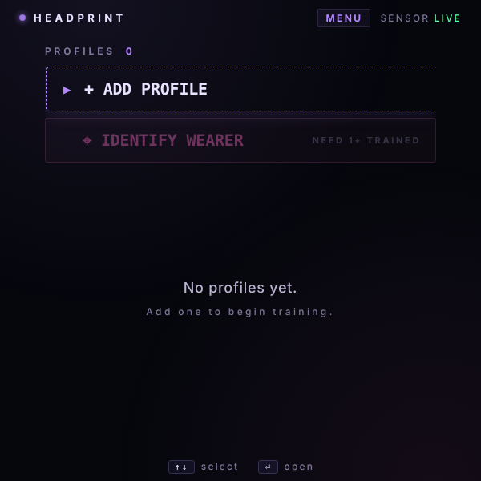
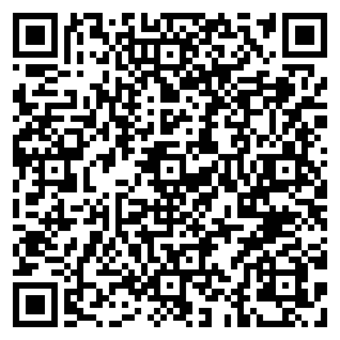

# HEADPRINT · Biometric Wearer ID

A proof of concept for recognizing who is wearing the Meta Ray-Ban Display glasses from how their head moves. The wearer trains a profile by performing four short head gestures three times; later, one pass through the same gestures is compared against every stored profile and the app names the closest match with a confidence score. It is a sketch of on-device, sensor-only identification, not a security feature.

> ▶ [Try it in the simulator](https://displayglasses.dev/?url=https%3A%2F%2Frbm-demos.lnr.io%2Fheadprint%2F&pos=center&size=60&bright=100&bg=hiking&bg-dark=10) · 👓 [Add it to your glasses](#add-to-your-glasses)

> ✅ **Status: Working.** Training and identification run on real `devicemotion` / `deviceorientation` samples from the glasses, with the feature extraction and 1-NN matching done on-device and profiles persisted in localStorage; it is a research sketch, not a security feature, but nothing in it is mocked.

---

## What it does

- **Profiles with callsigns.** `+ ADD PROFILE` picks a random two-word callsign (`STEADY-FOX-42`); ▲ ▼ reroll it, Enter accepts and goes straight into training. Profiles persist in `localStorage` (`headprint_profiles_v1`).
- **Four gestures per rep.** NOD, SHAKE, TILT and STILL, each with a 3-2-1 countdown and a 3 s recording window sampled every 30 ms from `devicemotion` and `deviceorientation`. Gestures chain automatically; a training session is 3 reps.
- **Feature extraction.** Each window is reduced to spread statistics per axis (standard deviation, range, mean absolute deviation of acceleration; standard deviation and range of orientation) plus energy and axis-ratio composites. Absolute heading is discarded so the result does not depend on where the wearer is facing.
- **Identification.** `⌖ IDENTIFY WEARER` (enabled once at least one profile is trained) records a single rep, normalizes every feature across all stored reps, takes the nearest rep per profile (1-NN) and turns the distances into percentages with a softmax. The top profile is RECOGNIZED only when it scores above 50% and leads the runner-up by at least 12 points; otherwise the result is UNKNOWN WEARER. The top four candidates are listed with their percentages.
- **Per-profile actions.** Enter on a profile opens an overlay with TRAIN MORE (adds three more reps), DELETE (with a confirm step) and CLOSE.
- **Sensor status.** The top-right pill reads LIVE once motion events arrive, WAIT… while attaching, and KEYS when no sensor data showed up within 1.5 s. Browsers that require `DeviceMotionEvent.requestPermission()` get a GRANT overlay first.
- **Audio cues.** Web Audio beeps for navigation, countdown ticks, capture, enrolled, recognized and unknown.
- **Lifecycle.** Hiding the page removes the sensor listeners and stops every capture timer; on return the listeners are re-added without re-prompting and an interrupted countdown or recording restarts for the same gesture.

---

## Controls

| Where | Input | Result |
| --- | --- | --- |
| Menu | ▲ ▼ | Move between profiles, `+ ADD PROFILE` and `⌖ IDENTIFY WEARER` (disabled rows are skipped) |
| Menu | Enter | Open the profile overlay, start naming, or start identification |
| Menu | Back gesture (thumb + middle finger) | Nothing — the menu is the root screen |
| Naming | ▲ ▼ | Reroll the callsign |
| Naming | Enter | Accept the callsign and begin training |
| Naming | ◀ or Back gesture (thumb + middle finger) | Cancel and return to the menu |
| Capture | Enter (on `PRESS ⏎ TO START`) | Start the countdown for the first gesture; the rest chain automatically |
| Capture | Head movement | NOD, SHAKE, TILT or hold STILL during the 3 s recording window |
| Capture | Back gesture (thumb + middle finger) | Abort the session and return to the menu (already-saved reps are kept) |
| Result | Enter or Back gesture (thumb + middle finger) | Return to the menu |
| Profile overlay | ▲ ▼ | Move between TRAIN MORE, DELETE and CLOSE |
| Profile overlay | Enter | Run the focused action |
| Profile overlay | ◀ or Back gesture (thumb + middle finger) | Close the overlay |
| Delete confirm | ▲ ▼ ◀ ▶ | Move between CANCEL and DELETE |
| Delete confirm | Enter | Run the focused action |
| Delete confirm | Back gesture (thumb + middle finger) | Cancel |
| Permission overlay | Enter | Grant motion access and continue |
| Permission overlay | Back gesture (thumb + middle finger) | Dismiss without granting; the pending action is dropped |

---

## Screenshots

| Preview |
| --- |
|  |

No `?state=` routing; the single capture is the default view.

---

## Add to your glasses

Scan this with your phone to open the Meta AI app and add the demo to your Ray-Ban Meta Display glasses:



Or add it by hand in the Meta AI app: **Devices → Display Glasses settings → App connections → Web apps → Add a web app**, with the name `HEADPRINT · Biometric Wearer ID` and this URL:

```
https://rbm-demos.lnr.io/headprint/
```

---

## Running locally

The app is a single static HTML/CSS/JS bundle — no build step.

```bash
npx serve -l 3002 headprint
# then open http://localhost:3002
```

On a desktop without motion sensors the pill reads KEYS and recordings capture flat zeros, so every profile looks alike; the flow can still be walked through. Clear the `headprint_profiles_v1` key in `localStorage` to reset the profile list.

### Regenerating screenshots

> 🛠️ **Developer tooling only.** The app itself has zero Chrome dependency — it's vanilla HTML/CSS/JS that runs in the Ray-Ban Meta Display's built-in browser. The block below is just the local recipe used on a Mac to refresh the PNGs in `screenshots/`.

```bash
npx serve -l 3002 headprint &
CHROME="/Applications/Google Chrome.app/Contents/MacOS/Google Chrome"
mkdir -p headprint/screenshots
"$CHROME" --headless --disable-gpu --hide-scrollbars \
  --window-size=600,600 --virtual-time-budget=2000 \
  --screenshot="headprint/screenshots/preview.png" \
  "http://localhost:3002/"
```

---

## Files

```
headprint/
├── index.html      # menu, naming, capture, result screens and the three overlays
├── styles.css      # 600×600 layout, pills, progress meter, overlays
├── app.js          # profiles + localStorage, sensor capture, feature extraction, 1-NN matching, key dispatch
├── sw.js           # network-first service worker
├── favicon.png     # app icon
└── screenshots/    # preview.png
```

---

<sub>Made by L+R at [L+R](https://www.levinriegner.com).</sub>
