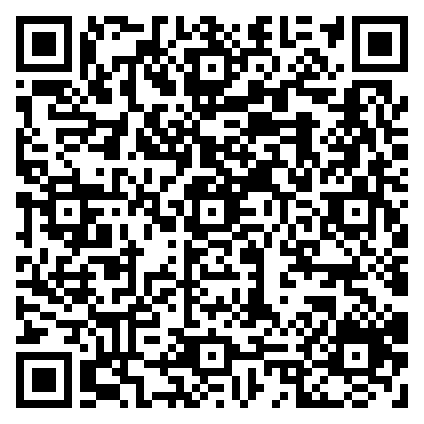

# KAIROS — Calendar HUD

A glanceable calendar for the Meta Ray-Ban Display glasses. The home view is an ambient dashboard — clock, today's event count, the next event, free hours and tomorrow's first item — with a drill-down into an agenda list, a per-event detail page and a week grid. All data is a built-in mock week, so the demo shows how a calendar feels on the lens without connecting an account.

> ▶ [Try it in the simulator](https://displayglasses.dev/?url=https%3A%2F%2Frbm-demos.lnr.io%2Fkairos-calendar-hud%2F&pos=center&size=60&bright=100&bg=hiking&bg-dark=10) · 👓 [Add it to your glasses](#add-to-your-glasses)

> 🧪 **Status: Concept.** The interface and D-pad flow are real; the events are a hard-coded mock week in `calendar-data.js`, not a connected calendar account. See [Making it real](#making-it-real).

---

## What it does

- **Ambient screen.** Four corner zones (TODAY count, NEXT event, FREE hours, TOMORROW), a large clock and date in the center, and a NOW / NEXT / FREE card that shows the running event's time remaining or the countdown to the next one. The NEXT zone shimmers when the event is within 15 minutes. Each zone is focusable and jumps to the matching view.
- **Agenda.** TODAY / TOMORROW / WEEK filter chips over a list of events with type-colored bars, start and end times, location, attendee count, duration, and NOW / SOON / DONE badges. The WEEK filter groups events under day separators.
- **Event detail.** Long-form time range, duration, title, location, a countdown line, an IMMINENCE heat bar that fills as the start approaches (within 4 hours), tags, description and attendee dots. PREV / NEXT step through every event in the dataset.
- **Week.** A Sunday-to-Saturday grid with up to four colored dots per day, a preview list for the selected day, PREV / NEXT week and OPEN DAY, which opens that day in the agenda.
- **Focus memory.** Every screen push records which control opened it, so the back gesture returns focus to that control even after the list re-renders.
- **Ambient particles.** One drifting particle per event today, sized and glowing by imminence, drawn on a canvas behind the dashboard.
- **Lifecycle.** The particle loop and the 10 s clock refresh are stopped while the page is hidden and restarted (with an immediate clock catch-up) when it is visible.
- **Mock data.** `calendar-data.js` holds 13 events across the week of 20–24 April 2026 (meetings, tasks, a break, a personal offsite). Free hours are computed against an 8-hour day.

---

## Controls

| Where | Input | Result |
| --- | --- | --- |
| Any screen | ▼ or ▶ | Move focus to the next control (wraps) |
| Any screen | ▲ or ◀ | Move focus to the previous control (wraps) |
| Any screen | Enter | Activate the focused control |
| Any screen | Back gesture (thumb + middle finger) | Go back one screen and restore focus to the control that opened it |
| Ambient | Enter (on TODAY or FREE) | Open the agenda for today |
| Ambient | Enter (on NEXT or the NOW card) | Open the current or next event's detail |
| Ambient | Enter (on TOMORROW) | Open the agenda for tomorrow |
| Ambient | Enter (on AGENDA / WEEK) | Open that view |
| Agenda | Enter (on a filter chip) | Switch between TODAY, TOMORROW and WEEK |
| Agenda | Enter (on an event) | Open its detail |
| Detail | Enter (on ← PREV / NEXT →) | Step to the previous or next event |
| Week | Enter (on a day) | Select that day and show its preview |
| Week | Enter (on ← PREV / NEXT →) | Move a week back or forward |
| Week | Enter (on OPEN DAY) | Open the selected day in the agenda |

Focus moves through controls in document order, so ◀ ▶ and ▲ ▼ are interchangeable.

---

## Screenshots

| Preview |
| --- |
|  |

No `?state=` routing; the single capture is the default ambient view.

---

## Making it real

**What's real today:**
- All four screens (ambient, agenda, detail, week), the D-pad navigation and the focus memory on back.
- The clock, the NOW / NEXT / FREE card, the SOON / DONE badges, the countdowns and the imminence bar: all computed from the device clock against each event's start and end time.
- The particle canvas, the 10 s clock refresh and the pause / resume lifecycle.

**What's simulated:**
- `CALENDAR_DATA` in `calendar-data.js`: 13 hard-coded events for 20–24 April 2026 stand in for the wearer's calendar. Nothing is fetched and nothing is written back.
- Because the dates are fixed, TODAY and TOMORROW are empty on any other day; the week view has to be paged back to April 2026 to see events.

**How to make it real:**
- Replace `CALENDAR_DATA` with a fetch of the next 7 days from a real source: Google Calendar (`events.list` with `timeMin` / `timeMax`), Microsoft Graph (`/me/calendarView`), or a private ICS feed parsed in the browser. Map the response into the existing `{ id, title, type, date, startTime, endTime, location, attendeeCount }` shape so the renderers do not change.
- Pick a sign-in path that works without a keyboard. Simplest: the wearer pastes a private ICS URL once through the text composer and the app stores it in `localStorage`. Cleaner: a small serverless proxy (for example a Vercel function) holds the OAuth refresh token and serves the app a JSON window, with the device paired by a short code typed on the phone.
- Cache the fetched window in `localStorage` so the ambient screen paints instantly and offline; refresh on `visibilitychange` → visible and every few minutes while visible, and stop polling when hidden.
- Optionally register WebMCP tools (`calendar_next_event`, `calendar_open_day`) so Meta AI can answer "what's next?" from the same data.
- Effort: small for a read-only ICS feed; medium for Google or Microsoft OAuth through a proxy; large for write-back (accept, decline, create).

---

## Add to your glasses

Scan this with your phone to open the Meta AI app and add the demo to your Ray-Ban Meta Display glasses:



Or add it by hand in the Meta AI app: **Devices → Display Glasses settings → App connections → Web apps → Add a web app**, with the name `KAIROS — Calendar HUD` and this URL:

```
https://rbm-demos.lnr.io/kairos-calendar-hud/
```

---

## Running locally

The app is a single static HTML/CSS/JS bundle — no build step.

```bash
npx serve -l 3003 kairos-calendar-hud
# then open http://localhost:3003
```

The mock events are dated 20–24 April 2026. On any other date the TODAY and TOMORROW views are empty; use WEEK with ← PREV / NEXT → to reach that week, or edit the dates in `calendar-data.js`.

### Regenerating screenshots

> 🛠️ **Developer tooling only.** The app itself has zero Chrome dependency — it's vanilla HTML/CSS/JS that runs in the Ray-Ban Meta Display's built-in browser. The block below is just the local recipe used on a Mac to refresh the PNGs in `screenshots/`.

```bash
npx serve -l 3003 kairos-calendar-hud &
CHROME="/Applications/Google Chrome.app/Contents/MacOS/Google Chrome"
mkdir -p kairos-calendar-hud/screenshots
"$CHROME" --headless --disable-gpu --hide-scrollbars \
  --window-size=600,600 --virtual-time-budget=2000 \
  --screenshot="kairos-calendar-hud/screenshots/preview.png" \
  "http://localhost:3003/"
```

---

## Files

```
kairos-calendar-hud/
├── index.html          # ambient, agenda, detail and week screens; service-worker registration
├── styles.css          # 600×600 HUD, zones, event rows, heat bar, week grid
├── app.js              # navigation history + focus memory, renderers, particle canvas, clock, key handling
├── calendar-data.js    # mock events for the week of 20–24 April 2026
├── sw.js               # network-first service worker
├── favicon.png         # app icon
└── screenshots/        # preview.png
```

---

<sub>Made by L+R at [L+R](https://www.levinriegner.com).</sub>
