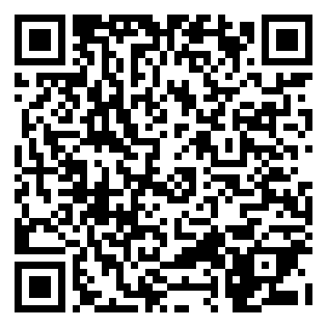

# Key Logger

A developer's input visualizer for the Meta Ray-Ban Display glasses. Every D-pad direction and pinch is shown as a large glyph in the center of the lens with a colored ripple, a particle burst and a synthesized note, so you can see exactly which event the glasses delivered, whether it arrived as a double or triple tap, and how long Enter was held. Useful for checking the gesture-to-key mapping on a new firmware or in the simulator.

> ▶ [Try it in the simulator](https://displayglasses.dev/?url=https%3A%2F%2Frbm-demos.lnr.io%2Fkey-logger%2F&pos=center&size=60&bright=100&bg=hiking&bg-dark=10) · 👓 [Add it to your glasses](#add-to-your-glasses)

> ✅ **Status: Working.** Everything runs on the glasses with no network: the glyphs, canvas effects and Web Audio synth respond to the real key events the glasses deliver.

---

## What it does

- **One glyph per key.** ↑ ↓ ← → ⏎ each have their own hue and musical note (G5, E4, A4, D5, C4). The glyph punches in with a short scale animation and fades back to an idle `arrows · enter` label after 2.2 s.
- **Tap chains.** Repeated presses of the same key within 380 ms are counted; the label reads DOUBLE, TRIPLE or ×n, the chord gains notes, the ripples stack and the frame tints.
- **Enter hold.** Pinch-and-hold shows `▼ HOLDING` with a breathing ring and a sustained filtered-sawtooth pad. Releasing fires an ascending arpeggio whose length scales with the hold time, plus a burst that grows with how long you held.
- **Directional particles.** Arrow presses throw particles in that direction; Enter throws them in every direction. Everything is drawn on a 2× backing canvas with trail fade and a soft vignette.
- **Auto-repeat ignored.** Held arrow keys do not spam; only the first `keydown` counts.
- **Lifecycle.** Hiding the page stops the render loop, releases a held Enter so the pad cannot keep sounding, and suspends the audio context. The loop restarts on return and audio resumes on the next key.
- **Offline.** A network-first service worker precaches the page.

---

## Controls

| Where | Input | Result |
| --- | --- | --- |
| Anywhere | ▲ ▼ ◀ ▶ | Show the glyph, ripple and note for that direction; repeat quickly for DOUBLE / TRIPLE |
| Anywhere | Enter (tap) | Show ⏎ with an inward ring; quick repeats count as DOUBLE / TRIPLE |
| Anywhere | Enter (hold, then release) | `▼ HOLDING` with a growing glow, then an arpeggio and burst sized by the hold duration |

There is no back-gesture handling; the page is a single screen. The hold effect depends on the glasses delivering a key-up when the pinch is released.

---

## Screenshots

| Preview |
| --- |
|  |

No `?state=` routing; the single capture is the default view.

---

## Add to your glasses

Scan this with your phone to open the Meta AI app and add the demo to your Ray-Ban Meta Display glasses:



Or add it by hand in the Meta AI app: **Devices → Display Glasses settings → App connections → Web apps → Add a web app**, with the name `Key Logger` and this URL:

```
https://rbm-demos.lnr.io/key-logger/
```

---

## Running locally

The app is a single static HTML file with inline CSS and JS — no build step.

```bash
npx serve -l 3004 key-logger
# then open http://localhost:3004
```

Use the arrow keys and Enter; audio starts on the first key press.

### Regenerating screenshots

> 🛠️ **Developer tooling only.** The app itself has zero Chrome dependency — it's vanilla HTML/CSS/JS that runs in the Ray-Ban Meta Display's built-in browser. The block below is just the local recipe used on a Mac to refresh the PNGs in `screenshots/`.

```bash
npx serve -l 3004 key-logger &
CHROME="/Applications/Google Chrome.app/Contents/MacOS/Google Chrome"
mkdir -p key-logger/screenshots
"$CHROME" --headless --disable-gpu --hide-scrollbars \
  --window-size=600,600 --virtual-time-budget=2000 \
  --screenshot="key-logger/screenshots/preview.png" \
  "http://localhost:3004/"
```

---

## Files

```
key-logger/
├── index.html      # inline styles, canvas effects, Web Audio synth, key handling, service-worker registration
├── sw.js           # network-first service worker
├── favicon.png     # app icon
└── screenshots/    # preview.png
```

---

<sub>Made by L+R at [L+R](https://www.levinriegner.com).</sub>
