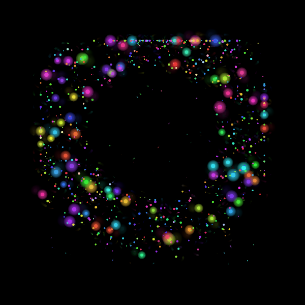
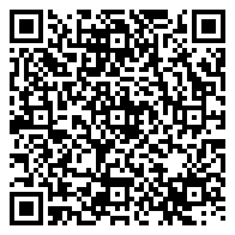

# L+R · HUD

The L+R studio portfolio reworked as a heads-up display for the Meta Ray-Ban Display glasses. After a short particle intro that assembles the L+R wordmark, the wearer browses selected work, the six service practices, studio background (story, news, clients, awards) and a contact card, all with the D-pad. It is a brand piece: typewriter text, particle effects and a small Web Audio synth respond to every move.

> ▶ [Try it in the simulator](https://displayglasses.dev/?url=https%3A%2F%2Frbm-demos.lnr.io%2Flevinriegner%2F&pos=center&size=60&bright=100&bg=hiking&bg-dark=10) · 👓 [Add it to your glasses](#add-to-your-glasses)

> ✅ **Status: Working.** Everything runs from the bundled `data.js`, the canvases and the Web Audio synth; the only network dependency is the project cover images, which load from L+R's web CDN and are hidden when they fail.

---

## What it does

- **Intro.** About 8 s of rainbow particles that scatter, converge into the L+R letterforms, hold in white, then burst while `Levin+Riegner` and `STRATEGY + AESTHETICS` type in. Audio cues mark each phase. The intro cannot be skipped.
- **Home.** A drifting particle-network canvas behind the wordmark, a one-line descriptor and four buttons: Work, Services, About, Contact.
- **Work.** Nine projects from `data.js` (Printemps New York, Media View, Meta Spatial SDK, Spireworks, Global Citizen, Louis Vuitton VR, Footprint Center, OceanX, Cakewalk) with ALL / SPATIAL / BRAND / PRODUCT filters matched on tags and category.
- **Project detail.** Cover image, a HIGHLIGHT stat, description and hashtags, with NEXT → cycling through the filtered list. Images load from L+R's web CDN and are hidden if they fail.
- **Services.** A two-column grid of six practices; each detail page lists capabilities and up to three related projects, with a CONTACT US action.
- **About.** STORY (founded 2012, regions, recognition), NEWS (eight dated items), CLIENTS (enterprise and startup chips) and AWARDS tabs, plus a SEE WORK shortcut.
- **Contact.** An overlay card with `hello@levinriegner.com` and the five regions.
- **Effects.** Every screen change blooms particles from the center and types its headings; buttons get their own burst shape and sound. The synth and particle canvases are built in, with no external assets.
- **Lifecycle.** When the page is hidden the intro, home canvas, FX loop, typewriter timers and audio context all pause; typing settles to full text so nothing is left half-written. All resume on return.

---

## Controls

| Where | Input | Result |
| --- | --- | --- |
| Home | ▲ ▼ | Move between Work, Services, About and Contact (wraps) |
| Home | Enter | Open the focused section |
| Work | ▲ ▼ | Move between projects |
| Work | ◀ ▶ | Cycle the ALL / SPATIAL / BRAND / PRODUCT filter |
| Work | Enter | Open the focused project |
| Project detail | ▶ or ▼ | Next project in the filtered list |
| Project detail | ◀ or ▲ | Previous project |
| Project detail | Enter | Next project |
| Services | ◀ ▶ | Move one tile across the grid |
| Services | ▲ ▼ | Move one row (two tiles) up or down |
| Services | Enter | Open the focused service |
| Service detail | Enter | Open the contact card |
| About | ◀ ▶ | Switch between STORY, NEWS, CLIENTS and AWARDS |
| About | Enter | Jump to Work |
| Contact card | Back gesture (thumb + middle finger) | Dismiss the card |
| Any screen | Back gesture (thumb + middle finger) | Return to the previous screen (nothing on Home) |

---

## Screenshots

| Preview |
| --- |
|  |

No `?state=` routing; the single capture is the home screen after the intro.

---

## Add to your glasses

Scan this with your phone to open the Meta AI app and add the demo to your Ray-Ban Meta Display glasses:



Or add it by hand in the Meta AI app: **Devices → Display Glasses settings → App connections → Web apps → Add a web app**, with the name `L+R · HUD` and this URL:

```
https://rbm-demos.lnr.io/levinriegner/
```

---

## Running locally

The app is a single static HTML/CSS/JS bundle — no build step.

```bash
npx serve -l 3005 levinriegner
# then open http://localhost:3005
```

Project cover images are fetched from `web-cdn-prod.levinriegner.com`, so project detail pages need a connection the first time; everything else runs offline.

### Regenerating screenshots

> 🛠️ **Developer tooling only.** The app itself has zero Chrome dependency — it's vanilla HTML/CSS/JS that runs in the Ray-Ban Meta Display's built-in browser. The block below is just the local recipe used on a Mac to refresh the PNGs in `screenshots/`.

The intro runs for about 8.3 s, so the virtual-time budget has to outlast it:

```bash
npx serve -l 3005 levinriegner &
CHROME="/Applications/Google Chrome.app/Contents/MacOS/Google Chrome"
mkdir -p levinriegner/screenshots
"$CHROME" --headless --disable-gpu --hide-scrollbars \
  --window-size=600,600 --virtual-time-budget=12000 \
  --screenshot="levinriegner/screenshots/preview.png" \
  "http://localhost:3005/"
```

---

## Files

```
levinriegner/
├── index.html      # intro + FX canvases, home, work, project, services, service, about screens, contact overlay
├── styles.css      # 600×600 HUD, green/amber/cyan accents, typewriter cursor, tiles and chips
├── app.js          # routing + history, renderers, typewriter, intro animation, FX particles, FX_AUDIO synth, key handling
├── data.js         # LR_DATA: work, news, services, clients, awards, regions
├── sw.js           # network-first service worker
├── favicon.png     # app icon
└── screenshots/    # preview.png
```

---

<sub>Made by the team at [L+R](https://www.levinriegner.com).</sub>
