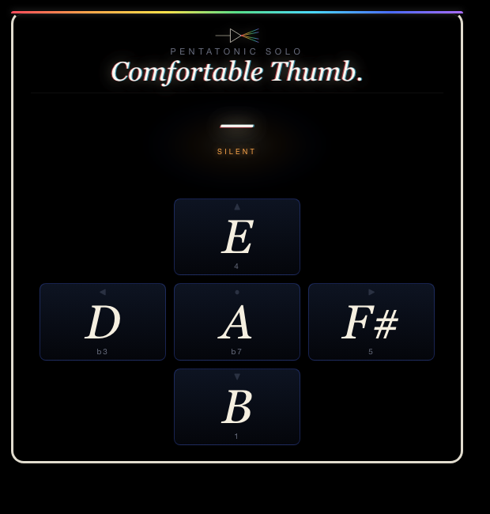
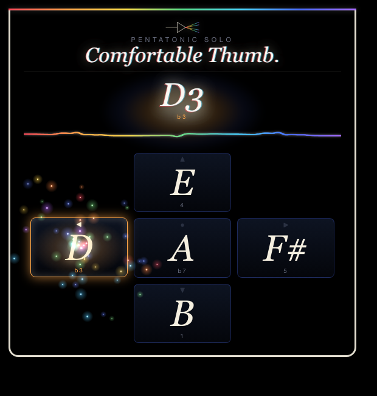

# Comfortable Thumb.

A thumb-controlled pentatonic solo synth for the Meta Ray-Ban Display glasses. Locked to **B minor pentatonic** — the key David Gilmour solos in on *Comfortably Numb* — so every press is in-scale. Tap a key, the note rings out for ~3.5 seconds; tap a new key and the previous note fades.

---

## What it does

- **Five notes on five inputs.** The four D-pad directions and Enter map to B, D, E, F# and A. Hold does not matter — each press auto-rings; a new press quick-fades the previous note (mono voice).
- **Gilmour-ish synth.** Web Audio API: sawtooth + slightly detuned square per voice, a lowpass with a wah-style attack sweep, soft saturation and a 430 ms tape-delay loop with feedback.
- **Prism visuals.** The pressed pad bursts 36 rainbow particles on a full-screen canvas and trickles sparkles while the note rings. The scope shows a thin white line at rest and a thick red-to-violet waveform while playing. The note readout shows pitch and scale degree (e.g. `D3`, `b3`).
- **Lifecycle-clean.** When the page is hidden the voice is silenced, the audio graph is suspended (delay tail included) and both canvas loops stop; they resume on return. Losing window focus also silences the note.
- **Play-along sheet.** The Notes section below has the full *Comfortably Numb* vocal lines and both guitar solos written as scale notes, plus a backing track link.

---

## Controls

| Where | Input | Result |
| --- | --- | --- |
| Anywhere | ▼ | Play **B** (root, degree 1) |
| Anywhere | ◀ | Play **D** (b3) |
| Anywhere | ▲ | Play **E** (4) |
| Anywhere | ▶ | Play **F#** (5) |
| Anywhere | Enter | Play **A** (b7, highest) |

Hold doesn't matter — each press auto-rings for a few seconds. A new press quick-fades the previous note. The app is a single screen, so the Back gesture is left to the system.

---

## Screenshots

| Idle (`/`) | Playing (`?demo=left`) |
| --- | --- |
|  |  |
| Black void, white straight scope line. | Chromatic note readout, thick rainbow waveform, prism particles bursting from the active pad. |

---

## Running locally

The app is a single static HTML/CSS/JS bundle — no build step.

```bash
npx serve -l 4222 pentatonic-solo
# then open http://localhost:4222
```

Add `?demo=down` (or `left`, `up`, `right`, `enter`) to the URL to auto-play a note 600 ms after load — handy for screenshots.

### Regenerating screenshots

> 🛠️ **Developer tooling only.** The app itself has zero Chrome dependency — it's vanilla HTML/CSS/JS that runs in the Ray-Ban Meta Display's built-in browser. The block below is just the local recipe used on a Mac to refresh the PNGs in `screenshots/`.

The app reads a `?demo=<slot>` parameter instead of `?state=`; the idle shot is a plain load:

```bash
npx serve -l 4222 pentatonic-solo &
CHROME="/Applications/Google Chrome.app/Contents/MacOS/Google Chrome"
"$CHROME" --headless --disable-gpu --hide-scrollbars \
  --window-size=600,600 --virtual-time-budget=1500 \
  --screenshot="pentatonic-solo/screenshots/idle.png" \
  "http://localhost:4222/"
"$CHROME" --headless --disable-gpu --hide-scrollbars \
  --window-size=600,600 --virtual-time-budget=2500 \
  --autoplay-policy=no-user-gesture-required \
  --screenshot="pentatonic-solo/screenshots/playing.png" \
  "http://localhost:4222/?demo=left"
```

---

## Notes

### Play along

Backing track (Comfortably Numb without the guitar) — opens on YouTube:

<a href="https://www.youtube.com/watch?v=wec4h8koJ1Q&list=RDwec4h8koJ1Q" target="_blank" rel="noopener noreferrer">
  
</a>

Press play, then follow the notes below. Each parenthesized group is the notes for the preceding syllables. Notes are written as their letter names — match them to the inputs in the Controls table above.

#### Verse 1 (Roger Waters)

Hel-lo (B — B)

Is there (B — B) an-y-bod-y (A — A — B — A) in there? (F# — F#)

Just nod (B — B) if you can (A — A — B) hear me (A — F#)

Is there (B — B) an-y-one (A — A — B) at home? (A — F# — F#)

Come on (B — B) now (A)

I hear (B — B) you're feel-ing (A — A — B) down (A — F#)

Well I (B — B) can ease (A — A) your pain (F# — F#)

And get you (B — B — B) on your feet (A — A — B) a-gain (A — F# — F#)

Re-lax (B — B)

I'll need some (B — B — B) in-for-ma-tion (A — A — A — A) first (F# — F#)

Just the (B — B) ba-sic facts (A — A — F#)

Can you (B — B) show me (A — A) where it hurts? (F# — F# — F#)

#### Chorus 1 (David Gilmour)

There is (A — A) no pain (F# — F#) you are (E — D) re-ced-ing (E — F# — D)

A dis-tant (A — A — F#) ship smoke (F# — E) on the (D — D) ho-ri-zon (E — F# — D)

You are (A — A) on-ly (A — F#) com-ing (F# — E) through in (D — D) waves (E — F#)

Your lips (D — D) move (D) but I (D — D) can't hear (B — B) what you're (A — A) say-ing (F# — F#)

When I (D — D) was a (D — D) child I (B — B) had a (A — A) fe-ver (F# — F#)

My hands (D — D) felt just (D — D) like two (B — B) bal-loons (A — F# — F#)

Now I've (D — D) got that (D — D) feel-ing (B — B) once a-gain (A — A — F# — F#)

I can't (D — D) ex-plain (D — D) you would (B — B) not un-der-stand (A — A — F# — F# — E)

This is (D — D) not how (D — D) I am (B — A)

I (F#) have (F#) be-come (F# — F#) com-fort-a-bly (F# — F# — E — D) numb (D)

#### First Guitar Solo (pentatonic adjusted)

- **Phrase 1:** D — F# — A
- **Phrase 2:** F# — E — D — E — F#
- **Phrase 3:** A — F# — E — D — A
- **Phrase 4:** A — D — E — F# — A — B — A
- **Phrase 5:** F# — A — B — A
- **Phrase 6:** F# — E — D
- **Phrase 7:** E — F# — E — D — B — A
- **Phrase 8:** A — D — E — F# — A — B — A
- **Phrase 9:** D — B — A — F# — E — D — D

#### Verse 2 (Roger Waters)

O.K. (B — B)

Just a (B — B) lit-tle pin (A — A — B) prick (A — F# — F#)

There'll be no (B — B — B) more a-a-a-a-ah! (A — A — F# — F# — E — D)

But you (B — B) may feel a (A — A — A) lit-tle sick (F# — F# — F#)

Can you (B — B) stand up? (A — A — F# — F#)

I do (B — B) be-lieve it's (A — A — A) work-ing, good (F# — F# — F#)

That'll keep you (B — B — B — B) go-ing through (A — A — A) the show (F# — F#)

Come on (B — B) it's time (A — A) to go (F# — F#)

#### Chorus 2 (David Gilmour)

There is (A — A) no pain (F# — F#) you are (E — D) re-ced-ing (E — F# — D)

A dis-tant (A — A — F#) ship smoke (F# — E) on the (D — D) ho-ri-zon (E — F# — D)

You are (A — A) on-ly (A — F#) com-ing (F# — E) through in (D — D) waves (E — F#)

Your lips (D — D) move (D) but I (D — D) can't hear (B — B) what you're (A — A) say-ing (F# — F#)

When I (D — D) was a (D — D) child (B)

I caught (A — A) a fleet-ing (F# — F# — F#) glimpse (E — D)

Out of (D — D) the cor-ner (D — D — B) of my (A) eye (F# — F#)

I turned (D — D) to look (D — D) but it (B — B) was gone (A — A — F# — F#)

I can-not (D — D — D) put my (B — B) fin-ger (A — A) on it (F# — F#) now (E — D)

The child (D — D) is grown (D — D)

The dream (B — B) is gone (A — F# — F#)

I (F#) have (F#) be-come (F# — F#) com-fort-a-bly (F# — F# — E — D) numb (D)

#### Second Guitar Solo / Outro (pentatonic adjusted)

Bends are noted but the synth doesn't pitch-bend — play the target note instead.

- **Phrase 1:** B (bend to D) — A — F#
- **Phrase 2:** D — E (bend to F#) — E — D — B
- **Phrase 3:** B — D — E — F# — A — B
- **Phrase 4:** B (bend to D) — B — A — F#
- **Phrase 5:** F# — A — B (bend to D) — B — A
- **Phrase 6:** B — D — E (bend to F#) — E — D — B
- **Phrase 7:** B — A — F# — E — D — B — A — F# — E — D — B
- **Phrase 8:** D — E — F# — A — B (bend to D) — B — A
- **Phrase 9:** F# — A — B (bend to D) — B (bend to D) — B (bend to D)
- **Phrase 10:** F# — A — B — D — E — F# — A — B
- **Phrase 11:** B (bend to D) — A — F# — E — D — B
- **Phrase 12:** D — E (bend to F#) — E — D — B

### Under the hood

- **Synth:** Web Audio API. Each note is a sawtooth + slightly detuned square through a per-voice lowpass with a wah-ish attack sweep (700→2400→1100 Hz), into a soft-saturation waveshaper and a 430 ms tape-delay loop with feedback for Gilmour space.
- **Visuals:** A full-screen canvas with `mix-blend-mode: screen` bursts 36 rainbow particles from the pressed pad and trickles sparkles while the note rings. The scope shows a thin white line at rest and a thick red→violet waveform when ringing.
- **Stack:** Vanilla HTML/CSS/JS, no dependencies. Built for the Ray-Ban Meta Display 600×600 viewport.

---

## Files

```
pentatonic-solo/
├── index.html      # header prism, stage + scope, 5-pad layout, service-worker registration
├── styles.css      # black void, spotlight stage, pad grid, ringing states
├── app.js          # Web Audio synth, particle + scope loops, key mapping, ?demo= helper
├── sw.js           # network-first service worker
├── favicon.png     # app icon
└── screenshots/    # idle.png, playing.png
```

---

<sub>Made by L+R at [L+R](https://www.levinriegner.com).</sub>
