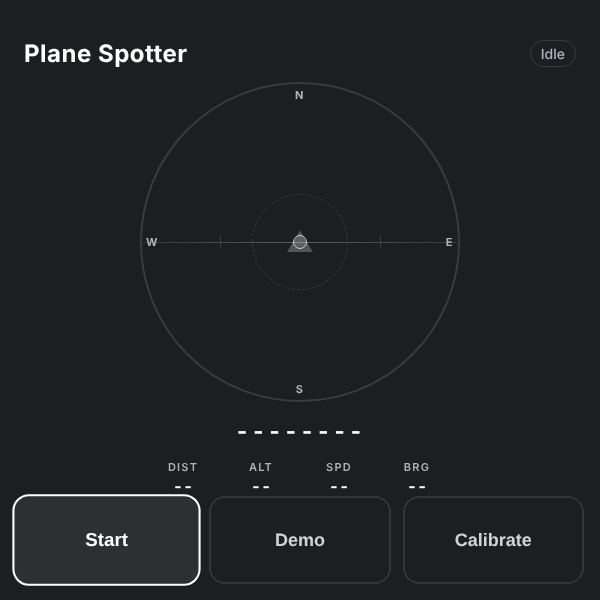

# Plane Spotter

A Meta Ray-Ban Display glasses webapp that points at the nearest aircraft. It uses OpenSky Network for state vectors, geolocation for the wearer's position, and `DeviceOrientationEvent` for head tracking. The marker rotates and translates in real time so the wearer can turn their head and see the bracket "lock" when they are looking at the plane.

> ▶ [Try it in the simulator](https://displayglasses.dev/?url=https%3A%2F%2Frbm-demos.lnr.io%2Fplane-spotter%2F&pos=center&size=60&bright=100&bg=hiking&bg-dark=10) · 👓 [Add it to your glasses](#add-to-your-glasses)

> 🔌 **Status: Working with live data.** Aircraft positions come from the OpenSky Network through the app's own Node proxy (`server.js`, OAuth2 client credentials in `.env`); the sensors and HUD math run on the glasses, but a plain static host has no `/api/aircraft`, so there the status reads Net err, and without credentials the proxy serves only a synthetic demo plane.

Web-based, vanilla JS on the client, with a small Node proxy for the OpenSky API.

---

## What it does

- **HUD scope.** A circular field-of-view view (±60°) with N/E/S/W ticks, a crosshair and a horizon line that rolls with head tilt. The nearest aircraft is a ▲ glyph at its true angular position; outside the FOV it pins to the rim as a ➤ arrow pointing toward the target. Within 8° the scope and marker switch to the on-target state.
- **Readouts.** Callsign (or ICAO24), distance, altitude, speed and bearing, refreshed every 15 s from `/api/aircraft` within a 50 km radius.
- **Start / Stop.** Start requests orientation permission where the platform asks for it, opens a geolocation watch and attaches the orientation listener; Stop tears all of it down. Status in the header reads Idle, Locating, Live, Demo, Demo*, No planes, GPS err, Net err, Denied.
- **Demo mode.** Toggles synthetic aircraft from the server (`?demo=1`); with no GPS fix it falls back to a San Francisco position so the scope works on a laptop.
- **Calibrate.** Captures the current yaw and pitch as zero offsets — useful on devices where `alpha` is not true-north absolute.
- **Lifecycle-clean.** While the page is hidden the orientation listener, GPS watch and poll interval are dropped and re-armed on return; permission is never re-requested. `watchPosition` always has a matching `clearWatch`.

---

## Controls

| Where | Input | Result |
| --- | --- | --- |
| Home | ▶ or ▼ | Move focus to the next button (Start / Stop → Demo → Calibrate, wrapping) |
| Home | ◀ or ▲ | Move focus to the previous button |
| Home | Enter (on Start) | Request sensor permission where needed, then start locating and polling |
| Home | Enter (on Stop) | Stop sensors, polling and clear the readouts |
| Home | Enter (on Demo) | Toggle synthetic demo aircraft on / off |
| Home | Enter (on Calibrate) | Zero the yaw / pitch offsets at the current head pose |
| Running | Back gesture (thumb + middle finger) | Stop (same as the Stop button) |
| Running | Head turn / tilt (`deviceorientation`) | Marker tracks the aircraft; horizon rolls with tilt; bracket locks within 8° |
| Running | Location (`geolocation` watch) | Updates the wearer's position used for distance, bearing and elevation |

On a desktop without `DeviceOrientationEvent` the readouts and marker show real aircraft data, but the head-relative direction is fixed.

---

## Screenshots

| HUD |
| --- |
|  |

---

## Add to your glasses

Scan this with your phone to open the Meta AI app and add the demo to your Ray-Ban Meta Display glasses:


Or add it by hand in the Meta AI app: **Devices → Display Glasses settings → App connections → Web apps → Add a web app**, with the name `Plane Spotter` and this URL:

```
https://rbm-demos.lnr.io/plane-spotter/
```

## Running locally

This app has a Node server (`server.js`) that proxies OpenSky, so it is run with `npm start` rather than a plain static server.

### Prerequisites

- **Node.js 18+** — `node --version`
- **An OpenSky Network OAuth2 client** — free, see "Get OpenSky credentials" below
- **`cloudflared`** — only if you want to load the webapp on a phone or the glasses (see "Run on a phone or glasses" in Notes)
  ```bash
  brew install cloudflared
  ```

### Get OpenSky credentials

The free anonymous OpenSky endpoint is severely rate-limited and effectively unusable. You need an OAuth2 client.

1. Create a free account at https://opensky-network.org
2. Account → API Client → create a new client
3. Copy the `clientId` and `clientSecret`

### Setup

From this directory:

```bash
cat > .env <<EOF
OPENSKY_CLIENT_ID=your-client-id
OPENSKY_CLIENT_SECRET=your-client-secret
EOF
```

`.env` is gitignored. Without it the app still runs but only returns synthetic demo planes.

### Run

```bash
npm start
# then open http://localhost:3000
```

Use the arrow keys to move focus and Enter on **Start**. For full pitch/yaw response you need a device with `DeviceOrientationEvent` (a phone or the glasses).

### Regenerating screenshots

> 🛠️ **Developer tooling only.** The app itself has zero Chrome dependency — it's vanilla HTML/CSS/JS that runs in the Ray-Ban Meta Display's built-in browser. The block below is just the local recipe used on a Mac to refresh the PNGs in `screenshots/`.

The app has no `?state=` routing; a single capture of the idle HUD is enough:

```bash
npm start &
CHROME="/Applications/Google Chrome.app/Contents/MacOS/Google Chrome"
"$CHROME" --headless --disable-gpu --hide-scrollbars \
  --window-size=600,600 --virtual-time-budget=2000 \
  --screenshot="plane-spotter/screenshots/preview.png" \
  "http://localhost:3000/"
```

---

## Notes

### Run on a phone or glasses (Cloudflare Tunnel)

The phone can't reach `localhost`, and the glasses won't load anything that isn't HTTPS. A Cloudflare quick tunnel exposes the local server over HTTPS without signup, DNS, or port forwarding:

```bash
npm run tunnel              # default port 3000
PORT=3030 npm run tunnel    # override if 3000 is busy
```

`scripts/tunnel.js` spawns `node server.js` and `cloudflared tunnel --url http://localhost:<PORT>`, then prints:

```
=========================================================
  Open on phone : https://<random>.trycloudflare.com
=========================================================
[plane-spotter] QR saved to /…/qr-tunnel.png (scan with phone camera to open in Safari/Chrome)
```

Open the URL on your phone, or scan `qr-tunnel.png`. The URL is also saved to `.tunnel-url`. `Ctrl-C` stops both child processes together.

Caveats:

- **The tunnel URL is publicly reachable.** Anyone who learns it can hit `/api/aircraft` (uses your OpenSky quota) and `/`. Trycloudflare URLs are random per session but they're not a security boundary. Run `/passcode-for-testing` first if you want a 3-digit gate.
- **The URL changes every run.** For a stable URL, register a free Cloudflare account and use a named tunnel (`cloudflared tunnel create`, `cloudflared tunnel route dns`).
- **You must keep `npm run tunnel` running.** Closing the terminal or sleeping the laptop drops the tunnel.

### How it works

```
Browser (phone or glasses)
   │  geolocation, deviceorientation
   │  GET /api/aircraft?lat&lon&radius
   ▼
server.js  ──── OAuth2 client_credentials ────► OpenSky Network
   │
   └─ via Cloudflare Tunnel for HTTPS access from phone/glasses
```

`lib/opensky.js` (shared by `server.js` and `api/aircraft.js`):

- OAuth2 token cache (refreshes 30s before expiry)
- Bbox derivation from radius (lat/lon delta)
- Haversine distance, great-circle bearing, atan2 elevation
- 10s in-memory response cache (per bbox)
- Demo aircraft generator (synthetic plane circling the user) when `?demo=1` or when OpenSky errors

Client-side, on every `deviceorientation` event the HUD scope projects the target onto a circular FOV view:

```
yaw       = webkitCompassHeading ?? (360 - alpha)   // 0 = North
pitch     = beta                                     // 0 looking at horizon
roll      = gamma                                    // head tilt
yawDiff   = normalize_180(aircraft.bearing - yaw)    // negative = left of gaze
pitchDiff = aircraft.elevation - pitch               // positive = above gaze
x_screen  = (yawDiff   / FOV) * scope_radius
y_screen  = (-pitchDiff / FOV) * scope_radius
on_target = sqrt(yawDiff² + pitchDiff²) < 8°
```

When the target is inside FOV (default ±60°) the plane glyph (▲) sits at its true angular position — yaw → x, pitch → y. Outside FOV the glyph pins to the rim and switches to a directional arrow (➤) pointing toward the target. A horizon line uses `gamma` (roll) to give the scope spatial reference.

`Calibrate` captures current yaw/pitch as zero offsets — useful on devices where `alpha` isn't true-north absolute.

### Endpoints

- `GET /` — webapp
- `GET /api/aircraft?lat=<deg>&lon=<deg>&radius=<km>&demo=<0|1>` — up to 20 nearest aircraft, each enriched with `distance` (m), `bearing` (deg from North), `elevation` (deg above horizontal)

`source` in the response: `opensky` (live), `opensky-cache` (within 10s TTL), `demo` (`demo=1` requested), `demo-fallback` (live failed; `error` field has details).

### Vercel deployment (optional, demo data only)

The Vercel scaffolding is left in place but not currently deployed. It serves the static webapp fine, but **`/api/aircraft` cannot return live data from Vercel** — OpenSky firewalls Vercel's serverless egress IP ranges at the TCP layer. A `/api/diag` endpoint deployed in both `iad1` and `fra1` confirmed:

| Target | Result |
|---|---|
| `api.github.com` | 200 in 115ms |
| `1.1.1.1` | 404 in 70ms |
| `opensky-network.org` | `UND_ERR_CONNECT_TIMEOUT` at 6s |
| `auth.opensky-network.org` | `UND_ERR_CONNECT_TIMEOUT` at 6s |

Authentication doesn't help — the TCP connection itself never opens. Same on iad1 and fra1. Vercel reaches GitHub and Cloudflare fine, so it's not a Vercel egress issue; it's an OpenSky-side ASN block. To get live data on a remote host you have to call OpenSky from a network OpenSky doesn't block (your laptop, a $5 VM, Fly/Railway/Render).

If you want to (re)deploy the demo build to Vercel:

```bash
vercel --prod
vercel env add OPENSKY_CLIENT_ID production
vercel env add OPENSKY_CLIENT_SECRET production
vercel alias set <deploy-url> <your-name>.vercel.app
```

The `error` field of the API response will surface the OpenSky failure so you can tell live data from demo:

```json
{ "source": "demo-fallback", "error": "OpenSky auth: fetch failed / cause=UND_ERR_CONNECT_TIMEOUT", ... }
```

### Tear-down

To stop everything cleanly:

- **Local server / tunnel** — Ctrl-C in the terminal running `npm start` or `npm run tunnel`. Both `server.js` and `cloudflared` exit together.
- **Generated artifacts** — `rm .tunnel-url qr-tunnel.png`
- **Vercel project** (if you deployed) — `printf 'y\n' | vercel project rm <project-name>` then `rm -rf .vercel`. Releases the alias and deletes deployments + env vars.
- **OpenSky credentials** — revoke at https://opensky-network.org → Account → API Client if you want to invalidate them. Otherwise just delete `.env`.

---

## Files

```
plane-spotter/
├── index.html          # 600×600 HUD: scope, callsign, readouts, Start / Demo / Calibrate, service-worker registration
├── styles.css          # dark UI, scope ring, marker + on-target states
├── app.js              # D-pad nav, geolocation + orientation, HUD scope rendering, polling, lifecycle
├── sw.js               # network-first service worker (never caches /api/)
├── favicon.png         # app icon
├── server.js           # local Node HTTP server with .env auto-loader
├── lib/opensky.js      # OAuth2 + OpenSky proxy + math, shared by server.js and api/aircraft.js
├── api/aircraft.js     # optional Vercel serverless wrapper around lib/opensky.js
├── scripts/tunnel.js   # spawns node server.js + cloudflared tunnel, generates qr-tunnel.png
├── package.json        # npm start / npm run tunnel
├── vercel.json         # Vercel config — framework: null, function timeout 25s
├── .gitignore          # .env, tunnel artifacts
├── .vercelignore       # excludes server.js and .env from Vercel uploads
└── screenshots/        # preview.png
```

`.env` (OpenSky credentials) is created locally and gitignored.

---

<sub>Made by the team at [L+R](https://www.levinriegner.com).</sub>
