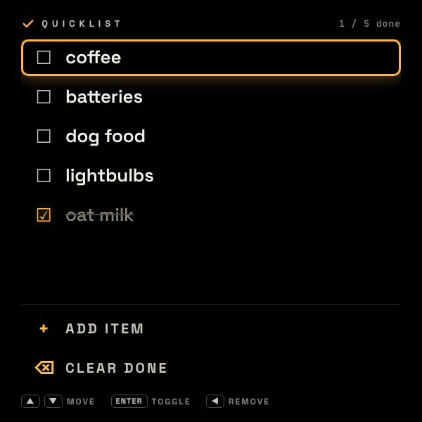
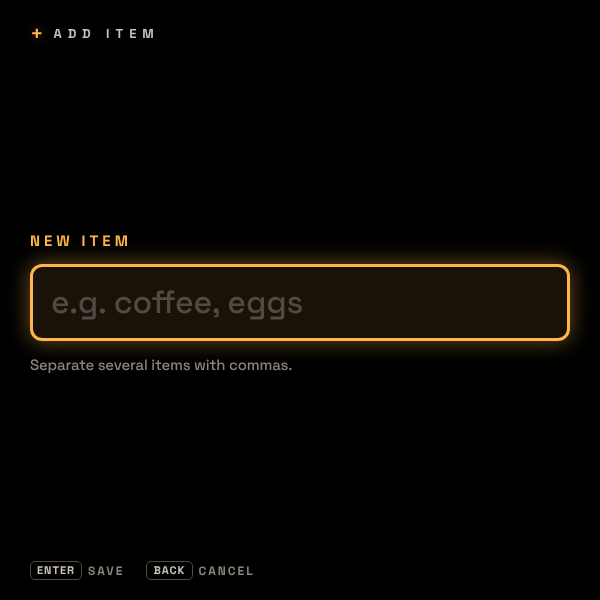
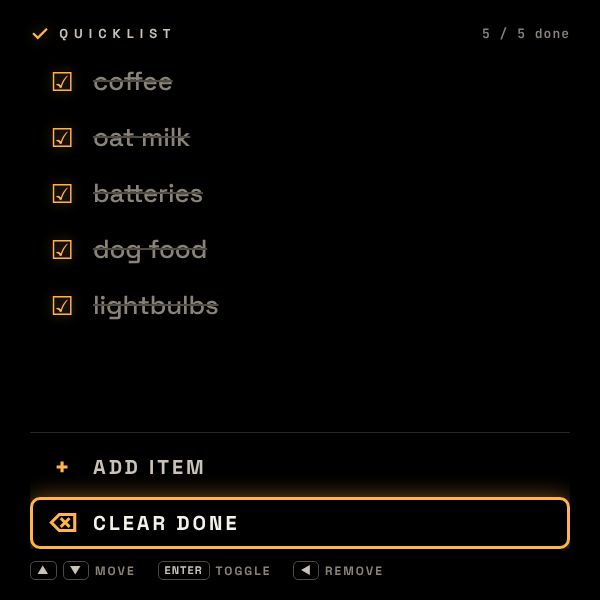
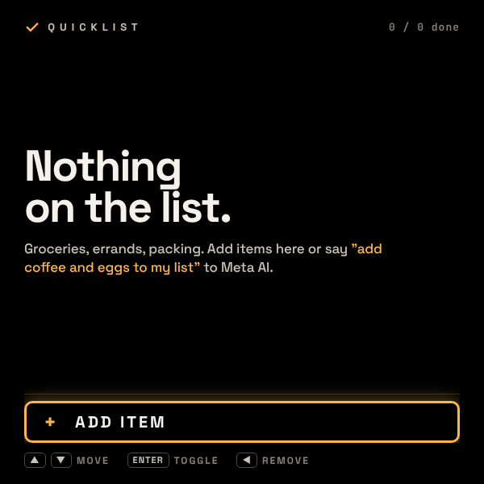

# Quicklist

A hands-free running list for the Meta Ray-Ban Display glasses — groceries, errands, packing. Big rows you can tick off with a pinch, text entry through the glasses' own handwriting/voice composer, and **Meta AI voice control** via WebMCP: say *"add coffee and eggs to my list"* and the row appears on the lens. It is the repo's reference implementation for WebMCP tools, composer-based text entry, offline use (service worker + self-hosted fonts) and lifecycle handling.

> ▶ [Try it in the simulator](https://displayglasses.dev/?url=https%3A%2F%2Frbm-demos.lnr.io%2Fquicklist%2F&pos=center&size=60&bright=100&bg=hiking&bg-dark=10) · 👓 [Add it to your glasses](#add-to-your-glasses)

> ✅ **Status: Working.** Everything runs on the glasses with no network: the list persists in `localStorage`, text entry goes through the glasses' own composer via a standard `<input>`, and the WebMCP voice tools mutate the same list the D-pad does.

---

## What it does

- **Big, glanceable rows.** Unchecked items first, checked items after, a checkbox glyph per row, and a mono `3 / 7 done` counter in the header. The focused row always carries a visible amber ring.
- **Tick, add, clear with the D-pad.** Enter toggles a row. Two action rows live at the bottom: `+ ADD ITEM` and `CLEAR DONE`. ◀ on a row removes it with a 1.5 s inline *removed · ▶ undo* affordance — no modal.
- **Text entry without a keyboard.** The Add screen is one standard `<input>`. On the glasses, pinching it opens the built-in handwriting/voice composer; on a desktop you just type. `coffee, eggs, butter` becomes three rows.
- **Voice via Meta AI.** Six WebMCP tools (`quicklist_*`) let the wearer add, check, uncheck, remove, clear and ask what's on the list in one spoken sentence each. Tools call the same functions the D-pad uses, so the screen re-renders as Meta AI acts.
- **Offline and fast.** Network-first service worker precaches the app and its WOFF2 fonts; nothing loads from a third-party CDN at startup. The list persists in `localStorage` (`quicklist_v1`) and is seeded on first run.
- **Lifecycle-clean.** The undo affordance is the only timer, and it is cleared when the page is hidden.

---

## Controls

| Where | Input | Result |
| --- | --- | --- |
| List | ▲ ▼ | Move focus between rows, then `+ ADD ITEM` and `CLEAR DONE` |
| List | Enter (on an item) | Toggle done / not done |
| List | Enter (on `+ ADD ITEM`) | Open the Add screen |
| List | Enter (on `CLEAR DONE`) | Remove every checked item (inline notice if there are none) |
| List | ◀ (on an item) | Remove it; the row shows *removed · ▶ undo* for 1.5 s |
| List | ▶ | Undo the last removal while the affordance is showing |
| List | Back gesture (thumb + middle finger) | Nothing — the list is the home screen |
| Add | Enter (on the input) | Open the handwriting/voice composer on the glasses; type on desktop |
| Add | Enter | Save the text as one or more rows (comma-separated) and return to the list |
| Add | Back gesture (thumb + middle finger) | Cancel and return focus to `+ ADD ITEM` |
| Anywhere | Voice (Meta AI) | See **Voice (Meta AI)** below |

---

## Voice (Meta AI)

With WebMCP enabled, the wearer can drive the list by talking to Meta AI. Each sentence resolves in a single tool call:

| Say | Tool called |
| --- | --- |
| "add coffee, sugar and cream to my list" | `quicklist_add_items(items: "coffee, sugar, cream")` |
| "what's on my list?" | `quicklist_get_state` (read-only) |
| "check off coffee and cream" | `quicklist_check_items(items: "coffee, cream")` |
| "uncheck coffee" | `quicklist_uncheck_items(items: "coffee")` |
| "remove batteries" | `quicklist_remove_items(items: "batteries")` |
| "clear everything that's done" | `quicklist_clear(done_only: true)` |
| "wipe the whole list" | `quicklist_clear(done_only: false)` |

Matching is case-insensitive and tolerant of whitespace and singular/plural. An unknown name comes back as `{ error: true, message, next_action }` listing the items that do exist, so Meta AI can retry instead of guessing. Every result carries the new list plus a `next_action` ("Confirm in one short sentence, then stop."); the page `<meta name="description">` adds the guardrail that Meta AI should never read the whole list back unless asked.

> ℹ️ Voice control requires **WebMCP to be enabled on the device** (Developer Mode or rollout). Eligibility is decided when the app launches, so relaunch Quicklist after enabling it. Where `document.modelContext` is absent (desktop Chrome, older firmware) the app runs identically on the D-pad alone.

---

## Screenshots

The app reads a `?state=…` URL parameter so each screen can be captured deterministically.

| List (`?state=list`) | Add (`?state=add`) |
| --- | --- |
|  |  |

| All done (`?state=done`) | Empty (`?state=empty`) |
| --- | --- |
|  |  |

`screenshots/preview.gif` cycles through the four states.

Routed states are never written to `localStorage`, so capturing them does not disturb a real list.

---

## Add to your glasses

Scan this with your phone to open the Meta AI app and add the demo to your Ray-Ban Meta Display glasses:


Or add it by hand in the Meta AI app: **Devices → Display Glasses settings → App connections → Web apps → Add a web app**, with the name `Quicklist` and this URL:

```
https://rbm-demos.lnr.io/quicklist/
```

## Running locally

The app is a single static HTML/CSS/JS bundle — no build step.

```bash
npx serve -l 3030 quicklist
# then open http://localhost:3030
```

Use ←→↑↓ + Enter to drive it. The list persists across reloads in `localStorage`; clear the `quicklist_v1` key to reset to the seeded list.

### Regenerating screenshots

> 🛠️ **Developer tooling only.** The app itself has zero Chrome dependency — it's vanilla HTML/CSS/JS that runs in the Ray-Ban Meta Display's built-in browser. The block below is just the local recipe used on a Mac to refresh the PNGs in `screenshots/`.

Screenshots come from headless Chrome against the `?state=…` URL parameter the app reads on load:

```bash
npx serve -l 3030 quicklist &
CHROME="/Applications/Google Chrome.app/Contents/MacOS/Google Chrome"
mkdir -p quicklist/screenshots
for STATE in empty list add done; do
  "$CHROME" --headless --disable-gpu --hide-scrollbars \
    --window-size=600,600 --virtual-time-budget=2000 \
    --screenshot="quicklist/screenshots/$STATE.png" \
    "http://localhost:3030/?state=$STATE"
done
```

---

## Files

```
quicklist/
├── index.html      # List + Add screens, head meta/guardrail, service-worker registration
├── styles.css      # 600×600, pure #000, amber accent, visible focus ring
├── app.js          # state, localStorage, D-pad handling, ?state= routing, WebMCP tools
├── sw.js           # network-first service worker (precaches app + fonts)
├── fonts/          # self-hosted Space Grotesk + JetBrains Mono (WOFF2) + fonts.css
└── favicon.png     # black list glyph on amber
```

---

<sub>Made by L+R at [L+R](https://www.levinriegner.com).</sub>
