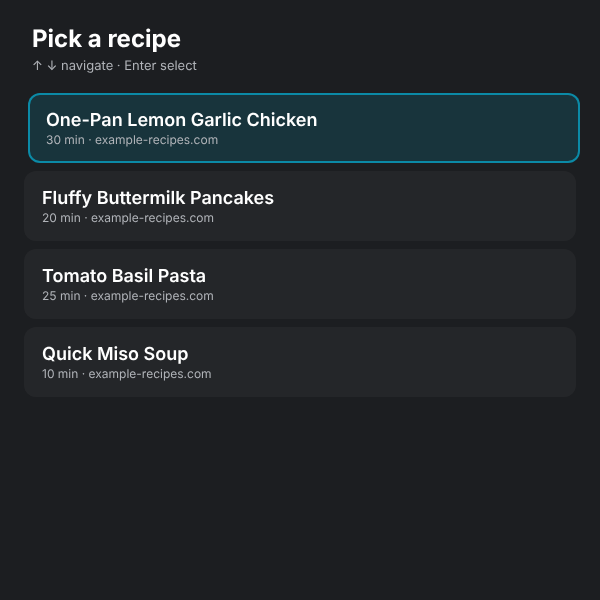

# Recipe Stepper

A hands-free recipe walkthrough for the Meta Ray-Ban Display glasses. It paginates a recipe one step at a time at 32px, navigated by lateral D-pad input only. Long steps are auto-split across pages so nothing overflows the 600×600 viewport, and Meta AI can open recipes and move between steps by voice.

> ▶ [Try it in the simulator](https://displayglasses.dev/?url=https%3A%2F%2Frbm-demos.lnr.io%2Frecipe-stepper%2F&pos=center&size=60&bright=100&bg=hiking&bg-dark=10) · 👓 [Add it to your glasses](#add-to-your-glasses)

> ✅ **Status: Working.** The picker, the four bundled recipes in `recipes.json` (their `source` URLs are placeholders), pagination and the WebMCP tools all run on the glasses with no network; only the optional `?url=` extractor needs the `/api/extract` Vercel function with an `ANTHROPIC_API_KEY`, and it is not available on a plain static host.

---

## What it does

- **Recipe picker.** The home screen lists the curated recipes in `recipes.json` (title, total time, source host). Pick one with the D-pad.
- **One step per screen.** Big step text, a "Step N of M" counter, progress dots (or a numeric `N / M` for recipes over 14 steps), and page pips when a single step spans several pages.
- **Lateral navigation.** ▶ advances page by page, then step by step; ◀ goes back. After the last step an "All steps complete" screen lets you review or pick a new recipe.
- **Load from a URL.** `?id=`, `?recipe=` and `?url=` query params bypass the picker (see Notes). `?url=` runs the page through `/api/extract`, a Vercel function that reads JSON-LD Recipe schema or falls back to the Anthropic Messages API.
- **Error recovery.** A load failure shows the message with "Press Enter to retry".
- **Offline-friendly.** A network-first service worker caches the app shell and the bundled recipes.
- **Voice via Meta AI.** Five WebMCP tools (`recipe_*`) open a recipe, move between steps, jump to a step and read the current one.

---

## Controls

| Where | Input | Result |
| --- | --- | --- |
| Picker | ▼ or ▶ | Highlight the next recipe (wraps) |
| Picker | ▲ or ◀ | Highlight the previous recipe (wraps) |
| Picker | Enter | Open the highlighted recipe at step 1 |
| Stepper | ▶ | Next page, then next step; past the last step shows the Finished screen |
| Stepper | ◀ | Previous page / step |
| Stepper | Back gesture (thumb + middle finger) | Return to the picker with the open recipe highlighted |
| Finished | ◀ | Back to the last step to review |
| Finished | Enter | Return to the picker |
| Finished | Back gesture (thumb + middle finger) | Return to the picker with the recipe highlighted |
| Error | Enter | Retry the load |
| Error | Back gesture (thumb + middle finger) | Return to the picker |
| Anywhere | Voice (Meta AI) | See **Voice (Meta AI)** below |

On a desktop, the arrow keys stand in for the D-pad swipes.

---

## Voice (Meta AI)

The app registers five WebMCP tools on `document.modelContext` (`recipe_get_state`, `recipe_open`, `recipe_next_step`, `recipe_previous_step`, `recipe_go_to_step`) so the wearer can cook without touching the D-pad. Things you can say:

- "Open the pancakes recipe" / "Open recipe number 2"
- "Next step" / "Go back a step"
- "Jump to step 6"
- "What's the current step?"

Voice navigation moves by whole step (the full step text is returned even when the screen paginates it); the D-pad still walks page by page. The app runs unchanged where `document.modelContext` is absent (desktop Chrome, the simulator, older firmware).

> WebMCP must be enabled on the device (Developer Mode or rollout), and the app relaunched after enabling it — eligibility is decided once at launch.

---

## Screenshots

| Stepper |
| --- |
|  |

---

## Add to your glasses

Scan this with your phone to open the Meta AI app and add the demo to your Ray-Ban Meta Display glasses:


Or add it by hand in the Meta AI app: **Devices → Display Glasses settings → App connections → Web apps → Add a web app**, with the name `Recipe Stepper` and this URL:

```
https://rbm-demos.lnr.io/recipe-stepper/
```

## Running locally

The app is a single static HTML/CSS/JS bundle — no build step. The bundled recipes and `?id=` / `?recipe=` routes work from any static server; only `?url=` needs the `/api/extract` function (deploy to Vercel, or point `&ai=` at a deployed copy).

```bash
npx serve -l 3105 recipe-stepper
# then open http://localhost:3105
```

### Regenerating screenshots

> 🛠️ **Developer tooling only.** The app itself has zero Chrome dependency — it's vanilla HTML/CSS/JS that runs in the Ray-Ban Meta Display's built-in browser. The block below is just the local recipe used on a Mac to refresh the PNGs in `screenshots/`.

The app has no `?state=` routing, but `?id=<preset-id>` opens a curated recipe at step 1 deterministically (ids: `lemon-garlic-chicken`, `fluffy-pancakes`, `tomato-basil-pasta`, `miso-soup`); a plain load captures the picker:

```bash
npx serve -l 3105 recipe-stepper &
CHROME="/Applications/Google Chrome.app/Contents/MacOS/Google Chrome"
"$CHROME" --headless --disable-gpu --hide-scrollbars \
  --window-size=600,600 --virtual-time-budget=2000 \
  --screenshot="recipe-stepper/screenshots/preview.png" \
  "http://localhost:3105/?id=fluffy-pancakes"
```

---

## Notes

### Loading recipes

The home screen is a picker over `recipes.json`. Three query params bypass it:

- `?id=<preset-id>` jumps to a curated recipe by id
- `?recipe=<JSON URL>` loads a pre-extracted recipe JSON (array of strings, or `{ title, steps[] }`)
- `?url=<recipe page URL>` runs the page through `/api/extract`

### AI extraction

`api/extract.js` accepts `POST { url }` and returns `{ title, totalTime, servings, steps[] }`.

It tries `application/ld+json` Recipe schema first (most major recipe sites publish it). If that is missing it falls back to the Anthropic Messages API (`claude-haiku-4-5`) on the stripped page text, asking for strict JSON with 80 to 200 character steps.

Setup on Vercel:

```bash
vercel env add ANTHROPIC_API_KEY
vercel deploy
```

Then point the webapp at it via `?url=...` (same origin) or `?url=...&ai=https://your-deploy.vercel.app/api/extract` from a different host.

### Pagination

`paginateStep` in `app.js` measures rendered text in a hidden node, binary searches for the largest word slice that fits the body container, and emits an array of page strings per step. The stepper walks pages first, then steps, so lateral input alone is enough.

---

## Files

```
recipe-stepper/
├── index.html        # picker, loading, error, stepper, finished screens, service-worker registration
├── styles.css        # 600×600 layout, 32px step text, progress dots + page pips
├── app.js            # picker, pagination, query-param loading, D-pad, WebMCP tools
├── recipes.json      # curated recipes shown in the picker (title, source URL, time, steps)
├── api/extract.js    # Vercel serverless function: recipe URL → { title, totalTime, servings, steps[] }
├── sw.js             # network-first service worker (never caches /api/)
├── favicon.png       # app icon
└── screenshots/      # preview.png
```

---

<sub>Made by the team at [L+R](https://www.levinriegner.com).</sub>
