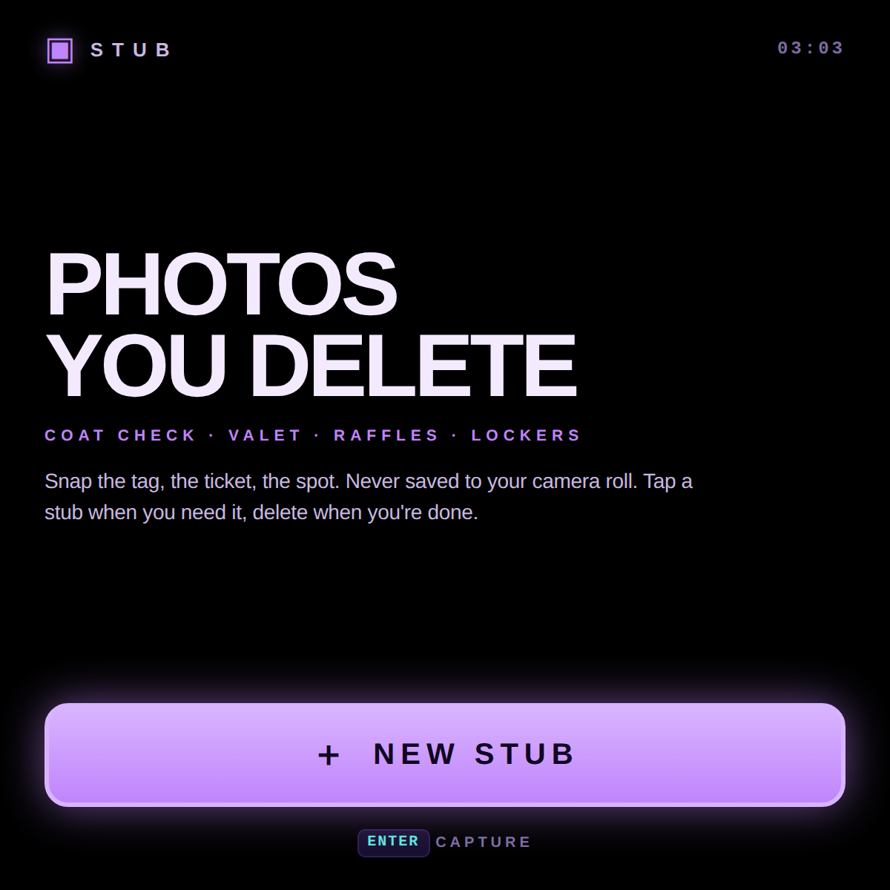
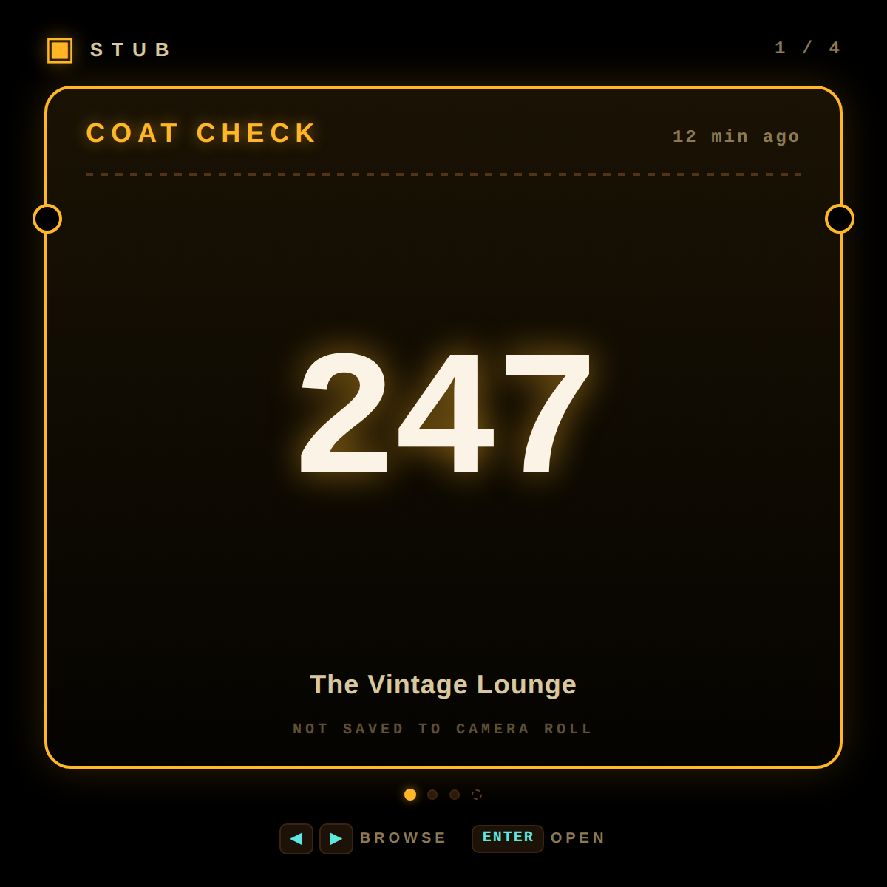
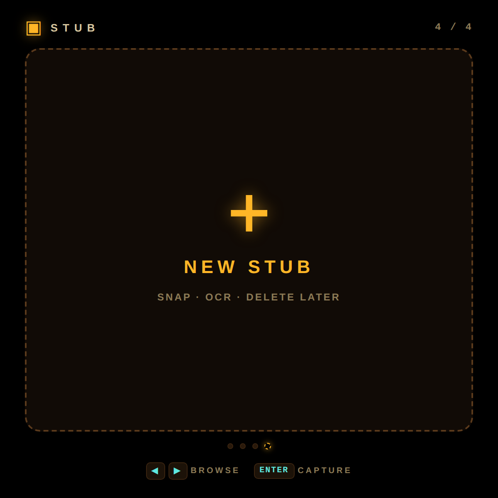
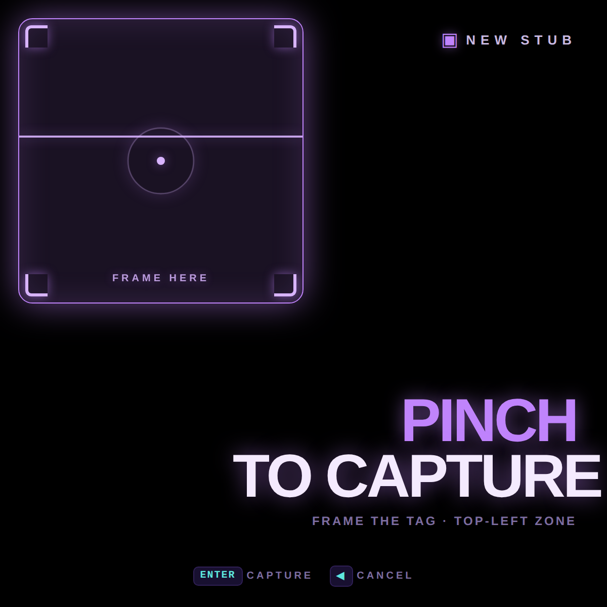
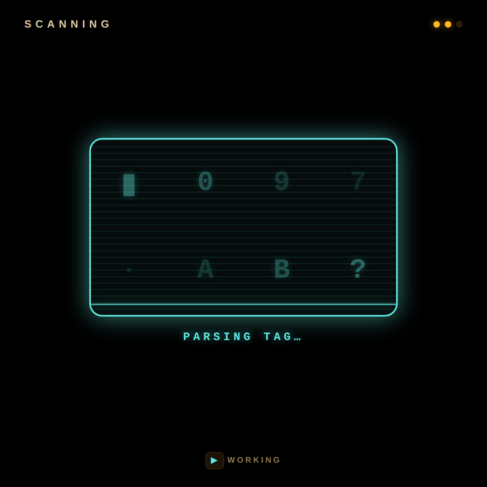
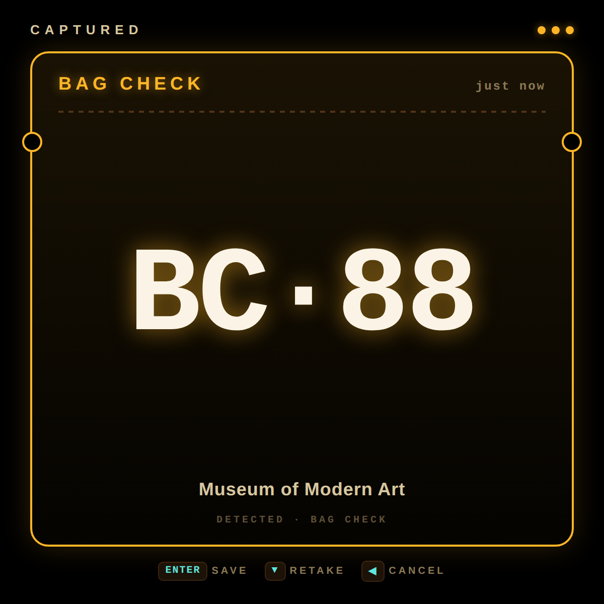
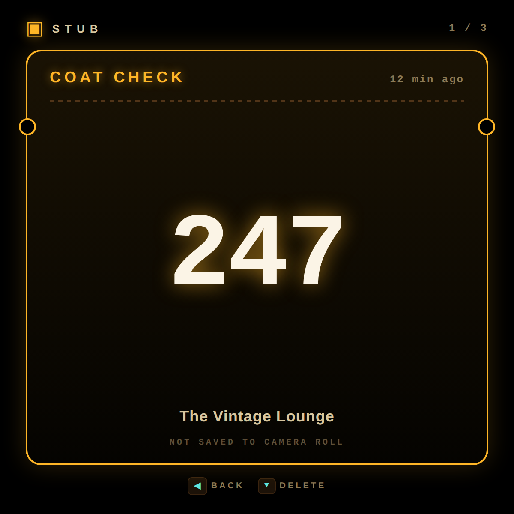
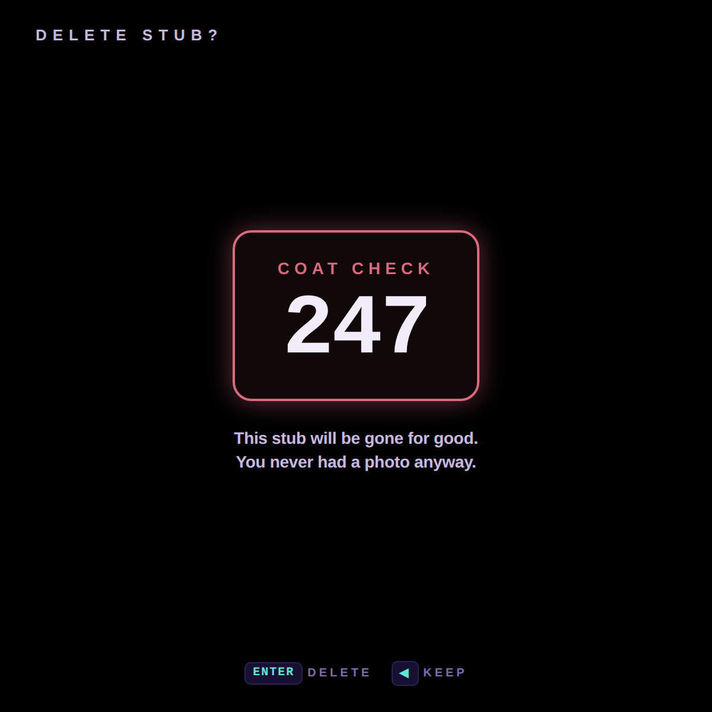

# Stub

A "photo notes" app for the Meta Display glasses — for the ephemeral receipts of daily life. **Snap the coat-check tag, the valet ticket, the locker number, the raffle stub.** The capture never goes to your camera roll. It lives in this app until you delete it.

> ▶ [Try it in the simulator](https://displayglasses.dev/?url=https%3A%2F%2Frbm-demos.lnr.io%2Fstub%2F&pos=center&size=60&bright=100&bg=hiking&bg-dark=10) · 👓 [Add it to your glasses](#add-to-your-glasses)

> 🧪 **Status: Concept.** The interface and D-pad flow are real; the camera capture and OCR are simulated, and each "scan" returns the next entry from a built-in ticket pool in `app.js`. See [Making it real](#making-it-real).

Designed for the 600×600 lens, driven by the D-pad. The camera lives on the right temple, so the capture screen highlights the **top-left quadrant** of the display — that's the sweet spot where a tag held in front of the wearer lands centered in the camera frame.

---

## What it does

- **One-screen capture.** The "New Stub" screen *is* the camera screen — a semi-translucent purple zone in the top-left of the lens, breathing and scanning, tells you *where* to frame the tag. A giant **PINCH TO CAPTURE** in the bottom-right tells you *how*. No intermediate aim step, no preview.
- **OCR pass** reads the tag and pulls out **category, code, and venue** so you never have to squint at the photo later. (The demo cycles through a built-in pool of realistic tickets; production wires up Tesseract or a small vision model.)
- **No camera roll.** Stubs live inside this app, scoped to its localStorage. They never touch Photos / Gallery, so the volunteer who hands you a numbered cardboard square in 2026 doesn't leak into your year-in-review.
- **Carousel of saved stubs.** ◀ ▶ to flip through them; the latest is always first. A `+ NEW STUB` sentinel sits at the end of the carousel.
- **One-tap delete** with a confirmation that reminds you the photo was never there to keep.

### What it's for

The kind of micro-receipt you'd otherwise photograph "just in case" and then have rotting at the top of your camera roll for six months:

- **Coat check** · the perforated cardboard tag
- **Valet** · the carbon-paper duplicate
- **Bag check** · museum, theater, ski-resort
- **Raffle / drawing** · "keep this half"
- **Parking spot** · `P3 · Row 12 · Space 412`, garage signage
- **Hotel room number** · written on the keycard sleeve so you remember after dinner
- **Locker** · gym, pool, spa, sauna, country club
- **Restaurant table / pager** · the brick that buzzes when your table's ready
- **Order pickup** · deli counter, pharmacy, hardware store, butcher
- **Rental car license plate** · so you can find it in row 47 of the airport lot
- **Apartment buzzer code** · the airbnb taped-to-the-fridge slip
- **Storage unit / unit access code**
- **Conference badge number / booth number**
- **Wristband ID** · festival, hospital, theme park
- **Dry cleaner / shoe repair / camera repair tickets**
- **Boat slip · marina · campsite · RV pad · ski lift pass**
- **Wine bottle label** · the one you liked at dinner
- **Whiteboard from a meeting** · "I'll re-photograph that later" except you actually want to delete it later
- **Pet collar tag** · when you find a wandering dog
- **WiFi password handwritten on a cafe chalkboard**
- **Medication label** · the dose you want to remember to refill
- **Business card** · when you don't actually want it in your contacts

Anything you'd photograph as a private bookmark and then wish you could un-photograph.

---

## Controls

| Where | Input | Result |
| --- | --- | --- |
| Home (empty) | Enter | Start a new capture |
| Home (carousel) | ◀ ▶ | Flip between saved stubs and the `+ NEW STUB` slot |
| Home (carousel) | Enter | Open the focused stub, or capture if `+ NEW STUB` is focused |
| Capture | Enter (= pinch on-device) | Snap & scan |
| Capture | ◀ | Cancel back to home |
| Scanning | ◀ | Bail out before the OCR resolves |
| Captured | Enter | Save the stub |
| Captured | ▼ | Retake |
| Captured | ◀ | Discard and go home |
| Detail | ◀ or Enter | Back to home |
| Detail | ▼ | Delete… |
| Delete confirm | Enter | Delete for good |
| Delete confirm | ◀ | Keep it |
| Any sub-screen | Back gesture (thumb + middle finger) | Same as ◀ on that screen — back one level |
| Anywhere | Voice (Meta AI) | "What stubs do I have?", "Find my valet ticket", "Delete stub 247" |

All inputs that exist on the device: D-pad arrows + Enter. No keyboard, no on-screen tap targets, no `×` close button — the controls map directly to what the glasses can do.

---

## Voice (Meta AI)

The app registers WebMCP tools (`document.modelContext`) so Meta AI can drive it by voice. Things a wearer can say:

- "What stubs do I have saved?"
- "Find my valet ticket"
- "Show me the coat check stub"
- "Do I have a locker number?"
- "Delete stub 247"

Finding a stub moves the carousel to the first match; deleting goes through the same delete path as the D-pad. Voice control requires WebMCP to be enabled on the device (Developer Mode or rollout) and the app relaunched afterwards. Without it the app works exactly as before with the D-pad alone.

---

## Screenshots

### Home

| First run — empty | Carousel of saved stubs | `+ NEW STUB` slot |
| --- | --- | --- |
|  |  |  |

### Capture flow

| Capture — pinch to snap | Scanning · OCR | Captured · save or retake |
| --- | --- | --- |
|  |  |  |

### Manage

| Saved stub detail | Delete confirmation |
| --- | --- |
|  |  |

---

## Making it real

**What's real today:**
- All seven screens and the D-pad flow: capture, scanning, confirm, carousel, detail and delete.
- Persistence: saved stubs live in `localStorage` (`mdg_stub_v1`) and survive reloads; delete really removes them.
- The WebMCP tools (`list`, `find`, `delete`) on `document.modelContext` operate on the same stored stubs the D-pad path uses.
- Lifecycle: the scan timers stop while the page is hidden and finish on a wall-clock deadline when it returns.

**What's simulated:**
- No photo is taken. The capture screen is a framing guide; Enter goes straight to the scanning screen.
- `DEMO_POOL` in `app.js` stands in for OCR of the camera frame. `renderScanning()` picks the next pool entry and `CONFIG.scanDurationMs` (1.2 s) plus the cycling `SCAN_STEPS` labels fake the recognition delay.
- `SEED_STUBS` in `app.js` pre-populates the carousel on first run so the demo does not open empty.

**How to make it real:**
- The glasses browser exposes no camera or microphone API to web apps, so capture cannot happen in `index.html`. Two paths exist:
  - **Meta AI vision plus WebMCP.** Register a `stub_save` tool that takes `category`, `code` and `location`. The wearer says "save this coat check tag"; Meta AI looks through the camera, reads the tag, and calls the tool. The app then skips the scanning screen and lands on confirm with real values. This keeps everything in the browser and needs only a new tool next to the existing three.
  - **Phone companion.** A companion app built with Meta's Device Access Toolkit grabs a frame from the glasses camera, runs OCR on the phone (on-device text recognition, or Tesseract), and posts the result to the web app over a local WebSocket or by pushing a URL with the fields in the query string. More work, but it yields a stored image too.
- Either way, replace `renderScanning()` with an await on the real result, keep the "no camera roll" promise by storing only the extracted fields (or a thumbnail in IndexedDB, never the gallery), and drop `SEED_STUBS` for production.
- The category classifier is the softest part: a small keyword table (VALET, COAT, LOCKER, ROOM) over the OCR text covers the common cases before any model is involved.
- Effort: small for the WebMCP route (one tool, one screen change), medium for the companion route.

---

## Add to your glasses

Scan this with your phone to open the Meta AI app and add the demo to your Ray-Ban Meta Display glasses:


Or add it by hand in the Meta AI app: **Devices → Display Glasses settings → App connections → Web apps → Add a web app**, with the name `Stub` and this URL:

```
https://rbm-demos.lnr.io/stub/
```

## Running locally

The app is a single static HTML/CSS/JS bundle — no build step.

```bash
npx serve -l 4321 stub
# then open http://localhost:4321
```

Use ←→↑↓ + Enter to drive it. Stubs persist across reloads in `localStorage`; clear that key to reset to the seeded carousel.

### Regenerating screenshots

> 🛠️ **Developer tooling only.** The app itself has zero Chrome dependency — it's vanilla HTML/CSS/JS that runs in the Ray-Ban Meta Display's built-in browser. The block below is just the local recipe used on a Mac to refresh the PNGs in `screenshots/`.

Screenshots come from headless Chrome against the `?state=…` URL parameter the app reads on load:

```bash
npx serve -l 4321 stub &
CHROME="/Applications/Google Chrome.app/Contents/MacOS/Google Chrome"
for STATE in home-empty home home-new capture scanning confirm detail delete; do
  "$CHROME" --headless --disable-gpu --hide-scrollbars \
    --window-size=600,600 --virtual-time-budget=2000 \
    --screenshot="stub/screenshots/$STATE.png" \
    "http://localhost:4321/?state=$STATE"
done
```

---

## Files

```
stub/
├── index.html      # all 7 screens (empty home, home carousel, capture, scanning, confirm, detail, delete)
├── styles.css      # 600×600 purple + cyan; ticket-stub card with side notches
├── app.js          # state machine, localStorage persistence, demo OCR pool
├── favicon.png     # black "ST" on purple
└── screenshots/    # generated state captures used by this README
```

---

<sub>Made by Alex Levin at [L+R](https://www.levinriegner.com).</sub>
