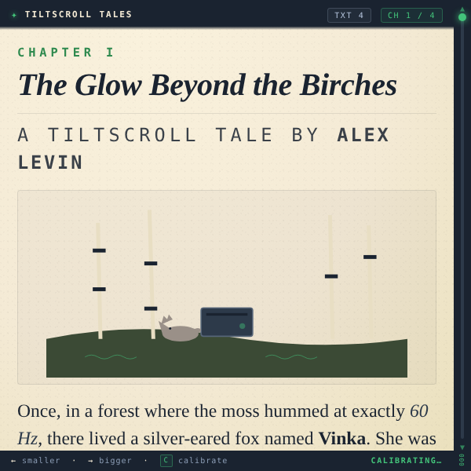

# Tiltscroll Tales

A four-chapter illustrated storybook for the Meta Ray-Ban Display glasses that scrolls with your head. Tilt up and the page slides toward its end; tilt down and it returns to the top. When you reach the bottom of a chapter the next-chapter button arms itself, and a pinch turns the page. It is a reading demo for anyone curious how far head tilt alone can carry a long-form text on the lens.

> ▶ [Try it in the simulator](https://displayglasses.dev/?url=https%3A%2F%2Frbm-demos.lnr.io%2Ftiltscroll-tales%2F&pos=center&size=60&bright=100&bg=hiking&bg-dark=10) · 👓 [Add it to your glasses](#add-to-your-glasses)

---

## What it does

- **A complete short story.** *The Glow Beyond the Birches* by Alex Levin, in four chapters with an inline SVG illustration each: a fox named Vinka finds a forgotten router in the forest, and an owl and a beaver help bring the woods online.
- **Tilt-to-scroll.** `deviceorientation` beta is read; the first reading after start becomes neutral, and ±22° from neutral maps to 0–100 % of the chapter's scroll height. Head up scrolls toward the bottom, head down toward the top. The value is smoothed (EMA 0.18) and applied in a `requestAnimationFrame` loop.
- **Tilt rail and readout.** A rail on the left shows a thumb at the current position and a three-digit percentage; the footer status shows the calibration value and the live offset in degrees.
- **Armed page turns.** `NEXT CHAPTER →` (or `READ AGAIN ↺` on chapter IV) arms and takes focus when the reader is past 92 % of the page, and only after they have scrolled back into the new chapter at least once, so a page turn never chains into the next one by accident.
- **Six text sizes.** ◀ ▶ step through 0.8× to 1.65×, shown as `TXT n` in the header and remembered in `localStorage` (`tiltscroll_size`).
- **Permission gate where needed.** On browsers that require `DeviceOrientationEvent.requestPermission()` a BEGIN overlay asks first; elsewhere the sensor attaches on load and the status reads `CALIBRATING…` until the first reading.
- **Lifecycle.** Hiding the page stops the render loop and removes the orientation listener; showing it re-arms both. Scroll position, calibration and text size are kept.
- **Offline.** Network-first service worker; system serif fonts. The page is styled as cream paper on a dark navy frame rather than pure black.

---

## Controls

| Where | Input | Result |
| --- | --- | --- |
| Reading | Head tilt up / down | Scroll toward the bottom / top of the chapter (±22° from neutral) |
| Reading | ▲ ▼ | Nudge the scroll position up / down by 8 % (the next sensor reading takes over again) |
| Reading | ◀ ▶ | Text size smaller / bigger (six levels, remembered) |
| Reading | Back gesture (thumb + middle finger) | Jump to the top of the chapter |
| Chapter end | Enter | `NEXT CHAPTER →` when armed (past 92 %); on chapter IV, `READ AGAIN ↺` returns to chapter I |
| Start overlay | Enter (on `BEGIN`) | Grant the orientation sensor and start reading (only shown where the browser requires a permission prompt) |

The footer also mentions a `C` calibrate key; that is a desktop shortcut and has no equivalent on the glasses.

---

## Screenshots

| Preview |
| --- |
|  |

---

## Add to your glasses

Scan this with your phone to open the Meta AI app and add the demo to your Ray-Ban Meta Display glasses:


Or add it by hand in the Meta AI app: **Devices → Display Glasses settings → App connections → Web apps → Add a web app**, with the name `Tiltscroll Tales` and this URL:

```
https://rbm-demos.lnr.io/tiltscroll-tales/
```

---

## Running locally

The app is a single static HTML/CSS/JS bundle — no build step.

```bash
npx serve -l 3055 tiltscroll-tales
# then open http://localhost:3055
```

Without a tilt sensor, ↑↓ nudge the scroll position, ←→ change the text size, Enter turns the page when the button is armed, and `C` recalibrates.

### Regenerating screenshots

> 🛠️ **Developer tooling only.** The app itself has zero Chrome dependency — it's vanilla HTML/CSS/JS that runs in the Ray-Ban Meta Display's built-in browser. The block below is just the local recipe used on a Mac to refresh the PNGs in `screenshots/`.

The app has no `?state=` routing, so the preview is a single capture of chapter I:

```bash
npx serve -l 3055 tiltscroll-tales &
CHROME="/Applications/Google Chrome.app/Contents/MacOS/Google Chrome"
"$CHROME" --headless --disable-gpu --hide-scrollbars \
  --window-size=600,600 --virtual-time-budget=2000 \
  --screenshot="tiltscroll-tales/screenshots/preview.png" \
  "http://localhost:3055/"
```

---

## Files

```
tiltscroll-tales/
├── index.html      # four chapters with inline SVG illustrations, tilt rail, start overlay, SW registration
├── styles.css      # 600×600 paper page on navy frame, text-scale variable, armed button state
├── app.js          # orientation → scroll mapping, rAF loop, arming logic, text size, lifecycle
├── sw.js           # network-first service worker
├── favicon.png     # app icon
└── screenshots/    # preview.png
```

---

<sub>Made by L+R at [L+R](https://www.levinriegner.com).</sub>
