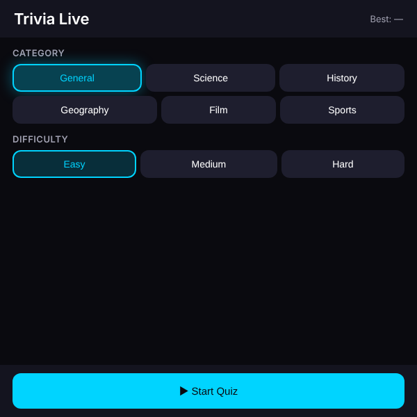

# Trivia Live

A live trivia quiz for the Meta Ray-Ban Display glasses, powered by the free **Open Trivia DB** API (no API key). Pick a category and difficulty, answer ten timed multiple-choice questions on the D-pad, and let Meta AI read questions and relay your answers by voice.

> ▶ [Try it in the simulator](https://displayglasses.dev/?url=https%3A%2F%2Frbm-demos.lnr.io%2Ftrivia-live%2F&pos=center&size=60&bright=100&bg=hiking&bg-dark=10) · 👓 [Add it to your glasses](#add-to-your-glasses)

> 🔌 **Status: Working with live data.** Questions come from the Open Trivia DB public API (no key); offline the Start screen still loads from the service worker, but starting a round shows `Could not load questions` with a Retry button, and only the high scores are local.

---

## What it does

- **Start screen.** Category chips (General, Science, History, Geography, Film, Sports) and difficulty chips (Easy, Medium, Hard), with the best score for that combination in the header. The selection is remembered between launches.
- **10-question rounds.** Four shuffled answers (A–D) per question, with the category and difficulty shown as a chip and the running score in the header.
- **15-second timer.** A bar and a number count down per question; both turn amber under 5 s. Running out counts as wrong and reveals the correct answer.
- **Feedback and auto-advance.** A Correct! / Incorrect / Time's up! banner shows for 1.5 s, then the next question appears.
- **Results.** Final score, a review of every question with your answer vs. the correct one, and a NEW BEST badge when you beat the stored high score. High scores live in `localStorage` under `mdg_trivia_live`, keyed by `"<categoryId>_<difficulty>"`.
- **Lifecycle-clean.** The countdown is wall-clock based; the 1 s UI interval stops while the page is hidden and reconciles on return (timing out if the deadline passed). The question fetch is abortable.
- **Voice via Meta AI.** Three WebMCP tools (`trivia_*`) start a round, read the question and score an answer, through the same functions the D-pad uses.

---

## Controls

| Where | Input | Result |
| --- | --- | --- |
| Start | ▲ ▼ ◀ ▶ | Move focus through the category chips, difficulty chips and Start Quiz |
| Start | Enter (on a chip) | Select that category or difficulty |
| Start | Enter (on Start Quiz) | Fetch 10 questions and begin |
| Quiz | ▲ ▼ ◀ ▶ | Move focus between answers A–D |
| Quiz | Enter | Lock in the focused answer |
| Quiz | Back gesture (thumb + middle finger) | Abandon the round and return to Start |
| Loading | Back gesture (thumb + middle finger) | Cancel the question fetch and return to Start |
| Results | ▲ ▼ ◀ ▶ | Move focus between Play Again and Home |
| Results | Enter | Activate the focused button |
| Results | Back gesture (thumb + middle finger) | Return to Start |
| Error | ▲ ▼ ◀ ▶ | Move focus between Retry and Home |
| Error | Enter | Activate the focused button |
| Error | Back gesture (thumb + middle finger) | Return to Start |
| Anywhere | Voice (Meta AI) | See **Voice (Meta AI)** below |

On the Start screen there is nothing to go back to, so the Back gesture is left to the system.

---

## Voice (Meta AI)

With WebMCP enabled on the glasses the app registers tools on `document.modelContext`, so Meta AI can run a round hands-free. Example utterances:

- "Start a science quiz on hard"
- "Read me the question"
- "The answer is B"
- "It's Paris"
- "Play again"

Tools: `trivia_get_state` (read-only, never exposes the answer of an open question), `trivia_start` (category and difficulty optional), `trivia_answer` (letter or option text — the page scores it, Meta AI only relays the result). Each one calls the same functions the D-pad uses, so the screen updates as Meta AI acts.

> WebMCP must be enabled on the device (Developer Mode or rollout) and the app relaunched after enabling it. Without it the app works exactly as before, D-pad only.

---

## Screenshots

| Quiz |
| --- |
|  |

---

## Add to your glasses

Scan this with your phone to open the Meta AI app and add the demo to your Ray-Ban Meta Display glasses:


Or add it by hand in the Meta AI app: **Devices → Display Glasses settings → App connections → Web apps → Add a web app**, with the name `Trivia Live` and this URL:

```
https://rbm-demos.lnr.io/trivia-live/
```

## Running locally

The app is a single static HTML/CSS/JS bundle — no build step.

```bash
npx serve -l 3107 trivia-live
# then open http://localhost:3107
```

### Regenerating screenshots

> 🛠️ **Developer tooling only.** The app itself has zero Chrome dependency — it's vanilla HTML/CSS/JS that runs in the Ray-Ban Meta Display's built-in browser. The block below is just the local recipe used on a Mac to refresh the PNGs in `screenshots/`.

The app has no `?state=` routing; a plain load captures the Start screen:

```bash
npx serve -l 3107 trivia-live &
CHROME="/Applications/Google Chrome.app/Contents/MacOS/Google Chrome"
"$CHROME" --headless --disable-gpu --hide-scrollbars \
  --window-size=600,600 --virtual-time-budget=2000 \
  --screenshot="trivia-live/screenshots/preview.png" \
  "http://localhost:3107/"
```

---

## Notes

### Gameplay

- Pick a **Category** (General, Science, History, Geography, Film, Sports) and **Difficulty** (Easy, Medium, Hard) on the Start screen.
- 10 questions per round, 4 multiple-choice answers each.
- **15-second** countdown per question. Timer turns amber under 5s. Running out counts as wrong and reveals the correct answer.
- Correct/incorrect feedback banner shows briefly after each answer, then auto-advances.
- Results screen shows final score, a review of every question with your answer vs. correct, and a NEW BEST badge if you beat the stored high score.
- High scores stored in `localStorage` under `mdg_trivia_live`, keyed by `"<categoryId>_<difficulty>"`.

### API

`https://opentdb.com/api.php?amount=10&category=<id>&difficulty=<easy|medium|hard>&type=multiple`

HTML entities in question text and answers are decoded via a `<textarea>.innerHTML` round-trip. Answer order is shuffled with Fisher–Yates; the correct index is remembered after shuffle.

---

## Files

```
trivia-live/
├── index.html      # Start · Quiz · Results · Loading · Error, service-worker registration
├── styles.css      # chips, answer buttons, timer bar, feedback, review
├── app.js          # state machine, fetch, decode, shuffle, timer, scoring, WebMCP tools
├── sw.js           # network-first service worker
├── favicon.png     # app icon
├── vercel.json     # static rewrites
└── screenshots/    # preview.png
```

---

<sub>Made by the team at [L+R](https://www.levinriegner.com).</sub>
